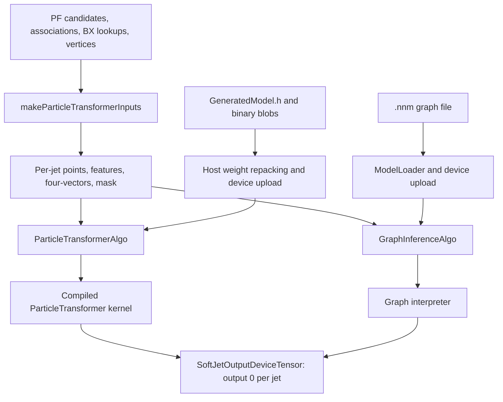

# ParticleTransformerAlpaka: package, class, and function reference

Source directory: `/afs/cern.ch/work/j/jleonhol/private/l1scouting/clustering/nano/CMSSW_16_1_0_pre3/src/PhysicsTools/ParticleTransformerAlpaka`  
Inspected: 15 October 2026. This document describes the files present in this checkout, including private helpers, exporters, standalone tools, and test fixtures. It is a source reference, not a new implementation. Names and signatures can be located using the source index at the end. Relative links refer to this package.

## Contents

1. [Purpose and execution flow](#1-purpose-and-execution-flow)
2. [Directory and artifact inventory](#2-directory-and-artifact-inventory)
3. [Input transformation and its functions](#3-input-transformation-and-its-functions)
4. [Compiled model descriptors and storage](#4-compiled-model-descriptors-and-storage)
5. [Compiled cooperative inference](#5-compiled-cooperative-inference)
6. [Scalar C++ reference](#6-scalar-c-reference)
7. [CMSSW producers and launch adapters](#7-cmssw-producers-and-launch-adapters)
8. [Graph binary format and loader](#8-graph-binary-format-and-loader)
9. [Graph shared state, layers, and interpreter](#9-graph-shared-state-layers-and-interpreter)
10. [Python graph representation and export pipeline](#10-python-graph-representation-and-export-pipeline)
11. [ParticleTransformer frontends](#11-particletransformer-frontends)
12. [TorchScript conversion](#12-torchscript-conversion)
13. [Command-line exporters and checkpoint reader](#13-command-line-exporters-and-checkpoint-reader)
14. [Python numerical references](#14-python-numerical-references)
15. [Tests, harnesses, and benchmarks](#15-tests-harnesses-and-benchmarks)
16. [Configuration, build, and practical workflows](#16-configuration-build-and-practical-workflows)
17. [Observed limits and documentation discrepancies](#17-observed-limits-and-documentation-discrepancies)
18. [Comparison with PyTorchAlpaka at maximum jet throughput](#18-comparison-with-pytorchalpaka-at-maximum-jet-throughput)
19. [Source symbol index](#19-source-symbol-index)

## 1. Purpose and execution flow

The package performs neural-network inference on jets represented by L1 scouting particle-flow candidates. It supplies CMSSW Alpaka modules, numerical kernels, exported model data, and Python programs that translate trained models into those kernels' input formats. Alpaka lets the same cooperative kernel code target supported CPU and GPU execution backends; CUDA-specific integer instructions have a scalar fallback.

There are two implementations of inference:

| Aspect | Compiled ParticleTransformer | Graph interpreter |
|---|---|---|
| CMSSW module | `ParticleTransformerProducer` | `GraphInferenceProducer` |
| Algorithm adapter | `ParticleTransformerAlgo` | `GraphInferenceAlgo` |
| Computation | `part::runParticleTransformer` | `nn::runGraph` |
| Architecture | Fixed in constants and C++ control flow | Operation and buffer tables in an `.nnm` file |
| Model data | Generated descriptor header plus two binary blobs | One `.nnm` containing program, storage layout, and values |
| Dense-weight preparation | Host repacks original row-major weights | Exporter writes the device layout directly |
| Parallelism | One jet per block | One jet per block, or one per CUDA warp for a small model |
| Published CMSSW result | First of two class probabilities | First graph output value |

The graph interpreter is model independent within its implemented operation set and fixed resource limits. It is not an arbitrary PyTorch runtime. Its TorchScript frontend recognizes particular supported operations and rejects other graphs.



An event uses an input-transformation launch followed by one inference launch when work is available. “One launch” in comments about inference refers to the network evaluation, not the complete producer including transformation and zero initialization. Queue operations are asynchronous except for model initialization and the optional timing synchronization.

The compiled network has a 16-particle padded sequence, 15 input features, a 128-channel embedding, eight heads of 16 channels, a 512-channel feed-forward hidden state, eight particle-attention blocks, two class-attention blocks, and a two-class FP32 classifier. Its pair encoder maps four Lorentz-derived features through widths `4 → 64 → 64 → 64 → 8`.

### Mathematical conventions

A quantized dense weight row uses a positive scale `s_w[o]` and signed values in `[-127,127]`. With a learned activation scale `s_x`, the integer path computes:

```text
q_x = clamp(round_to_even(x / s_x), -127, 127)
y[o] = bias[o] + (s_x * s_w[o]) * sum_k(q_x[k] * q_w[o,k])
```

The implementation multiplies by a precomputed FP32 reciprocal instead of repeatedly dividing. Dense products use INT32 accumulation on this path. A weight-only INT8 layer retains FP32 activations and arithmetic; an FP32 layer stores its weights in the parameter blob. Normalization, attention scores, softmax, residual streams, and layer outputs are floating point.

Self-attention computes `softmax(scale * QKᵀ + pair_bias + key_mask)V`, independently per head. The compiled scale is `1/sqrt(16) = 0.25`. Masked keys receive the finite sentinel `-3.4e38`, so with at least one usable key their exponentials underflow to zero. LayerNorm uses population variance unless a graph flag explicitly requests the sample-variance convention.

## 2. Directory and artifact inventory

| Path | Content and role |
|---|---|
| [BuildFile.xml](BuildFile.xml) | Exports the package interface to SCRAM. |
| [plugins/BuildFile.xml](plugins/BuildFile.xml) | Builds `alpaka/*.cc` as an EDM plugin library for enabled Alpaka backends; declares Alpaka, Eigen, scouting SoA, framework, logging, parameter, utility, and heterogeneous-core dependencies. |
| [interface/alpaka](interface/alpaka) | Fixed model types, generated offsets, weight repacking, compiled cooperative kernel, and scalar reference. |
| [interface/alpaka/graph](interface/alpaka/graph) | Graph format, host loader, shared state, reusable layers, and interpreter. |
| [plugins/alpaka](plugins/alpaka) | Input transformation, two producer classes, and their backend-specific launch adapters. |
| [python](python) | CMSSW default `cms.EDProducer` configurations. |
| [scripts](scripts) | CLI exporters, checkpoint loading, numerical references, and the `nnexport` library. |
| [scripts/nnexport/frontends](scripts/nnexport/frontends) | Translates Weaver, generated-header, and TorchScript representations into graph IR. |
| [test](test) | Pytest checks, CPU cooperative harnesses, CUDA benchmarks, an example CMSSW configuration, and printed-jet input. |
| [test/performance_results](test/performance_results/README.md) | New matched-checkpoint GPU timing/memory results, raw samples, source/runtime metadata, and reproduction instructions. |
| [data](data) | Runtime model files, export reports, and the preprocessing/training YAML. |
| [scripts/data](scripts/data) | Additional wrapper-specific exports; these differ from similarly named runtime files. |
| [README.md](README.md) | Installation, compiled path design, and historical validation discussion. |
| [GRAPH_FORMAT.md](GRAPH_FORMAT.md) | Existing design and usage guide for graph inference and conversion. |
| [VALIDATION.md](VALIDATION.md) | Recorded numerical/performance validation and methodology; results belong to the stated model/revision. |
| [REVISION](REVISION) | Compiled model/API revision notes and expected source markers. |
| [.gitignore](.gitignore) | Ignores `*.quantization.json` and `__pycache__/`. |
| [scripts/.gitignore](scripts/.gitignore) | Ignores Python bytecode caches inside the scripts checkout. |
| [GeneratedModel.quantization.json](interface/alpaka/GeneratedModel.quantization.json) | Present but ignored generated QAT report: blob/checkpoint hashes, per-tensor errors and activation-scale triples; records 46 layers with positive activation scales. |

`__pycache__` and `.pytest_cache` directories are execution byproducts rather than source interfaces. The nested `scripts/.git` directory contains Git history, objects, refs, and bookkeeping for the scripts checkout; its internal files are version-control metadata, not inference classes/functions. The two `__init__.py` files in `nnexport` and `frontends` establish Python packages and contain no executable class/function definitions.

### Shipped models, read directly from their binary headers

All of these files declare 16 maximum tokens. Counts below are elements, not bytes, for weights and parameters. INT8 weights occupy one byte each and FP32 parameters four bytes each.

| File | Features | Ops / buffers | INT8 weights | FP32 parameters | Outputs | Interpretation |
|---|---:|---:|---:|---:|---:|---|
| [data/b_kinadd.nnm](data/b_kinadd.nnm) | 15 | 258 / 167 | 2,108,032 | 47,176 | 2 | Graph migration of the shipped QAT compiled model; eight heads and four pair features. |
| [data/softjet_deepsets.nnm](data/softjet_deepsets.nnm) | 15 | 12 / 9 | 0 | 2,690 | 1 | FP32 DeepSets wrapper conversion; small enough for default warp mode. |
| [data/model_deepsets.nnm](data/model_deepsets.nnm) | 15 | 12 / 9 | 0 | 2,690 | 1 | Byte-identical to `data/softjet_deepsets.nnm` at inspection. |
| [data/softjet_part_unique.nnm](data/softjet_part_unique.nnm) | 15 | 205 / 118 | 2,108,032 | 46,284 | 2 | Frozen ParticleTransformer conversion, weight-only INT8, folded pair norms, final pair GELU and permuted head scaling. |
| [data/softtauid_sigmoid.nnm](data/softtauid_sigmoid.nnm) | 10 | 47 / 29 | 0 | 351,737 | 4 | FP32 encoder and multi-head output conversion; no pair embedding. |
| [scripts/data/softjet_deepsets.nnm](scripts/data/softjet_deepsets.nnm) | 15 | 13 / 10 | 0 | 2,690 | 1 | Dedicated SoftJet-wrapper export with an explicit masking copy. |
| [scripts/data/softjet_part_unique_cpu.nnm](scripts/data/softjet_part_unique_cpu.nnm) | 15 | 205 / 118 | 2,108,032 | 46,284 | 1 | Wrapper export publishing only the first classifier probability. |

Each associated `.export.json` records source/file hashes, dimensions, op/buffer counts, quantization or precision information, and allocation details. The wrapper-specific reports are [scripts/data/softjet_deepsets.export.json](scripts/data/softjet_deepsets.export.json) and [scripts/data/softjet_part_unique_cpu.export.json](scripts/data/softjet_part_unique_cpu.export.json); their recorded random-check maximum differences are approximately `2.98e-8` and `4.95e-3`, respectively, for those exported artifacts. A report may retain an old absolute output path; its matching content hash identifies the artifact. The tau report's `arena_floats_used` is 10,240, while the conservative maximum span over serialized buffer records is 10,496; root-allocation peaks and view-record spans are different measurements. Layout selection uses the loader's span measurement.

The compiled model has [model_weights.int8.bin](data/model_weights.int8.bin), 2,108,032 bytes, and [model_params.fp32.bin](data/model_params.fp32.bin), 59,713 floats or 238,852 bytes. Its checkpoint hash is recorded in `GeneratedModel.h` as `ff19bd5cacc7320f52f1581148f182f0f12eab21dba46494cf9b7cdda7f20e4c`. These blobs and the header are a matched set.

## 3. Input transformation and its functions

Sources: [TransformKernel.h](plugins/alpaka/TransformKernel.h) and [TransformKernel.dev.cc](plugins/alpaka/TransformKernel.dev.cc). Names live in the backend's `ALPAKA_ACCELERATOR_NAMESPACE::part`, distinct from the global compiled-kernel namespace `::part`.

### `makeParticleTransformerInputs(queue, pf, associationMap, jetBxLookup, vertices, vertexBxLookup)`

This host function returns a newly allocated `l1sc::SoftJetInputDeviceTensor`. Its jet count is association-offset count minus one, or zero when the offset array is empty. It zero initializes every tensor record so skipped candidates, missing vertices, and unused tail slots retain zero features/vectors/points and mask zero.

It derives the bunch-crossing counts from the two BX prefix arrays. With no jets, no jet BXs, or differing jet/vertex BX counts, it returns the zeroed tensor without launching transformation. Otherwise it launches `ComputeInputsKernel` with one logical 32-thread block per jet using CMSSW's backend-aware work division.

Each record holds `points[16,2]`, `features[16,15]`, `vectors[16,4]`, and `mask[16]`. The inference kernels use features, vectors when needed, and mask; they do not consume `points`.

### `ComputeInputsKernel` and `operator()`

The stateless functor operates on device views of the five input products and the destination tensor. Each block handles jets in a grid-stride loop, although the usual launch gives it just one jet. Seven 16-element shared arrays cache particle kinematics and a seven-float array holds the jet four-vector and derived `pt, eta, phi`.

For each jet it:

1. Locates its BX by binary search. Selects the first vertex in that BX as the primary `z0` reference. A BX without vertices leaves the entire jet zeroed.
2. Takes the first `min(number of associated candidates,16)` association entries, preserving their order. It does not sort by transverse momentum or replace a bad candidate with a later candidate.
3. Computes each selected particle's massless four-vector in parallel. Nonpositive `pt` contributes four exact zeros.
4. Lets lane zero sum those four-vectors in index order. The serial accumulation preserves addition order. Derives jet `pt`, `eta = asinh(pz/max(pt,1e-8))`, and `phi = atan2(py,px)`.
5. Computes features in parallel for positive-`pt` candidates, fills four-vectors and point coordinates, and sets their mask to one. A rejected candidate leaves a hole rather than compacting the sequence.
6. Synchronizes before reusing shared arrays for another jet.

The reference jet used for relative features is built from the retained first 16 candidates, not necessarily every constituent of the original cluster. `deta` is reflected by the sign of jet eta: `(candidateEta-jetEta) * (jetEta>=0 ? +1 : -1)`.

| Feature column | Value written |
|---:|---|
| 0 | `clip((log(max(pt,1e-8))-1.7)*0.7, -5,5)` |
| 1 | `clip((log(max(E,1e-8))-2.0)*0.7, -5,5)` |
| 2 | `clip((log(max(pt/max(jetPt,1e-8),1e-8))+4.7)*0.7, -5,5)` |
| 3 | Same relative-log transform for `E/jetEnergy`. |
| 4 | `clip((sqrt(deta²+dphi²)-0.2)*4, -5,5)` |
| 5 / 6 | Reflected `deta` / wrapped `dphi`. |
| 7 | Candidate `z0` minus first vertex `z0` in the BX. |
| 8 / 9 | Candidate `dxy` / `puppiw`. |
| 10 | Charged hadron: absolute PDG ID 211, 321, or 2212. |
| 11 | Neutral hadron: absolute PDG ID 130 or 2112. |
| 12 / 13 / 14 | Photon / electron / muon: absolute PDG ID 22 / 11 / 13. |

The YAML specifies the same feature ordering and affine constants. The actual C++ transform performs zero padding with a mask, even though the YAML lists wrap padding for several training inputs.

### Scalar helpers in `TransformKernel.dev.cc`

| Function | Functioning and contract |
|---|---|
| `clip(acc,x,low,high)` | Applies max with `low`, then min with `high` through Alpaka math. |
| `safeLog(acc,x)` | Returns `log(max(x,1e-8))`. |
| `preprocess(acc,value,subtractBy,multiplyBy,clipMin=-5,clipMax=5)` | Affine preprocessing followed by clipping. |
| `deltaPhi(acc,phi1,phi2)` | Subtracts the angles and adds/subtracts one `2π` when outside `[-π,π]`; assumes ordinary input angle ranges. |
| `px(acc,pt,phi)` | `pt*cos(phi)`. |
| `py(acc,pt,phi)` | `pt*sin(phi)`. |
| `pz(acc,pt,eta)` | `pt*sinh(eta)`. |
| `energy(acc,pt,eta)` | `pt*cosh(eta)`, the massless convention. |
| `bunchCrossingOf(jetBxLookup,numberOfBxs,jet)` | Binary-searches monotonic BX prefix offsets for the interval containing the jet. Requires a nonempty, valid lookup; the caller checks nonzero BX count. |

## 4. Compiled model descriptors and storage

### `ModelTypes.h`

All descriptors in [ModelTypes.h](interface/alpaka/ModelTypes.h) are nonowning aggregates in `part::generated`. They describe values elsewhere; none allocates memory or frees pointers.

| Type | Members and meaning |
|---|---|
| `Linear` | `in`, `out`, INT8 `weight`, per-output `scale`, FP32 `bias`, and `activation` scales. Current exports store three activation scales ordered key, query, value. A zero scale denotes an unquantized activation. The physical weight layout depends on the consumer. |
| `FloatLinear` | Input/output widths, FP32 row-major `[out][in]` weights, and bias. Used by the classifier. |
| `LayerNorm` / `Norm` | Width, epsilon, gamma, and beta. `Norm` is an alias. |
| `BatchNorm` | Width, epsilon, gamma, beta, running mean, and running variance. Uses inference statistics. |
| `NamedLinear` | Diagnostic pairing of a name and `Linear const*`; not used by the current runtime traversal. |
| `NamedLayerNorm` | Diagnostic pairing of a name and `LayerNorm const*`. |
| `BlockData` | Pre-attention norm, QKV projection, attention-output projection, post-attention norm, pre-FFN norm, first FFN projection, post-FFN norm, second FFN projection, per-head scale, and per-channel residual scale. |

The comment claiming `activation` points to two floats predates the current three-scale representation. Runtime code primarily uses slot zero, and uses slot one for class queries; the third value preserves the observed V scale.

### `ModelConstants.h`

[ModelConstants.h](interface/alpaka/ModelConstants.h) fixes the dimensions listed in section 1. `kMaxPairs=16*17/2=136` includes diagonal pairs. `kThreadsPerJet=256`; register tiles are bounded by `kTokenBlockMax=8` rows and `kColumnBlockMax=4` output columns. `kTokenBlock=4` is the compiled token-padding granularity. `kFfnTokenTile=8` and `kPairTile=32` control shared-memory reuse. `kReduceThreads=128` bounds normalization participation.

The principal scratch capacities are `kBigScratch=6144` floats, `kNormScratch=1024` floats, and `kQuantScratch=4096` bytes. Static assertions prove these can hold the overlapping consumers the hand-written schedule assigns to them; changing a dimension requires checking the complete schedule and generated data.

### `ModelDefinition.h`

[ModelDefinition.h](interface/alpaka/ModelDefinition.h) is the intended include point for model consumers. It includes types/constants and opens `namespace part` around `GeneratedModel.h`, so that generated accessors end up in `part::generated`.

- `usesIntegerArithmetic(layer)` returns true exactly when `activation` is nonnull, slot zero is positive, and `in` is divisible by 16. This predicate is shared by packing and scalar arithmetic selection. The production schedule nevertheless directly calls integer GEMMs for its expected QAT layers; this predicate does not make the compiled path generally adaptable to arbitrary scale-free checkpoints.
- `quantizeOne(value,inverseScale)` rounds a finite scaled value to nearest with ties to even, clips to `[-127,127]`, and returns `int8_t`. It explicitly corrects ties after a signed half-offset/truncation step. The caller supplies the reciprocal scale. It is intended for normal finite model activations, not arbitrary NaNs/infinities or out-of-range float-to-int conversions.

### Generated header: every accessor

[GeneratedModel.h](interface/alpaka/GeneratedModel.h) contains model hashes, element counts, two convention booleans, and pointer-offset accessors. `ModelView {weights,params}` is a nonowning pair of base pointers. Accessors construct descriptors without copying tensor data. The switch accessors return an empty descriptor for an unknown index; callers must use valid indices.

| Accessor | Result |
|---|---|
| `inputBN(m)` | 15-channel input BatchNorm. |
| `embedNorm(m,i)` | Norm widths 15, 128, and 512 for stages 0, 1, 2. |
| `embedLinear(m,i)` | Dense dimensions `15→128`, `128→512`, and `512→128`. |
| `pairInputBN(m)` | Four-channel normalization of Lorentz features. |
| `pairBN(m,i)` | Post-projection BN widths 64, 64, 64, and 8. |
| `pairLinear(m,i)` | Pair dense projections `4→64`, `64→64`, `64→64`, `64→8`. |
| `block(m,i)` | Parameters for one of eight particle blocks. |
| `clsBlock(m,i)` | Parameters for one of two class blocks. |
| `finalNorm(m)` | 128-channel normalization of the final class token. |
| `classifier(m)` | `FloatLinear` with dimensions `128→2`. |
| `clsToken(m)` | Pointer to the 128 learned class-token components at the beginning of the parameter blob. |

For the shipped header, `pair_final_gelu=false` and `transpose_scaled_heads=false`.

### `ModelTranspose.h`

[ModelTranspose.h](interface/alpaka/ModelTranspose.h) bridges file layout and production-kernel layout.

- `forEachLinear(view,function)` invokes the callback on three embedding layers, four pair layers, four dense tensors for each of eight particle blocks, and four for each of two class blocks: 47 INT8 matrices. It deliberately excludes the FP32 classifier.
- `transposeWeights(source,params,destination)` visits these matrices, preserves each matrix's blob offset, and rewrites its elements. Integer layers use `[k/4][out][4]`, so four weights form a signed-byte dot-product word. Other INT8 layers use `[in][out]`, coalescing adjacent output columns. It returns the number of weight bytes covered. It does not requantize values or alter scales. Source and destination should be separate buffers; the algorithm is not an in-place transpose.

## 5. Compiled cooperative inference

Source: [ParticleTransformerFastKernel.h](interface/alpaka/ParticleTransformerFastKernel.h), namespace `part`.

### Shared state and small types

`JetShared` is the complete per-block working state. `x` holds persistent particle states; `na` holds normalized tiles and initially the input features; `quant` stages INT8 activations; `big` is reused for QKV, pair embedding, FFN, and class-attention intermediates; `pair` stores head-major triangular bias; `cls` and `clsNorm` hold the class stream. `reduceA/reduceB`, `mean/rstd` support normalization. `p4`, `mask`, and `logits` hold physical inputs and results. `active`, `tokens`, and `pairs` control work.

`active` means **last valid particle index plus one**, not the number of ones in the mask. Interior holes remain in the sequence. `tokens` rounds `active` up to a multiple of four. `pairs=active*(active+1)/2`.

With the current definitions, `JetShared` occupies 47,872 bytes on the checked host ABI and fits the source assertion of 47 KiB. `Float4` and `Int4` are 16-byte-aligned aggregates of four floats or four integers used for vector-sized loads. They own only their inline components.

### Lane, arithmetic, and tile helpers

| Function | Behavior |
|---|---|
| `dot4(acc,a,b,c)` | Adds four signed INT8 products, interpreting `a,b` as packed words, to accumulator `c`. CUDA devices at architecture 6.1+ use `__dp4a`; other builds unpack and multiply four bytes. |
| `laneOf(acc)` / `laneCount(acc)` | Read the block thread index and thread extent. Cooperative loops stride by the actual lane count. |
| `geluOf(acc,value)` | Exact erf GELU: `0.5*x*(1+erf(x/sqrt(2)))`. |
| `fill(acc,data,size,value)` | Lane-strided fill; does **not** synchronize by itself. |
| `applyGelu(acc,data,size)` | Applies GELU in place and then synchronizes the block. |
| `tileCovers(outputs,tokens,tb,cb)` | Compile-time predicate: `cb` divides the output width and the row-tile/column-group task count can cover 256 configured lanes. |
| `tokenBlockFor(outputs,tokens)` | Chooses the largest supported row tile with enough tasks, trying large row tiles before column widths. Falls back to one row. |
| `columnBlockFor(outputs,tokens)` | Returns the column tile paired with that selection, with a one-row fallback search. |

Tile choice is compiled against `kThreadsPerJet`, even when a host harness tests another lane count. Actual task loops still cover the operation with 1, 32, 96, or 256 lanes.

### Dense and normalization functions

- `gemmInt8<KDIM,WSTRIDE,NOUT,TB,CB>(...)` reads packed integer weights and row-major INT8 activations. Each lane owns a `TB×CB` accumulator array. Four words at a time load 16 activations per row; `dot4` performs signed integer MACs. It writes only real token rows, applies activation and weight scales once per result, adds bias, and synchronizes. `KDIM` must be divisible by 16 and `CB` must divide `NOUT`. Output slicing uses `columnBegin` while retaining the full weight output stride.
- `gemmTiled<...,INPUT_T,OUTPUT_T>(...)` evaluates INT8 weights with FP32 inputs/accumulation. Weights are `[in][out]`; the per-channel scale is applied after summation. Optional activation layouts make tokens contiguous within each channel, permitting `Float4` loads. The current QAT schedule mainly uses the row-major form for awkward input widths. Trailing register-tile rows may read finite scratch padding but are not stored.
- `gemmNarrow<KDIM,NOUT>(...)` assigns one FP32 classifier output to a lane, starts with its bias, walks input components in order, and synchronizes. Classifier weights remain `[out][in]`.
- `layerNorm<SIZE,INPUT_T,OUTPUT_T>(...)` computes each row's mean, then variance, using groups of up to 32 participating lanes and separate shared partial arrays. It applies `(x-mean)/sqrt(var+eps)*gamma+beta`, supports the optional token-contiguous layouts, and synchronizes between reduction/output phases. The scratch schedule also permits the in-place uses made by this file.
- `roundToGrid(acc,data,count,scale)` quantizes and immediately dequantizes a float array in place. A nonpositive scale makes it a no-op; otherwise it ends with a barrier. This lets a narrow FP32 projection reproduce activation fake quantization without an integer GEMM.
- `quantizeRows(acc,input,inputStride,output,width,rows,inverseScale)` converts strided FP32 rows to tightly packed INT8 rows using `quantizeOne`, then synchronizes.
- `applyBatchNorm<SIZE>(acc,parameters,input,output,tokens)` applies channelwise inference BN to contiguous rows and synchronizes.

### Pair indexing and embedding

`triangularBase(row,size)=row*size-row*(row-1)/2` gives the first slot for upper-triangular row `row`. `pairSlot(i,j,size)` sorts the pair indices and adds their displacement. `pairFromSlot(acc,slot,size,i,j)` estimates the inverse with a quadratic formula, clamps it, then corrects with short loops to remove floating-point boundary errors. For a valid slot, the output obeys `0≤i≤j<size`.

`encodePairs(acc,model,shared)` processes at most 32 pairs per pass. It computes four log features, normalizes them with input BN, runs four dense/BN stages with GELU after the first three and optionally the fourth, and stores one bias per head in `shared.pair[head*kMaxPairs+slot]`. The first four-input projection uses the FP32-weight-dequantization arithmetic; subsequent 64-input stages quantize activations and use integer GEMMs. Final partial tiles repeat the last valid pair for harmless padded computation. The scatter writes only actual pairs, and writes zero if either particle is masked.

For four-vectors `a,b`, the pair features are `log(min(pt_a,pt_b)*Δ)`, `log(min(pt_a,pt_b)/(pt_a+pt_b))`, `log(Δ)`, and `log((E_a+E_b)²-|p_a+p_b|²)`, with protective clamps. Here `Δ` uses rapidity difference and wrapped azimuth, rather than pseudorapidity difference. The FP32 expression order matters especially on diagonal invariant masses, where cancellation determines the value before the logarithm clamp.

### Transformer stages

`feedForward(acc,preFc,fc1,postFc,fc2,residualScale,shared,tokens)` handles eight token rows at a time. It normalizes `x`, quantizes for `fc1`, projects to 512, applies GELU, normalizes that hidden state, quantizes for `fc2`, projects back to 128, and writes `x = residualScale*x + projected`. Its output is the updated persistent `x`; wide hidden values die after each tile.

`particleBlock(acc,parameters,shared)` first computes normalized QKV in eight-token tiles into 384-wide `big` rows. A lane then owns one query/head, keeps its score row in registers, reads K/V, adds triangular pair bias, masks keys, normalizes scores, and overwrites its Q slice with the merged attention result. All lanes finish before the dead K/V slices are reused for output projection and scaled-head staging. It applies head scaling **after** the output projection, performs the optional head/dimension permutation, post-attention normalization, and residual addition, then calls `feedForward`. Masked particle states need not stay zero after every block; their keys remain masked.

`classBlock(acc,parameters,shared)` updates only the learned class-token stream. Keys and values come from the pre-attention-normalized `[class,particles]` sequence. The single query comes from the **unnormalized** class token and uses the second activation scale. The function projects only the needed Q or KV columns of the fused weight, computes attention with the class key always available, applies output projection/head scaling/post norm and the residual, then executes the class FFN and scaled residual. Particle states are read but not updated.

`runParticleTransformer(acc,model,shared)` is the top-level network function. All lanes must call it after features have been written into `shared.na`, vectors into `p4`, mask into `mask`, and a barrier has completed. It derives counts, clears scratch without erasing the feature prefix, and returns two zeros for an empty jet. For nonempty input it executes input BN, three `LayerNorm→Linear→GELU` embedding stages, masked embedding writeback, pair encoding, eight particle blocks, learned class-token loading, two class blocks, final normalization, FP32 classification, and two-class softmax. The array named `logits` contains probabilities on return.

## 6. Scalar C++ reference

Source: [ParticleTransformerKernel.h](interface/alpaka/ParticleTransformerKernel.h). These functions evaluate the fixed model sequentially and read the original **row-major** INT8 blob. Passing production-packed weights to this reference would give wrong results. Large local arrays make it useful as an oracle, not as the producer's production implementation.

| Symbol | Functioning |
|---|---|
| `linear(acc,FloatLinear,x,z)` | Serial FP32 bias-plus-dot-product for every output. |
| `integerLayer(l)` | Delegates to `usesIntegerArithmetic`. |
| `linear(acc,Linear,x,y)` | With valid learned scale and divisible width, quantizes each input and accumulates exact integer products; otherwise dequantizes weights and optionally snaps activations to their grid. |
| `norm(acc,p,x,y)` | Serial two-pass population-variance LayerNorm. |
| `batchNorm(acc,p,x,y)` | Serial channelwise inference BatchNorm. |
| `gelu(acc,x)` | Erf GELU. |
| `encodePairs(acc,model,p4,mask,pair)` | Computes all `16×16` ordered pairs, runs the pair MLP, and zeros masked pair bias. Unlike the fast kernel it stores the full square bias matrix. |
| `transformerBlock(acc,p,x,mask,pair)` | Computes full-sequence self-attention, post-projection head scaling/norm, attention residual, FFN, and scaled residual using straightforward loops. |
| `classBlock(acc,p,cls,x,mask)` | Sequential class attention with normalized K/V and raw class Q, then the class FFN. |
| `Kernel` / `Kernel::operator()` | Full fixed graph from row-major features, four-vectors, and a Boolean mask to two probabilities. It embeds all 16 rows and runs fixed-size loops. It has no empty-jet early exit corresponding to the cooperative kernel's zero-output policy. |

The header's introductory wording about always folding scales into each product is historical. The current integer branch applies both scales after integer accumulation.

## 7. CMSSW producers and launch adapters

These classes are defined in each enabled `ALPAKA_ACCELERATOR_NAMESPACE`. `DEFINE_FWK_ALPAKA_MODULE` registers the producer implementations so the Python plugin names can use `@alpaka`. Backend-specific `device::Event` tokens ensure products and queues belong to the selected execution backend.

### Compiled producer and model cache

Source: [ParticleTransformerProducer.cc](plugins/alpaka/ParticleTransformerProducer.cc).

- `ResidentModel` owns the device weight and parameter buffers. `DeviceWeights` and `DeviceFloats` are aliases deduced from CMSSW device-buffer factories.
- `ModelRegistryEntry` associates a device and resolved weight/parameter paths with a shared `ResidentModel`.
- `modelRegistryMutex()` returns the function-local static mutex protecting lookup, upload, and insertion.
- `modelRegistry()` returns a heap-created vector intentionally retained for process lifetime; it gives the model reuse across streams without destroying GPU buffers after CUDA teardown. This now follows the graph registry strategy after the CMSSW shutdown fix described in Section 18.
- `readExact<T>(file,destination,count)` opens an `edm::FileInPath`, requires exactly `count*sizeof(T)` bytes, reads into caller storage, and throws `cms::Exception("ParticleTransformerModel")` on size/open/read failure. It does not verify the recorded SHA-256 hashes at runtime.
- `residentModel(queue,weightsFile,paramsFile)` locks the registry, returns an existing matching entry, or reads the two files into host buffers, copies/repackages weights, checks coverage against the generated size, allocates device buffers, uploads both blobs, and waits before publishing the entry. Waiting also keeps staging storage alive until the copy finishes. Cache identity is device plus file paths, not file content.

`ParticleTransformerProducer` derives from `stream::EDProducer<>`. Its constructor records five consume tokens (`pf`, `clusters`, `jetBxLookup`, `vertices`, `vertexBxLookup`), model filenames, `maxBlocks`, the timing flag, and an output token. `fillDescriptions(descriptions)` declares those configuration keys and defaults. `produce(event,eventSetup)` fetches inputs and the event queue, lazily obtains the resident model, transforms the input records, creates/zeros one output value per jet, launches inference for nonempty events, optionally waits for timing, and moves the result into the event. The instance retains a shared model pointer and an algorithm object between events.

### Compiled launch adapter

Sources: [ParticleTransformerAlgo.h](plugins/alpaka/ParticleTransformerAlgo.h) and [ParticleTransformerAlgo.dev.cc](plugins/alpaka/ParticleTransformerAlgo.dev.cc).

`ParticleTransformerAlgo` is a stateless host launcher. Its `run(queue,weights,params,inputs,outputs,numberOfJets,maxBlocks)` returns immediately for zero jets. Otherwise it launches `min(maxBlocks,numberOfJets)` blocks when capped, or one block per jet for zero `maxBlocks`, at a configured 256 lanes. The weights must already have been repacked. Header/implementation compatibility is guarded by `PARTICLE_TRANSFORMER_ALGO_API_REVISION == 5`.

`JetInferenceKernel::operator()` allocates one shared `JetShared`, assigns jets by block/grid stride, and copies Eigen-backed input matrices by `(particle,feature)` coordinates into row-major scratch. It does not reinterpret the Eigen storage. It calls `runParticleTransformer`, then lane zero stores probability zero into `outputs.output()[jet]`. The final barrier protects scratch reuse in the next grid-stride iteration.

### Graph producer and device cache

Source: [GraphInferenceProducer.cc](plugins/alpaka/GraphInferenceProducer.cc).

- `DeviceArray<T>` deduces device-scoped allocation types. It uses the non-caching device overload because its registry is intentionally retained to process exit; the compiled producer now does the same.
- `ResidentGraph` owns four device sections: ops, buffers, INT8 weights, and FP32 parameters. It also holds a nonowning `nn::ModelView`, the loader's warp-fit Boolean, and its float-arena reach.
- `GraphRegistryEntry` identifies a device, resolved `.nnm` path, and shared graph.
- `graphRegistryMutex()` returns the initialization/lookup mutex.
- `graphRegistry()` returns a heap-created vector intentionally never destroyed. The comment explains that normal static destruction can occur after the CUDA context is gone. The compiled registry now uses the same lifetime strategy, following the shutdown failure found during the CMSSW tests.
- `readWholeFile(file)` returns all bytes and throws `cms::Exception("GraphModel")` on open/read failure.
- `residentGraph(queue,file)` performs registry lookup under lock, reads and validates the file with `nn::loadModel`, requires a feature input, copies four sections into host staging, allocates device arrays, uploads, waits, constructs a view containing device pointers, caches the object, and returns it. It does no weight repacking because `.nnm` already stores the required layouts.

`GraphInferenceProducer` also derives from `stream::EDProducer<>`. The constructor registers the five input products, filename, block cap, layout string, timing option, and output product; it rejects layout strings other than `auto`, `block`, or `warp`. `fillDescriptions` declares the corresponding defaults. `produce` lazily loads the graph, chooses and logs layout once per module instance, calls the shared input transform, zero initializes output records, launches the graph, optionally waits, and publishes the result.

Its private `chooseLayout(graph)` returns block mode for an explicit `block`. Explicit `warp` throws a configuration exception if the backend is not CUDA or the graph exceeds per-warp capacities. `auto` selects warp only when both checks pass. It uses actual serialized buffer reach rather than the larger arena capacity written into the header.

### Graph launch adapter and its two kernel functors

Sources: [GraphInferenceAlgo.h](plugins/alpaka/GraphInferenceAlgo.h), [GraphInferenceAlgo.dev.cc](plugins/alpaka/GraphInferenceAlgo.dev.cc).

`GraphInferenceAlgo::Layout` has `Block` and `Warp`. `kWarpLayoutAvailable` is true only when the CUDA backend macro is enabled. `GRAPH_INFERENCE_ALGO_API_REVISION` is 2.

- `GraphJetKernel::operator()` allocates `nn::GraphShared`, stages features and optional vectors directly into their allocated arena slots, writes the mask, synchronizes, and calls `runGraph` with null input pointers to signal that loading is complete. Lane zero publishes `shared.output[0]`.
- `GraphWarpJetKernel::operator()` exists only for CUDA. A 256-lane block normally contains eight independent 32-lane jet groups, each with its own `GraphWarpState`. It creates `SubGroup{acc,lane,32}`, stages inputs in that warp's arena, executes the same interpreter, and publishes its first output. Warp-local jet loops may have different iteration counts; no block barrier is allowed within them.
- `GraphInferenceAlgo::run(...)` returns on zero jets. Block mode needs `numberOfJets` blocks; warp mode needs `ceil(numberOfJets/kWarpJetsPerBlock)`. `maxBlocks` caps the selected grid. It launches the corresponding functor with the same model view and device input/output views. The producer is responsible for ruling out unsupported forced warp requests.

Both producers expose only one scalar per jet. A comment labeling output zero as `jet_isB` describes the default model; a different graph can assign different meaning to its first value.

## 8. Graph binary format and loader

### `ModelFormat.h`: enums and records

[ModelFormat.h](interface/alpaka/graph/ModelFormat.h) is the C++ binary contract. Its Python mirror is [format.py](scripts/nnexport/format.py). Format version 1 uses magic `0x4e4e4731` (the code labels this `NNG1`). Python explicitly writes little-endian records; C++ reads records in place using the host ABI, so this implementation assumes compatible little-endian platforms and record layouts.

An `.nnm` contains a 128-byte header, 64-byte op records, 24-byte buffer records, INT8 weights, FP32 parameters, and a NUL-separated op-name table. Each section starts at a 16-byte boundary. File offsets are bytes, tensor offsets are elements in a particular blob, and arena offsets are floats or INT8 bytes. No serialized field is a pointer.

`RowSpec` represents literal or runtime row counts:

| C++ / Python symbol | Value | Runtime meaning |
|---|---:|---|
| `kRowsTokens` / `ROWS_TOKENS` | -1 | Last valid particle index plus one in the current interpreter; there is no four-row rounding. |
| `kRowsTokensPlusOne` | -2 | That extent plus a class-token row. |
| `kRowsPairs` | -3 | `active*(active+1)/2` triangular pairs. |
| `kRowsActive` | -4 | Unrounded active extent; currently equals tokens in the interpreter. |
| `kRowsOne` | -5 | One row. |

Literal positive row counts can deliberately evaluate a fixed padded sequence, including masked tail rows in operations that do not mask them.

`OpCode` contains `Nop`, `TileBegin`, `TileEnd`, `Linear`, `LayerNorm`, `BatchNorm`, `Activate`, `Residual`, `Quantize`, `RoundToGrid`, `Attention`, `HeadScale`, `PairFeatures`, `PairScatter`, `LoadConst`, `Copy`, `Softmax`, `LoadInput`, `Output`, and `Reduce`, in numeric order 0 through 19. `kOpCodeCount` is a validation sentinel. Their computation is specified in section 9.

`Reduction` selects sum, mean, or max. `Activation` selects identity, exact GELU, ReLU, SiLU, tanh, or sigmoid. `Arena` selects float or INT8 storage. `Layout` selects row-major (`offset+r*stride+c`) or column-major (`offset+c*stride+r`) activation storage. `WeightLayout` names row-major `[out][in]`, transposed `[in][out]`, and packed `[in/4][out][4]`; it is not stored separately on each linear op, because flags imply it.

Flag bits 0–11 are, respectively, `kFlagInt8Weights`, `kFlagInt8Input`, `kFlagPairBias`, `kFlagMaskKeys`, `kFlagKeyOffsetOne`, `kFlagTransposeHeads`, `kFlagMaskRows`, `kFlagInPlace`, `kFlagNormUnbiased`, `kFlagNormEpsOutside`, `kFlagSoftmaxRows`, and `kFlagWeightedRows`. `InPlace` is descriptive; actual buffer aliasing and handler semantics determine storage reuse. The format tests check the matching Python constants.

| Record | Fields and use |
|---|---|
| `OpRecord` | Opcode/flags; three input buffer IDs; output buffer ID; row specification and width; three integer attributes; six tensor offsets; two floats. `-1` marks unused IDs/offsets. Linear integer attributes encode slice start, produced columns, and full weight output extent. |
| `BufferRecord` | Arena offset, rows, columns, stride, arena kind, tiled flag, and layout. A tiled buffer is indexed locally within each tile, while a persistent buffer uses the current tile's absolute base. |
| `FileHeader` | Magic/version; op/buffer counts; five section offsets; weight/parameter/string lengths; arena capacities; token/input/vector/output dimensions; largest head count and pair-feature count; payload hashes. |

`fnv1a(data,bytes)` computes the 64-bit FNV-1a checksum, starting at `14695981039346656037` and multiplying by `1099511628211` after XORing each byte. Hashes cover the weight and parameter payloads, not the op table, buffer table, or complete file. SHA-256 in JSON reports is a separate provenance check.

### `ModelLoader.h`: `LoadedModel`, `detail::fits`, and `loadModel`

[ModelLoader.h](interface/alpaka/graph/ModelLoader.h) implements host validation and returns nonowning pointers into the supplied file image. The image must remain alive until the referenced sections have been copied or are no longer used.

`LoadedModel` stores header and section pointers, feature/vector `InputSlot`s, and conservative `floatsUsed/int8Used` high-water marks. `fitsWarpMode()` compares those marks with the small per-warp capacities. `view(deviceWeights,deviceParams,deviceOps,deviceBuffers)` builds a nonowning runtime `ModelView` using caller-supplied pointers and header dimensions; callers can provide either uploaded device arrays or host pointers for a harness.

`detail::fits(offset,count,elementSize,total)` checks a section using division and subtraction so the ordinary `offset + count*size` overflow is avoided.

`loadModel(image,bytes,model,error)` returns Boolean success. Its local `fail(message)` lambda records a one-line error and returns false. Its local `maxRows(buffer)` lambda resolves a buffer's worst-case row count from header dimensions. The function checks:

- Header length, magic, and version.
- File bounds of the op, buffer, weight, and parameter sections.
- FNV hashes of the two numeric payloads.
- Requested arena capacities, maximum tokens, and output width against this build's constants.
- Nonnegative buffer offsets and positive strides/widths, and buffer spans against the compiled arena sizes. It also measures each arena's largest reached offset.
- Known opcodes, ordinary input/output buffer IDs, pair-bias IDs, and tile sizes within the reduction-row limit.
- For Linear, presence of input/output IDs, valid output-column slicing, full weight span inside the selected numeric blob, and an activation-scale offset for INT8 inputs.
- Nonnegative parameter offsets begin inside the parameter blob.

It discovers direct-staging input slots from `LoadInput` records and finally fills the successful `LoadedModel`.

These are useful consistency checks, not exhaustive verification of every possible malformed file. For example, the loader does not fully validate string-section extents, op-specific parameter-vector lengths, every enum/flag combination, tile pairing/nesting, required operands for every opcode, or producer input compatibility. A parameter vector beginning inside the blob is not proof that its full width fits. Kernel execution trusts the exporter and the remaining invariants. Reuse a freshly default-initialized `LoadedModel` for each independent load, as the producer does.

## 9. Graph shared state, layers, and interpreter

### `GraphShared.h`

[GraphShared.h](interface/alpaka/graph/GraphShared.h) sets compile-time resource ceilings. Defaults are 10,560 float-arena elements, 4,096 INT8 bytes, 256 lanes per block, 128 reduction lanes, 32 maximum tokens, 32 normalization scratch rows, and 16 output values. `NN_ARENA_FLOATS`, `NN_ARENA_INT8`, and `NN_THREADS_PER_JET` can override the main capacities at compilation.

`GraphState<Floats,Int8,Reduce>` owns inline float/INT8 arenas, two reduction arrays, per-row mean/rstd, mask, output, and scalar token/pair/tile fields. Static members `kFloats/kInt8/kReduce` let generic functions use the selected type's capacities. The `tileBase/tileRows` members are present, but the current interpreter primarily passes uniform tile values as arguments rather than updating those members.

`GraphShared` aliases the full-capacity state. The default host ABI size is 47,840 bytes. The source asserts a maximum of 47 KiB.

Warp mode uses `kWarpLanes=32`, `kWarpJetsPerBlock=kThreadsPerJet/32` (eight by default), `kWarpArenaFloats=1152`, and `kWarpArenaInt8=128`. The latter two are overridable with `NN_WARP_ARENA_FLOATS` and `NN_WARP_ARENA_INT8`. `GraphWarpState` uses these capacities and 32 reduction entries. `GraphWarpBlock` contains one such state for every warp; the default sizes are 5,472 bytes per warp and 43,776 bytes per block. It also has a 47 KiB assertion. Warp mode saves barriers and shares a block among independent jets; it does not provide more storage for an individual jet.

### `GraphLayers.h`: execution-group abstraction

Source: [GraphLayers.h](interface/alpaka/graph/GraphLayers.h), namespace `nn`.

| Symbol | Functioning |
|---|---|
| `laneOf(acc)` / `laneCount(acc)` | Read the actual Alpaka block lane and extent. |
| `SubGroup<TAcc>` | Holds the real accelerator by reference plus a subgroup-local lane and lane count. It is an execution adapter, not an owner or a new accelerator. |
| `laneOf(group)` / `laneCount(group)` overloads | Return subgroup-local values so the same layer loops serve one warp. |
| `inner(acc)` | Returns the supplied accelerator by reference. |
| `inner(group)` | Returns `group.acc`, keeping Alpaka math calls bound to the real accelerator. |
| `barrier(acc)` | Actual block-wide `alpaka::syncBlockThreads`. |
| `barrier(group)` | `__syncwarp()` on device CUDA. Host fallback synchronizes the underlying test block and is correct only when the group covers that whole block. CUDA launchers use full, aligned warps. |
| `Int4` | 16-byte-aligned group of four integer words for aggregate loads. |
| `dot4(acc,a,b,c)` | Same packed signed-byte MAC/fallback arithmetic as the compiled kernel. |

`Lattice` amortizes runtime integer division when distributing a row/column rectangle over lanes. Its constructor `Lattice(lane,lanes,width)` computes the initial linear index `at`, row, column, and row/column advances. It treats a nonpositive width as one to avoid division by zero in the iterator itself. `advance()` increments `at` by the lane count and updates row/column using additions and one wrap check. Operation shape validity remains the exporter's responsibility.

`applyActivation(acc,kind,value)` dispatches all six activation enum values, using `inner(acc)` for math; unknown values fall back to identity. `quantizeOne(value,inverseScale)` duplicates the compiled ties-to-even symmetric INT8 conversion so the graph code has no dependency on a fixed model.

### Runtime-shaped GEMMs and normalization

`tileCovers(outputs,rows,tb,cb,lanes)` checks column divisibility and sufficient tasks against the **actual** group size. `chooseTile(outputs,rows,lanes,tb,cb)` writes the selected row/column tile sizes, trying row sizes 8, 4, 2, then 1 and column sizes 4, 2, 1.

The `NN_TILE_DISPATCH(CALL)` macro maps this runtime choice to twelve template instantiations. Its temporary `NN_CALL` wrappers are undefined after use; `NN_TILE_DISPATCH` itself remains defined by the header. They generate code; they are not extra runtime model operations.

| Function | Input arithmetic, storage, and result |
|---|---|
| `gemmInt8Tile<TB,CB>(...)` | Packed INT8 weights, strided INT8 activations, INT32 register accumulators; output slice uses full weight stride and separate input/output strides. Applies `activationScale*scale[o]` and bias after accumulation. Uses aggregate activation loads when width/stride permit; otherwise individual packed words. |
| `gemmFloatTile<TB,CB>(...)` | Transposed INT8 weights and strided FP32 input. Reuses raw integer-valued weights across token rows, accumulates floats, then scales and adds bias. |
| `gemmInt8(...)` | Chooses/register-dispatches the integer tile specialization. |
| `gemmFloat(...)` | Chooses/register-dispatches the weight-only tile specialization. |
| `gemmPlainTile<TB,CB>(...)` | FP32 row-major weights and FP32 inputs. Starts each accumulator at bias and traverses K in order. Trailing missing input rows reuse the last valid row and are never stored. Marked `noinline` to avoid harming the much larger interpreter's CUDA inlining/register decisions. |
| `gemmPlain(...)` | Runtime tile dispatch for the FP32 specialization. |
| `layerNorm(...,shared,flags)` | Grouped two-pass channel reduction using state-specific reduction capacity; supports population or sample variance and epsilon inside or outside the square root. Writes mean/rstd scratch and applies affine normalization. |
| `batchNorm(...)` | Elementwise inference BN using running mean/variance and explicit strides. |

Every GEMM tile finishes with the execution group's barrier; wrapper functions inherit this synchronization. Normalization synchronizes its reduction phases and writes. INT8 and weight-only GEMMs rely on appropriately reserved finite trailing tile storage. The full-floating implementation explicitly avoids reading a nonexistent row. Shared-memory fits alone do not establish all arbitrary custom graph schedules are valid.

`triangularBase`, `pairSlot`, and `pairFromSlot` implement the same triangular mapping as their compiled counterparts, using `inner(acc)` for the inverse square root expression. `lorentzFeatures(acc,a,b,out,count)` computes up to four ordered FP32 log features from section 5, with rapidity/azimuth wrapping and mass clamps. The `count` loop writes at most four components.

### `GraphKernel.h`: views and addressing

[GraphKernel.h](interface/alpaka/graph/GraphKernel.h) defines:

- `InputSlot`: arena offset, row stride, reserved rows, and feature width. `valid()` tests only `offset>=0`.
- `ModelView`: nonowning pointers to ops, buffers, INT8 weights, FP32 params; op count, max tokens, output size; and feature/vector slots. It owns no allocation.
- `GraphInputs`: optional row-major feature and vector pointers. Null means that input was already staged in its arena slot. The mask is always in the shared state.
- `resolveRows(spec,shared)`: returns a literal or resolves the five runtime row symbols. Unknown negative specs fall back to one in C++; the NumPy reference instead raises.
- `bufferOrigin(buffer,tileBase)`: uses local zero for a tiled buffer and absolute tile base for a persistent buffer; incorporates row-major stride or column-major row displacement accordingly.

`attentionImpl<MAXKEYS>(...)` assigns a query/head to each lane task. It computes its score vector in a register array, adds optional pair bias, applies key masking and optional class-key offset, subtracts the maximum, exponentiates, normalizes, and forms each output component from V. It allows output to reuse Q because its scores are finished before Q is overwritten. K/V must remain distinct from the output. It ends with `barrier`. Dispatch selects a 17-key or 33-key register array depending on runtime key rows.

### `executeOp`: complete opcode behavior

`executeOp(acc,model,op,shared,inputs,tileBase,tileRows)` receives the 64-byte op **by value**, reducing repeated global-field loads. Inside a tile, literal row counts are limited by the trailing tile's actual rows; symbolic counts are resolved normally. Nonpositive work returns uniformly across the group. A local `origin(id)` lambda applies `bufferOrigin`.

| Opcode | Behavior and relevant attributes |
|---|---|
| `Nop`, `TileBegin`, `TileEnd` | No arithmetic here; the outer interpreter handles regions. |
| `LoadInput` | Copies feature or vector rows into the output arena buffer; returns immediately for a null input pointer. Despite format constants mentioning mask input, this handler only selects features versus vectors; mask is loaded separately by callers. |
| `LoadConst` | Copies `i[0]` FP32 parameter values from `t[0]` to a buffer row, typically the learned class token. |
| `Linear` | Selects integer, weight-only, or plain FP32 GEMM from flags. Uses `t[0]` weight, `t[1]` scale, `t[2]` bias, `t[3]` activation scale; `i[0]` selects a weight-column slice and `i[2]` the full output stride. |
| `LayerNorm` | Calls the two-pass normalizer with gamma/beta, epsilon, and normalization flags. |
| `BatchNorm` | Applies affine inference normalization using gamma, beta, running mean/variance, and epsilon. |
| `Activate` | Applies activation `i[0]` to the output buffer in place. |
| `Residual` | Reads old output and source, then writes `alpha[c]*oldOutput + source`; absent `t[0]` means a plain sum. |
| `Quantize` | Writes symmetric INT8 to the staging arena, taking its scale from `params[t[0]]`. The literal fallback mentioned in the format comment is not implemented in this handler. |
| `RoundToGrid` | Snaps output floats to the quantization grid in place; nonpositive scale returns without work. |
| `Attention` | Resolves the keys buffer's own row specification, supplies optional column-major pair bias, key masking, class offset, and score scale to `attentionImpl`. |
| `HeadScale` | Multiplies channels of each head by its scale; optionally maps `head*headDim+d` to `d*heads+head`. Frontends provide safe distinct staging where permutation could conflict. |
| `PairFeatures` | Addresses four-vectors absolutely rather than relative to a pair tile. Inverts each pair slot and computes Lorentz features into the tile. |
| `PairScatter` | Writes head-major triangular bias; skips beyond the pair count and zeros pairs involving masked particles. |
| `Copy` | Copies row/channel elements; optionally zeros masked particle rows. Its persistent-buffer origin handles tile writeback. |
| `Softmax` | Stable in-place normalization across columns per row; `kFlagSoftmaxRows` instead normalizes down rows per column for attention pooling. This operation does not automatically mask rows. |
| `Reduce` | One lane per channel walks input rows, optionally skips masks and multiplies by a one-column weight buffer, then sums, averages, or maximizes into one row. Mean divides by counted rows, not the sum of weights. Empty means/maxima become zero. |
| `Output` | Copies `i[0]` values from the source's first row to `shared.output`, bounded by the interpreter's 16-output limit. |

Normal handlers synchronize when they finish. No-op cases and uniformly skipped work do not need a barrier. Unknown opcodes fall through without work, but the host loader rejects them before normal execution.

### `runGraph`: execution and already-staged inputs

`runGraph(acc,model,shared,inputs)` is called by every lane after mask staging and a barrier. Lane zero finds the last valid index, sets `active=tokens=last`, and derives the triangular pair count. It then clears the float arena **except** feature/vector reserved ranges already staged by a null-pointer caller, clears INT8 staging and output slots, and synchronizes. Empty jets return all-zero outputs.

It walks operations in order. A `TileBegin` locates the next `TileEnd`, resolves total rows, and repeatedly executes the enclosed program with a uniform base and shortened final tile. Regions do not nest. Other operations are dispatched once with base zero. All choices are uniform within the block or subgroup evaluating that jet.

The direct-staging exception to arena clearing and the allocator's input lifetime rule are essential together: CMSSW writes inputs before op zero, so clearing them or reusing their arena ranges before their eventual `LoadInput` would silently corrupt inference. The standalone harness has a `--prestaged` mode specifically to exercise this path.

## 10. Python graph representation and export pipeline

A frontend builds a `Graph`; the allocator places buffers; the writer serializes records and numeric blobs; the reference loader reads the file again. The C++ loader then consumes the same contract. No C++ inference compilation is needed for a new model that uses existing supported operations and fits the resource ceilings.

### `nnexport/format.py`

The `Op`, `Red`, and `Act` `IntEnum` classes mirror C++ opcodes, reductions, and activations. Module constants mirror all row symbols, flag bits, arenas, layouts, and input selectors. `OP_STRUCT`, `BUFFER_STRUCT`, and `HEADER_STRUCT` encode little-endian 64-, 24-, and 128-byte records, asserted at import time.

- `fnv1a(data)` is the Python 64-bit wrapped checksum matching C++.
- `pack_op(opcode,flags,inputs,out,rows,cols,ints,tensors,floats)` pads unused inputs/tensors with `-1` and integers/floats with zero, then packs one record. Struct arity enforces the fixed maximum fields.
- `pack_buffer(offset,rows,cols,stride,arena,tiled,layout)` serializes a buffer record and zero padding.

### `nnexport/graph.py`: classes and storage

[graph.py](scripts/nnexport/graph.py) contains the model-independent intermediate representation.

`ExportError(RuntimeError)` communicates a topology, shape, or capacity that cannot be exported. Frontends use it to produce actionable CLI failures.

`Blobs` accumulates INT8 tensors and FP32 parameter arrays:

| Member | Behavior |
|---|---|
| `__init__()` | Starts weight/parameter lists and element counters at zero. |
| `add_weights(values,layout=0)` | Converts to contiguous INT8, optionally transposes or packs `[out][in]` into the device layout, flattens, appends, and returns its starting element offset. DP4A packing requires input width divisible by four. |
| `add_params(values)` | Flattens contiguous FP32 values, appends, and returns an element offset. |
| `weight_bytes()` / `param_bytes()` | Concatenates arrays into bytes, returning empty bytes if no values exist. |
| `weight_count` / `param_count` properties | Return cumulative element counts. |

`Buffer` is a dataclass containing ID/name, runtime rows, columns, reserved row capacity, stride, arena, tile/layout state, optional parent view and parent-relative offset, and allocator-filled absolute offset. `elements` computes required storage (`capacity*stride` row-major, `cols*stride` column-major). `root` follows parents to the owning allocation.

`OpNode` is a dataclass for opcode, flags, input/output IDs, shape, integer/tensor/float attributes, name, and allocation metadata. `extra_reads` exposes dependencies hidden in attributes such as pair-bias IDs; `reads_out` records in-place behavior. The allocator touches every output regardless, so in-place output lifetimes are included.

`Region` stores begin/end operation indices and a tile size. Neither dataclass owns device memory.

### `Graph`: every method

`Graph.__init__(max_tokens,input_features,four_vector=4)` creates blobs and empty buffer/op/region lists and records model dimensions. It initializes output/head/pair-feature metadata and tracks whether a tile region is open.

| Method | What it adds or resolves |
|---|---|
| `capacity_of(rows,tile=None)` | Returns a literal, supplied tile capacity, or worst-case capacity for a runtime row symbol; errors on unknown symbols. |
| `buffer(name,rows,cols,...)` | Declares a root buffer, computes capacity/default stride, validates minimum stride, assigns the next ID, and appends it. It does not allocate storage. |
| `view(parent,name,column=0,row=0,cols=None,rows=None)` | Creates a row-major alias with the parent's stride, arena, and tile state plus an element displacement; rejects unsupported parent layout or a column window past the row stride. |
| `tile(rows,size)` | Context manager emitting balanced `TileBegin/TileEnd`, adding a `Region`, and rejecting nested regions. The closing marker is emitted in `finally`. |
| `_emit(node)` | Appends and returns an `OpNode`. |
| `load_input(which,out,rows,cols)` | Declares a feature/vector load; the loader uses these records to identify staging slots. |
| `load_const(out,offset,length)` | Declares a one-row parameter-vector copy. |
| `linear(src,out,...,column_offset=0,int8_weights,int8_input,activation=-1)` | Encodes the three arithmetic paths, tensor offsets, full output extent, and selected slice. Rejects INT8 input without an activation scale. |
| `layer_norm(src,out,...,unbiased=False,eps_outside=False)` | Encodes normalization and convention flags; records in-place output reading when applicable. |
| `batch_norm(src,out,...)` | Encodes gamma/beta/mean/variance offsets and epsilon. |
| `activate(buffer,kind,rows,cols)` | Declares an in-place activation and its output read. |
| `residual(src,out,alpha,rows,cols)` | Declares scaled old-output plus source and records that old output is read. |
| `quantize(src,out,scale_offset,rows,cols)` | Declares float-to-INT8 staging. |
| `round_to_grid(buffer,scale_offset,rows,cols)` | Declares in-place float fake quantization. |
| `attention(keys,values,queries,out,...,pair_bias=None,mask_keys=True,key_offset_one=False)` | Encodes fused attention, updates maximum head count, and records the pair buffer as an `extra_reads` dependency. Key length comes from the keys buffer. |
| `head_scale(src,out,...,transpose)` | Encodes per-head scaling and optional head/dimension permutation. |
| `pair_features(p4,out,count,rows)` | Encodes absolute-vector pair feature generation and records model pair-feature count. |
| `pair_scatter(src,out,heads,rows)` | Declares partial writes into persistent triangular bias; marks output as read to express persistence. |
| `copy(src,out,rows,cols,mask_rows=False)` | Declares a copy and optional row masking. |
| `softmax(buffer,rows,cols,over_rows=False)` | Declares in-place rowwise or particle-axis softmax. |
| `reduce(src,out,kind,rows,cols,mask_rows=True,weights=None)` | Declares pooling from many input rows to one output row, with optional mask and per-row weights. |
| `output(src,count)` | Appends publication and sets model output size. |

These helpers encode intended semantics; most do not comprehensively validate shapes. The frontend, allocator, reference execution, loader, and tests provide additional checks.

### `allocator.py`: liveness and placement

[allocator.py](scripts/nnexport/allocator.py) maps IR buffers to fixed shared arenas.

`Interval(begin,end)` has `overlaps(other)`, using inclusive endpoints: values used/written by the same op interfere. `Placement` carries float and INT8 high-water marks plus a human-readable allocation report.

`_liveness(graph)` returns intervals for root buffers. Its nested `touch(buffer_id,index)` ignores negative IDs, resolves views to their root, and extends an interval. It visits regular inputs, extra reads, and outputs. If a value crosses a tiled region boundary, its interval covers the whole region so later iterations cannot find it overwritten. Every input's lifetime is extended to begin at op zero, supporting caller-prestaged data even when its `LoadInput` record appears later.

`allocate(graph,float_capacity,int8_capacity,float_align=4,int8_align=16)` mutates each buffer's offset and returns `Placement`. It sorts roots by descending size×lifetime, then size and start. For each root it scans ranges occupied by simultaneously live buffers in the same arena and places it in the first sufficiently large aligned gap. INT8 allocation spans are rounded to 16 bytes; float starts are aligned to four float elements. Unused roots receive offset zero. Views are resolved through summed parent offsets after root placement. Failure raises `ExportError` naming the buffer, required capacity, and available arena. This is a heuristic placement, not a proof that no alternative packing exists when it fails.

### `tiling.py`: automatic row-local scheduling

[tiling.py](scripts/nnexport/tiling.py) can shrink intermediates in a generic TorchScript graph without changing per-row arithmetic.

- `_row_local(op,token_rows)` accepts same-particle operations with the specified particle row axis. Softmax over particles is excluded because it needs the whole sequence.
- `_runs(graph,token_rows)` returns maximal inclusive runs of such ops.
- `_cut(graph,live,begin,end)` splits a run around old buffers' last reads and long-lived buffers' first writes. This avoids keeping a large unrelated buffer alive for the entire region.
- `apply(graph,token_rows,tile)` rejects existing regions, returns for an ineffective tile size, computes liveness and candidate runs, marks values born and dead inside a run as tiled, shrinks their capacities, rewrites internal op row counts, and inserts region markers. Persistent inputs/outputs keep full capacity and are indexed from the tile base. It mutates the graph in place.

### `writer.py`, `quantize.py`, and `torch_numpy.py`

`writer._pad(stream)` writes zero bytes to the next 16-byte boundary. `writer.serialise(graph,placement,arena_floats,arena_int8)` requires allocated buffer offsets, packs ops/buffers, gets numeric bytes and NUL-separated op names, writes a placeholder header and aligned sections, then replaces the header with actual offsets, dimensions, capacities, and FNV hashes. It returns bytes; the CLI controls file creation. `placement` conveys the allocation stage's result, while actual serialized offsets are read from the graph's buffers.

`quantize_per_output_channel(weight)` flattens each output row, computes `max(abs(row),1e-12)/127`, rounds/clips to signed INT8, and returns `(quantized,scales,error_report)` with original shape and max/mean absolute dequantization errors. `quantize_activation(values,scale)` rejects a nonpositive scale, forms its reciprocal in FP32, multiplies, rounds with NumPy ties-to-even, clips, and returns INT8.

`torch_numpy.to_numpy(tensor,dtype=float32)` accepts `None`, arrays, lists, scalars, or Torch tensors. Torch inputs are detached, moved to CPU, and made contiguous; it tries NumPy DLPack import, then the NumPy bridge, then `tolist`. It copies aliased DLPack storage before returning so export transformations cannot modify model parameters. `to_torch(torch,array)` makes contiguous NumPy data and tries `torch.from_numpy`, then DLPack plus clone, then `torch.tensor(array.tolist())`. This supports CMSSW Torch builds without the NumPy bridge. The general TorchScript exporter uses it; the older SoftJet-specific checking code still uses direct `.numpy()/from_numpy()` calls.

## 11. ParticleTransformer frontends

### `frontends/particle_transformer.py`

[particle_transformer.py](scripts/nnexport/frontends/particle_transformer.py) knows the Weaver topology but reads widths, block counts, and classifier dimensions from tensors. It supports optional pair embedding and explicitly tiled attention/FFN schedules.

`normalize(raw)` returns canonical tensors and activation scales. It strips `.wrapped.`, extracts observer maxima, refuses an observer with zero observations, concatenates separate Q/K/V weights and biases into `in_proj`, and removes the original projection entries. Scale triples are key, query, value maxima divided by 127; ordinary layer maxima become one scalar scale. Key and value are expected to observe the same normalized input. This helper does not automatically infer every training graph convention; final-pair activation and head permutation are separate build arguments.

`Shapes.__init__(tensors,max_particles,heads)` discovers embedding norm/projection indices, input/embedding/FFN widths, particle/class block counts, pair layers and optional folded norms, classifier width, head count/dimension, and maximum pair count. Its nested `shape(name)` reads either ordinary arrays or migrated prequantized dictionaries. It checks embedding layer pairing, fused QKV width, divisibility by heads, pair output/head agreement, and pair norm/projection counts. Missing head information requires an explicit value. It assumes the supported regular topology and canonical contiguous block naming; it is not a general graph parser.

`Builder` binds tensors/scales/shapes to a new `Graph`, precision policy, tile sizes, graph-convention booleans, epsilon, and reporting dictionaries. Its `_param_cache` member is initialized but not used by the current methods.

| `Builder` method | Functioning |
|---|---|
| `__init__(...)` | Stores conversion options and creates the graph/report. |
| `param(values)` | Appends FP32 parameters and returns an offset. |
| `scalar(value)` | Appends a one-element FP32 array. |
| `tensor(name)` | Looks up and converts a named tensor to a NumPy array. |
| `linear_tensors(name)` | Reads/flattens dense weights and bias, preserving designated float layers. Migrated INT8 bytes/scales are carried through unchanged; ordinary weights are quantized per output row. Records quantization errors and activation triples, packs the chosen device layout once, and returns widths, offsets, arithmetic flags, and separate KV/query scale offsets. It refuses an already-quantized tensor designated FP32. |
| `norm_tensors(name)` | Appends gamma/beta and returns their offsets. |
| `batchnorm_tensors(name)` | Appends gamma/beta/running mean/running variance and returns offsets. |
| `integer_path(dense)` | Tests INT8 weights, positive slot-zero activation scale, and input width divisible by 16. |
| `feed(source,dense,rows,name,scale_key='act_kv')` | Creates and quantizes an INT8 staging buffer for integer arithmetic; otherwise snaps floats in place when a scale exists, or returns the original float source. Returns source buffer, INT8-input Boolean, and scale offset. |
| `project(source,dense,out,...)` | Calls `feed`, checks its arithmetic path agrees with the weight layout selected at storage time, and emits a sliced or full `Linear`. A missing class-query scale cannot silently switch a packed tensor to the wrong reader. |

`build(tensors,scales,...)` constructs the entire graph and returns `(graph,metadata)`. Default `float_layers` contains `fc.0`, preserving the classifier. It creates feature loading and input BN, first embedding norm/projection/GELU, tiled remaining embedding stages, masked embedding writeback, optional tiled pair-feature MLP/scatter, particle blocks, class-token load and class blocks, final norm/classifier/softmax, and output publication. Metadata records discovered dimensions, tile/convention choices, precision, tensor errors, and scales. A `precision` label referring to FP32 activations does not exclude INT8 staging when QAT scales are present.

`_particle_block(builder,prefix,x,pair_bias,index)` emits one pre-norm block. It places Q/K/V into one full-sequence buffer, views its slices, overwrites Q with attention, then reuses dead K/V slices for projection and head scaling. It adds the attention residual and emits an eight-row-style FFN region with scaled residual. `index` identifies the block at call sites; naming and tensor selection use `prefix`.

`_class_block(builder,prefix,x,cls,index)` emits KV from normalized class and particle streams into `tokens+1` rows, Q from the raw class token with `act_q`, attention with key-offset-one masking, then projection/head scaling/post norm/residual and FFN. It aliases rows/columns through `Graph.view` rather than copying a complete concatenated tensor.

### `frontends/legacy_generated.py`

[legacy_generated.py](scripts/nnexport/frontends/legacy_generated.py) migrates the current generated descriptor format without the original checkpoint and without requantization. Its regular expressions accept specific emitted C++ initializer syntax; it is not a C++ parser or a general reader of all historical headers.

`Generated.__init__(header)` stores text and parses string, Boolean, and integer constants. `body(accessor)` locates an emitted accessor body or raises `ExportError`. `cases(accessor)` extracts switch return expressions in numeric case order. `single(accessor)` extracts a simple return expression.

Its separate `Blobs` class wraps original row-major weight and parameter arrays. `__init__` stores them; `vector(offset,size)` copies FP32 values; `linear(expression)` parses either a six-field INT8 `Linear` with three activation scales or an FP32 `FloatLinear`, returning explicit arrays and scales; `norm(expression)` extracts affine LN vectors; `batch_norm(expression)` extracts BN vectors/statistics. Unknown syntax raises `ExportError`. Parsed epsilon fields are not propagated by these descriptor dictionaries; the graph builder uses its epsilon option.

`_block(blobs,expression)` splits a `BlockData{...}` initializer at top-level commas using brace depth, requires ten members, decodes all norm/dense descriptors, and retains scale-pointer expressions for later length-aware reads.

`load(header_path,weights_path,params_path,heads=None)` checks blob element counts against header constants and builds canonical tensor/scale dictionaries. It reads embedding and pair accessors, infers heads from the final pair projection when possible, decodes particle/class blocks, extracts head/residual scale arrays with dimensions derived from surrounding tensors, final norm/classifier, and the learned class token. It returns `(tensors,scales,constants)`. Nested `add_dense(name,descriptor)` registers weights/bias and positive activation triples; `add_norm(name,descriptor)` expands vector dictionaries into canonical names. It checks sizes, not the header's SHA-256 strings. The implementation expects the current INT8 embedding descriptors when determining embedding width.

## 12. TorchScript conversion

### Shape bookkeeping in `torchscript_shapes.py`

[torchscript_shapes.py](scripts/nnexport/frontends/torchscript_shapes.py) labels axes as `TOKEN`, `CHANNEL`, or `UNIT`. The interpreter physically sees only particle rows and channels, so batch-one reshapes can be represented without moving arena data if those two extents are preserved.

| Function | Behavior |
|---|---|
| `frame(axes)` | Returns `(has_token_axis,channel_width)`, defaults width to one if no channel axis exists, and rejects more than one channel axis. |
| `normalise(dim,rank,extra=0)` | Resolves negative dimensions, validates bounds, and allows an extra insertion position for unsqueeze. |
| `transpose(axes,first,second)` | Returns labels with two normalized axis positions swapped. |
| `permute(axes,order)` | Returns the requested normalized axis ordering. |
| `unsqueeze(axes,dim)` | Inserts a width-one `UNIT` axis. |
| `squeeze(axes,dim=None)` | Removes all width-one axes or selected axes; rejects explicitly removing a non-unit extent. |

### Pattern matching in `torchscript_patterns.py`

[torchscript_patterns.py](scripts/nnexport/frontends/torchscript_patterns.py) reconstructs higher-level operations from several TorchScript nodes. A pattern has an anchor at its last emitted node, and a consumed-node set. Shared constants remain available to other computations.

| Helper | Behavior |
|---|---|
| `uses_of(graph)` | Builds value → `(consumer,input_index)` lists. |
| `constant(value)` | Returns the IValue of a `prim::Constant`, else `None`. |
| `scalar(value)` | Accepts numeric/Boolean constants or one-element tensor constants and returns a float; rejects nonscalar tensors. |
| `tensor_constant(value)` | Returns a detached CPU tensor constant, else `None`. |
| `trace_back(value)` | Walks through shape-like nodes and select nodes, returning the underlying producer and ordered select indices; identifies fused Q/K/V slices. |
| `trace_forward(value,uses)` | Follows a unique consumer chain of shape-only nodes to the last rearranged value. |
| `ancestors(node,boundary)` | Collects producer nodes by backward traversal until input boundary values or constants/parameters. |
| `_peel_scale(value)` | Extracts constant multiplication or division applied to Q before attention scores, returning factor and unscaled value. |
| `_head_count(nodes)` | Finds TorchScript's truncating `embed_dim/num_heads` shape arithmetic and returns the literal head count when present. |
| `_sides(node)` | Decodes fused scaled-dot-product attention arguments, rejecting causal attention or nonzero dropout; preserves `scale=None` as default head scaling. |
| `_assemble(...)` | Reconciles Q/K/V roots as one fused projection with select indices 0/1/2 or three separate square projections from the same source. Rejects cross-attention, finds the merged output anchor, consumed nodes, mask root, and head count. |
| `find_attention(graph,uses)` | Finds fused scaled-dot-product attention or older `baddbmm/softmax/bmm` and matrix-product variants, validates supported alpha/beta/key-transpose forms, and returns matches in execution order. |
| `_sole(uses,value,kind)` | Returns the unique matching consumer kind, else `None`. |
| `_last_dim(dims)` | Accepts the supported final-axis dimension spelling, including `[-1]`. |
| `find_std_norms(graph,uses)` | Matches centered input, matching mean/std, optional frozen gamma, epsilon added to std, division, and optional beta. Preserves unbiased variance and epsilon-outside-root conventions. Rejects incomplete/different normalizations. |
| `find_weighted_pools(graph,uses)` | Recognizes sum/mean immediately consuming a nonscalar tensor product; broadcasting and particle-axis validity are checked later by the converter. |

`Attention` is a match dataclass holding anchor/output, source query, fused or separate projections, mask, heads, head dimension, scale, and consumed nodes. `StdNorm` holds source/output, gamma/beta, epsilon, variance convention, anchor, and consumed nodes. `WeightedPool` holds anchor, weights, source, and consumed multiplication. They describe matched graph structure; they do not execute it.

### Generic conversion in `torchscript.py`

Source: [torchscript.py](scripts/nnexport/frontends/torchscript.py).

`Tokens(multiple=1)` represents a symbolic particle extent in shape arithmetic. `__init__` stores its integer multiple; `__repr__` prints `particles` or a multiplied form for diagnostics.

`Value.__init__(buffer=None,axes=(),constant=None,role='constant',members=None)` describes either an activation buffer, constant/shape expression, mask, or tuple/list. Properties `is_activation`, `cols`, and `has_token` inspect role and axis frame.

`_location(node)` extracts the first source-range line, falling back to operation kind. `looks_like_particle_transformer(names)` detects canonical or `mod.`-prefixed block-attention names together with a class token, routing supported Weaver graphs to their dedicated frontend.

`Converter.__init__(graph,sequence,quantize,eps,batched,pad_rows,features_at=0)` binds an IR graph and conversion policy, initializes SSA-value mappings, use tables, reports, and name counters. It uses literal `max_tokens` rows for fixed padding or `ROWS_TOKENS` for variable multiplicity. `mask_multiplicative` records whether the original model uses 1/0 keep flags rather than 0/-infinity attention bias.

| Converter helper | Functioning |
|---|---|
| `fresh(cols,token,name)` | Allocates a uniquely named IR buffer with particle rows or one jet row. |
| `rows_of(value)` | Selects the converter's particle row specification or literal one. |
| `activation(buffer,token,cols)` | Creates a canonical activation `Value` with axis labels. |
| `like(source,buffer,cols)` | Changes channel width while preserving batch/unit/particle axis positions. |
| `readers_outside(value,consumed)` | Counts consumers outside an idiom, deciding safe storage reuse. |
| `dense(name,weight,bias)` | Stores FP32 weights when requested or symmetric weight-only INT8 otherwise; adds zero bias if absent and returns offsets/dimensions. Generic TorchScript supplies no QAT activation ranges. |
| `project(source,weight,bias,out,name)` | Creates a dense descriptor and emits a full-width Linear from float activations. |
| `constant_of(value)` | Resolves a known nonactivation constant; returns `None` for unknown/activation. |
| `numpy_of(value)` | Converts a resolved constant to FP32 NumPy or returns `None`. |
| `operand(node,index)` | Requires a previously resolved operand; otherwise raises `ExportError`. |
| `activation_operand(node,index)` | Additionally requires an activation role. |

`convert(torch,graph,input_cols)` identifies tensor arguments, assigns the actual feature argument its buffer and axis labels, marks other arguments as masks/auxiliary placeholders, collects patterns, and walks nodes. It executes pattern anchors or ordinary handlers, collecting unsupported-operation messages with source locations. On success it calls `emit_outputs`; on failure it raises a combined `ExportError`. Auxiliary inputs are not generally modeled as physical tensors: a graph computing genuine point/vector features must use an appropriate dedicated frontend or fail conversion.

`collect_patterns(graph)` creates anchored handlers for attention, handwritten normalization, and weighted pooling and records consumed nodes. Its lambdas capture each match. `absorbed(consumed,anchor)` skips only nodes whose outputs do not escape the matched idiom, preserving shape arithmetic reused after the fused block.

`node(torch,node)` dispatches constants, tuple/list construction, shape operations, Linear/norms, activations, softmax, arithmetic, reductions, reshapes, and slices. Inference-only dropout, alias, clone, detach, contiguous, cast, and `to` are treated as passthrough. It rejects remaining parameter attributes, raw unrecognized matrix products, unsupported Boolean/floor division, and unknown ops.

| Node handler/emitter | Behavior and important refusal conditions |
|---|---|
| `size(node)` | Reads a labeled axis extent as an integer or `Tokens(1)`. Requires an activation. |
| `_shape_product(kind,first,second)` | Evaluates literal shape multiplication/division and literal multiples of a particle extent. Refuses multiplying two particle extents or unsupported symbolic division. |
| `linear(node)` | Requires a frozen 2-D weight matching last-axis channels; allocates output and emits dense computation. |
| `layer_norm(node)` | Requires affine gamma/beta and a normalized shape matching channel width; reads epsilon and delegates to `emit_norm`. |
| `emit_norm(...)` | Reuses source storage only when there are no outside readers, broadcasts scalar/channel affine terms, emits LN flags, records conventions, and maps the output value. |
| `batch_norm(node)` | Requires inference mode, affine vectors, and running statistics; emits a fresh output with recorded epsilon. |
| `in_place_target(node,source,name)` | Reuses a dead source or copies it first if residual/other readers still need it. |
| `activation_node(node,kind)` | Emits supported exact activations. Explicitly rejects tanh-approximate GELU. |
| `softmax(node,kind)` | Emits channel- or token-axis softmax using a safe in-place target. Rejects log-softmax and softmax over an incidental unit axis. |
| `slice(node)` | Passes through a full-axis slice, creates row-major views for unit-stride channel windows, and rejects unsupported striding, empty windows, or particle truncation. Mask-role slices remain mask-role values. |
| `arithmetic(node,kind)` | Handles shape math, recognized activation×mask passthrough with a multiplicative-mask marker, and equal-shaped residual sums. General tensor products/division/subtraction and constant additions are unsupported outside recognized patterns. Residual sums first copy an operand so neither source is clobbered. |
| `reduce(node)` | Resolves the activation operand then delegates to `emit_reduce` without weights. |
| `emit_reduce(node,source,weights,masked=None)` | Requires one particle-axis reduction, updates keepdim axes, emits sum/mean/max, and selects masking from explicit override or padding mode. Fixed-length models normally retain padded contributions unless the graph explicitly masks them. |
| `emit_weighted_pool(node,match)` | Recognizes an activation×mask pool as masked reduction, or a one-channel activation as per-particle weights. Validates particle axes and supported broadcasting. |
| `reshape(node,kind)` | Updates transpose/permute/squeeze/unsqueeze or reshape labels; permits only changes preserving particle/channel extents. Mask rearrangements remain masks. |
| `retarget(source,arguments)` | Labels explicit reshape target sizes, unit dimensions, symbolic particle counts, and inferred `-1`. Rejects flattening that merges particles/channels or unresolved layouts. |
| `emit_attention(match)` | Reads heads from the pattern or derives head dimension from explicit score scale; fuses frozen QKV weights, creates Q/K/V views, and emits masked self-attention with output reusing Q. Refuses incompatible widths/nonfrozen projections. It does not implement general cross-attention or arbitrary additive bias tensors. |
| `emit_std_norm(match)` | Converts optional scalar/channel affine parameters, validates broadcasting, and emits matched variance/epsilon conventions. |
| `emit_outputs(graph)` | Requires a jet-level tensor or tuple of jet-level tensors. Rejects per-particle returns. Uses a directly contiguous row when possible or copies tuple members side by side into a joined row, then publishes all values in tuple order. |

### Calling convention and input-width discovery

`_argument_names(module)` reads tensor argument debug names and strips SSA suffixes. `_slot_roles(names)` identifies feature/mask names, defaults to first input/last extra mask where unnamed, and marks remaining slots auxiliary. `_candidate_widths(torch,module)` gathers unique possible feature widths from 2-D state tensors and frozen constants; nested `offer(width)` retains positive unseen widths. `infer_input_features(...)` probes these widths and requires exactly one that successfully calls the model, otherwise asks for explicit `--input-features` through an error.

`_probe(torch,module,input_features,max_tokens,sequence=True)` tries unbatched then batch-one calls and several mask shapes. Its local `attempt(batched,mask_shape)` creates zero features, width-2 points or width-4 auxiliary tensors, and a candidate mask and calls under `no_grad`. Success returns arity, batch flag, dynamic mask shape, feature/mask indices, and auxiliary widths. Probing establishes a callable shape, not full semantic correctness; later graph conversion supplies that check.

`build(path,...)` loads a TorchScript archive on CPU, switches to eval, and first routes recognizable state-dict ParticleTransformers to their frontend. Otherwise it freezes/inlines the module, tries frozen-ParT recovery, then runs the generic converter. A mask-taking sequence defaults to fixed padding. If arena sizes are supplied, the local `convert(tile)` rebuilds a fresh graph and optionally applies automatic tiling; the driver tries untiled, then tiles 8, 4, 2, and 1 until allocation succeeds. It returns graph and metadata including precision, layers, output widths, selected tile, padding, and calling signature. Recognized ParT branches use their dedicated tiling path rather than the generic retry schedule.

### Frozen ParT recovery in `torchscript_part.py`

[torchscript_part.py](scripts/nnexport/frontends/torchscript_part.py) assigns canonical Weaver names to unnamed frozen constants based on the supported topology and execution order.

- `_NotRecognised` is an internal exception meaning “try the generic frontend”; it is different from a malformed recognized model's `ExportError`.
- `_const(value)` reads a constant IValue and returns `None` on other nodes/conversion failure.
- `_array(tensor)` uses the compatibility converter for FP32 NumPy.
- `_is_tensor(value,numel=None,shape=None)` checks tensor-like shape and optional size/shape constraints.
- `_through_split(value)` follows `ListUnpack←split_with_sizes` to recover the fused projection constant used by separate class Q/KV calls.
- `Collected.__init__()` creates ordered lists for norms, linears, convolutions, head and residual scales, plus class token and graph conventions.
- `collect(torch,graph)` walks in execution order, extracts constants from recognized layer operations, detects head-scale einsum permutation, gathers residual vectors and the class token, and records whether GELU directly follows the last pair convolution. It refuses a convention changing between blocks.
- `looks_like_particle_transformer(found)` requires the characteristic scale vectors, class token, and a fused projection three times embedding width.
- `to_named_tensors(found)` reconstructs input/embedding/pair/block/head names, accounts for pair BN already folded into convolutions, and determines particle versus class blocks from total block count and repeated fused projections. Its nested `put(name,value)` inserts FP32 arrays. It validates key expected shapes/count relationships and returns tensors plus conventions.
- `extract(torch,module)` inlines the graph, collects constants, returns `None` for an unrecognized model, or returns named tensors/conventions. Once recognized, structural errors propagate instead of being silently swallowed.

The recovery records original normalization epsilons while collecting, but named-tensor reconstruction does not carry each epsilon into the builder; standard expected epsilon is used downstream. Its supported topology, not arbitrary layer-order inference, makes positional reconstruction meaningful.

## 13. Command-line exporters and checkpoint reader

### Torch-free `weaver_checkpoint.py`

[weaver_checkpoint.py](scripts/weaver_checkpoint.py) reads the PyTorch ZIP/pickle tensor-storage format without importing Torch. It supports known storage dtypes and reconstructs strides/offsets into copied NumPy arrays.

| Class/function | Behavior |
|---|---|
| `_StorageType.__init__(dtype)` | Stores the NumPy dtype associated with a Torch storage class. |
| `_Storage.__init__(key,dtype,size)` | Stores the ZIP storage key, dtype, and element count. |
| `_Tensor.__init__(storage,offset,shape,stride)` | Captures reconstruction metadata, with tuple shape/stride. |
| `_rebuild(storage,offset,shape,stride,*_)` | Pickle replacement for Torch tensor reconstruction; creates `_Tensor`. |
| `canonical_tensor_name(name)` | Removes leading `mod.` and normalizes MHA `in_proj_weight/in_proj_bias` to `.in_proj.weight/.bias`. |
| `detect_checkpoint_variant(path)` | Unpickles metadata, examines raw first-block QKV key spelling, and returns `legacy_mha` or `modern_custom`; errors when neither is present. |
| `_Unpickler.find_class(module,name)` | Replaces known tensor reconstruction/storage classes, Torch Size, and OrderedDict; other names fall through to ordinary pickle resolution. This is a compatibility reader, not a sandboxed unpickler. |
| `_Unpickler.persistent_load(pid)` | Resolves storage persistent IDs; rejects tags other than `storage`. |
| `load_state_dict(path)` | Finds `data.pkl`, reads storage bytes, applies tensor element offset and strides, canonicalizes names, rejects canonical collisions, and returns copied arrays keyed by canonical name. Assumes the supported ZIP state-dict structure, rather than all possible checkpoint containers. |

### `export_model.py`: graph export entry point

[export_model.py](scripts/export_model.py) selects one of two `FRONTENDS`.

`export_particle_transformer(args)` loads a checkpoint with the Torch-free reader, normalizes QAT naming/scales, and invokes the dimension-aware graph builder with requested particle/head/tile/convention options. `export_legacy_generated(args)` loads the existing header/blobs, preserves its recorded final-GELU/head-transpose booleans over CLI fallbacks, builds the graph, and records migration provenance.

`main()` parses frontend/source/output/report, maximum particles (16), optional heads, token/pair tiles (8/32), convention flags, legacy blobs, and arena capacities (10,560/4,096). It builds, allocates, serializes, creates output directories, writes `.nnm`, and prints a JSON summary. Optional JSON contains quantization/scales and allocation reports. `ExportError` becomes a concise `export failed` exit. This CLI's convention defaults are explicit false flags; unlike the historical Weaver exporter, it does not automatically select legacy conventions from key spelling.

### `export_torchscript.py`: generic model export/check

[export_torchscript.py](scripts/export_torchscript.py) uses the frontend from section 12.

`_call_module(...)` reproduces a recorded signature when present: dynamic or full padded rows, feature argument position, optional batch, multiplicative versus additive mask, auxiliary zeros, and tuple-output concatenation. Without a signature it supports simple one-input calls or tries both channel-last/channel-first four-input Weaver layouts and returns the successful layout alongside the result. Its nested `shaped(array,transpose)` makes the selected batch-one layout and uses the Torch compatibility bridge.

`compare_with_torch(...)` loads the original module and serialized NumPy model, generates seeded jets or resamples real printed-jet particles, calls both implementations, and returns `(largest_difference,worst_case,input_nudge_sensitivity)`. Random vectors are massless. It also perturbs inputs at roughly FP32 relative epsilon and measures the original module's output sensitivity. This statistic is empirical context, not a universal numerical lower bound. This checker compares the expected output prefix and does not have all the explicit finite/shape checks of `export_softjet.py`.

`main()` optionally infers feature width, converts/allocates/serializes, writes output, and optionally checks it. Options include `--float`, `--sequence/--no-sequence`, fixed/variable padding, epsilon, capacities, seed/trials/real-jet input, and tolerance. Check failure is based on `max(check_tolerance,3*nudge_sensitivity)` in this script; the default nominal tolerance is `5e-3`. The file is written before optional checking, so existence alone does not mean the check passed. An optional report records final metadata and allocation.

### `export_softjet.py`: wrapper-specific export/check

[export_softjet.py](scripts/export_softjet.py) preserves the four-input CMSSW SoftJet wrappers' one-score return contract. It is a specialized alternative to the general exporter, not just another filename for it.

- `_call_module` and its nested `shaped` handle one-input/four-input or a simpler recorded two-input calling signature using the direct Torch NumPy bridge. The signature branch assumes the older feature-first/additive-mask pattern, unlike the newer general helper's argument-role handling.
- `compare_with_torch` follows the same seeded/reference strategy but requires positive trial count, explicitly tests minimum/maximum multiplicity in its first random cases, requires exact output-shape equality and finite values, and treats the input-nudge result as diagnostic only.
- `SoftJetConverter`, a `torchscript.Converter` subclass, overrides `emit_weighted_pool` and `arithmetic` to emit explicit masked copies for binary keep masks. This preserves row-zeroing effects even in fixed padding. Its `node` override accepts the wrapper's jet-level `reshape(-1,cols)` and supported prefix output slices, forwarding other nodes to the base implementation.
- `build_softjet(...)` requires positive sequence dimensions, freezes/loads/inlines the module, and requires four tensor arguments. A recognized ParT must have a tail returning `probability[:, :1]`; it builds the complete classifier but changes final publication to one value while retaining `classifier_classes` metadata. For a DeepSets wrapper it refuses used point/vector arguments, removes only unused arguments, converts features plus binary mask with `SoftJetConverter`, and returns wrapper metadata.
- `main()` exposes similar CLI controls, with default 15 features, runs the specialized build, allocates/writes, optionally checks against the **explicit tolerance only**, and emits summary/report. Unlike generic export, perturbation sensitivity never relaxes acceptance.

### `export_qat_checkpoint.py`: current compiled model generator

[export_qat_checkpoint.py](scripts/export_qat_checkpoint.py) emits the header and matched raw blobs used by the compiled QAT path.

`sha256_bytes(data)` returns a hexadecimal digest. `normalize(raw)` strips wrappers, validates observer calibration, fuses Q/K/V, and preserves distinct key/query/value scales, similarly to the graph frontend but with CLI-oriented `SystemExit` failures. `ordered(tensors)` returns a deterministic traversal for the **fixed** three-embedding/four-pair/eight-particle/two-class topology; it refuses missing tensors and unsupported extras except BN tracking counters.

`main()` requires checkpoint, `--header`, `--weights`, `--params`, and `--report`. It quantizes dense matrices per output row, writes FP32 biases/norms/scales, keeps `fc.0` weights FP32, constructs offsets and descriptors, and writes provenance/quantization reports. It writes three activation scales per INT8 descriptor and hard-codes current pair/head conventions to false. This is not a variable-architecture graph exporter.

Its nested helpers are code generators: `add_param(name,x)` appends flattened FP32 values and records offsets; `lin(n)` formats an INT8 `Linear` or FP32 `FloatLinear`; `norm(n)` formats a norm descriptor; `bn(n)` formats inference BN; `block(n)` composes the ten-member `BlockData`. The generated accessor set is listed in section 4. Dense bias entries may also occur as separately stored tensors under this emission order; graph migration only carries forward values actually referenced by descriptors, helping explain different FP32 blob counts.

### Older generated-code exporters

[export_weaver_checkpoint.py](scripts/export_weaver_checkpoint.py) is the historical fixed Weaver weight-only generator. `sha256_bytes` computes blob digests. `main()` auto-detects MHA versus custom-QKV spelling, rejects an explicit conflicting variant, chooses legacy final-pair GELU/head permutation conventions, validates the expected fixed architecture, quantizes all matrix tensors, and emits external blobs/header/report. Its nested `add_param`, `lin`, `norm`, `bn`, and `block` perform the same append/descriptor formatting roles, but `lin` emits the older five-field INT8 descriptor and the classifier remains INT8. That generated output is not a drop-in replacement for the present QAT production kernel expecting FP32 classification and activation scales.

[export_part_alpaka.py](scripts/export_part_alpaka.py) is an earlier, restricted self-contained C++ exporter importing Torch and a model factory:

| Function | Behavior |
|---|---|
| `load_module(path,name)` | Imports a Python source file through importlib, registers its module name, and executes it. |
| `state_dict_from(path)` | Loads a checkpoint/module on CPU, extracts state_dict where needed, and strips `module.` prefixes. |
| `validate(model)` | Rejects segmentation, pair embedding, global token, RMSNorm, SwiGLU, Q/K norm, attention gates, learned head/residual scales, and post-projection norms unsupported by this older generator. |
| `ident(s)` | Converts a tensor path into an identifier prefixed `w_`, replacing nonalphanumeric characters. |
| `floats(a)` / `ints(a)` | Format flattened numeric literals for generated C++. |
| `emit_array(lines,ctype,name,a)` | Appends an `inline constexpr` array declaration using those formatters. |
| `main()` | Imports model/factory, loads/validates weights, collects Linear/LN modules, quantizes/stores inline arrays, generates a model-specific `infer` function and report. |
| Nested `main.emit_block(block,prefix,cls=False)` | Appends C++ source for a particle or class-attention block, residuals, and supported GELU/ReLU FFN. |

The generated `infer(acc,input,n,output)` is text produced by this script, not a checked-in runtime function in the current header. It clamps particle count and emits a restricted topology/classifier schedule. Its assumptions and referenced helper API belong to an earlier implementation; current compiled entry points are those in sections 4–7.

## 14. Python numerical references

### `nnexport/reference.py`: serialized-graph oracle

[reference.py](scripts/nnexport/reference.py) interprets **serialized bytes**, rather than the original `Graph`. This checks record packing, offsets, aliases, tile scheduling, and weights together. It uses FP32 arrays and exact INT32 matrix products where appropriate, but NumPy matrix multiplication/reductions can accumulate in a different order from cooperative C++.

`Model` is a dataclass containing decoded header, ops, buffer records, copied INT8/FP32 arrays, and diagnostic names. `load(path)` accepts a filesystem input or bytes/bytearray, checks magic/version and payload hashes, unpacks all records, copies numeric sections, and decodes the names. It is a reference parser, not a duplicate of every C++ loader resource check. `_gelu(x)` evaluates scalar `math.erf` with a floating intermediate and returns an FP32 array with the original shape. `ACTIVATIONS` maps all six kinds to elementwise functions; the inline lambdas implement identity/ReLU/SiLU/tanh/sigmoid.

`Interpreter.__init__(model)` allocates reusable NumPy float/INT8 arenas and an output vector. `resolve(spec)` maps literals and row symbols to current state, raising on unknown row symbols. `view(buffer_id,rows)` returns a writable logical `[rows,cols]` slice using arena kind, layout, stride, and tile-local versus absolute addressing.

`run(features,vectors,mask)` converts inputs to FP32, finds the active extent, clears arenas, returns zeros for an empty mask, and executes the op list with nonnested tile loops. `_matching_end(begin)` locates `TileEnd` or raises for an unterminated region. `_rows(op,rows_override)` limits literal tile rows or resolves a symbol. `_execute(op,rows_override=None)` finds the `_op_*` handler by enum name and executes it only for positive rows.

| Handler | Functioning |
|---|---|
| `_op_nop`, `_op_tile_end` | Empty handlers; tile control is outside dispatch. |
| `_op_load_input` | Copies features or vectors into the decoded output view. Mask input is not handled here. |
| `_op_load_const` | Copies a parameter-vector slice into one row. |
| `_op_linear` | Reconstructs the correct physical weight layout from flags, slices fused outputs, and computes either INT32 MACs plus both scales, FP32 weights, or dequantized weight-only arithmetic. It uses NumPy matrix multiplication. |
| `_op_layer_norm` | Copies source values, computes FP32 mean/variance with optional sample denominator and outside-root epsilon, applies gamma/beta, writes destination. |
| `_op_batch_norm` | Applies running-statistic BN to copied FP32 input. |
| `_op_activate` | Applies the activation dispatch to a copied subarray and writes it in place. |
| `_op_residual` | Writes scaled old output plus source or a plain sum. |
| `_op_quantize` | Uses `quantize_activation` and writes INT8 staging. |
| `_op_round_to_grid` | Quantizes and dequantizes the float output in place. Its helper rejects nonpositive scales, unlike C++'s no-op for this case. |
| `_op_attention` | Copies Q to permit aliasing, computes per-head scores and optional triangular bias, masks keys with class offset, uses stable softmax, and merges V. |
| `_op_head_scale` | Copies the input to prevent alias corruption while applying head scale/permutation. |
| `_op_pair_features` | Temporarily resets tile base to read physical particle vectors absolutely, restores the pair tile base, and computes log features for each pair. |
| `_op_pair_scatter` | Writes actual pair/head entries into a head-major bias view and zeros invalid-particle pairs. |
| `_op_copy` | Copies source before optional mask-row zeroing and destination assignment. |
| `_op_softmax` | In-place stable normalization along channels or rows. |
| `_op_reduce` | Builds the retained-row mask, optionally multiplies per-row weights, applies sum/mean/max, and returns zeros when no rows are kept. |
| `_op_output` | Copies the requested first-row values into the output vector. |

`_triangular_base`, `_pair_slot`, and `_pair_from_slot` provide the Python triangular mapping; the inverse uses a simple row walk. `_f32(value)` explicitly casts one scalar. `_lorentz_features(a,b)` deliberately rounds intermediate operations to FP32 in kernel order so diagonal cancellation and logarithm clamps match the C++ model more closely than a float64 expression would.

### `weaver_reference.py`: checkpoint-level model

[weaver_reference.py](scripts/weaver_reference.py) is a NumPy implementation of the fixed Weaver architecture, independent of `.nnm` packing.

`linear(x,w,b)` performs the affine projection; `ln` applies population-variance LN; `bn` broadcasts channel statistics over leading axes; `gelu` vectorizes `math.erf`; `softmax` subtracts the row maximum; `qlinear` quantizes/dequantizes weights per output row while retaining floating activations. `qlinear` is weight-only quantization, not the learned activation-grid QAT path.

`WeaverParT.__init__(state,quantized=False,model_variant='legacy_mha',pair_final_gelu=None)` stores tensors and selects linear arithmetic, validates the variant, and defaults final pair GELU from that variant. `_norm(x,n)`, `_linear(x,n)`, and `_batchnorm(x,n)` look up canonical parameter names and apply the corresponding primitive. `pair(v)` constructs the full pair feature square from batched channel-first four-vectors and applies the pair stack. `block(x,prefix,bias=None,cls=False,mask=None)` evaluates either a full particle block or class attention, including raw class Q, head scaling, optional permutation, post norms, FFN, and residual scaling. `__call__(x,v,mask)` expects batch/channel/token features, runs three embeddings, masked pair bias, eight particle/two class blocks, final norm/classifier, and returns **logits**. Call `softmax` separately for probabilities.

### `numpy_reference.py`: older header-derived calculation

[numpy_reference.py](scripts/numpy_reference.py) loads the current header and two blobs at import time and extracts descriptor lists by regex. It imports SciPy's erf. It is a fixed architecture diagnostic with float64-heavy arithmetic and weight dequantization, and it does not reproduce current learned activation quantization.

`blockscales(fn,cnt)` extracts head/residual-scale pointer offsets from a named generated block accessor. `lin(i,x)` reconstructs the selected INT8 matrix and applies dequantized weights without activation snapping. `nrm(i,x)` and `bn(i,x)` normalize using regex-derived descriptors. The module-level `gelu` lambda implements erf GELU. `attend(Q,K,V,valid,bias=None)` performs eight-head attention with optional full-square bias. `run(feat,mask,pair=None)` evaluates embedding, fixed particle/class blocks, FP32 head, and softmax. Pair bias is supplied externally; `run` does not derive it from four-vectors. Historical claims of exact agreement in its introductory text do not establish correctness for the present QAT arithmetic.

### `verify_model.py`

`read_printed_jet(path,max_particles,features)` reads nonempty lines, strips a prefix up to the first colon, parses numbers, takes features from columns starting at index 2 and vectors from indices 17–20, zero pads to the requested maximum, and sets mask one for each read row. The fixture is organized for 15 features; using another width does not redefine the vector columns or provide a different model's preprocessing.

`main()` reads an `.nnm`, prints model counts, parses the fixture to its declared dimensions, executes the serialized NumPy interpreter, and optionally compares output zero with `--expect` using `--tolerance` (default `1e-5`). The shipped b_kinadd model currently gives approximately `[0.2284962,0.7715038]`.

## 15. Tests, harnesses, and benchmarks

These files document intended behavior as well as provide verification. Existing tolerance constants and historical results are not interchangeable: floating reductions before activation rounding can cross an INT8 boundary and create a larger downstream change than pure FP32 last-bit noise.

### Python numerical/layout/source tests

[test_quantization.py](test/test_quantization.py):

| Function | What it checks |
|---|---|
| `test_per_channel_int8_error_bound()` | Random weight dequantization error is no more than half a channel scale plus rounding allowance. |
| `test_external_model_files()` | Current blob lengths, FP32 classifier descriptor, absence of inline host arrays, and SHA-256 values appearing in the generated header. |

[test_launch_layout.py](test/test_launch_layout.py): helpers `triangular_base`, `pair_slot`, and `pair_from_slot` independently reproduce the triangular indexing. The following tests require only ordinary Python:

| Function | What it checks |
|---|---|
| `test_upper_triangular_round_trip()` | Symmetric forward mapping and inverse for all tested pair slots. |
| `test_triangular_storage_is_smaller_than_the_full_matrix()` | The expected 136 versus 256 pair storage reduction. |
| `test_token_padding()` | Active extents round to the expected four-token granularity. |
| `test_scratch_is_large_enough_for_every_consumer()` | Fixed scratch capacities satisfy embedding, QKV, class, pair, and FFN needs. |
| `test_shared_footprint_fits_both_back_ends()` | Inline-array arithmetic gives 47,868 raw bytes, aligned to 47,872, within the CPU/CUDA budgets. |
| `test_source_contract()` | Source-level event launch, shared scratch, revision guard, packing/cache, barrier, vector-load, INT8, and configuration markers remain present. These checks guard design structure, not full runtime correctness. |

[test_graph_kernel_source.py](test/test_graph_kernel_source.py): `definitions(text,name)` uses regex to recover helper overload signatures/bodies. `test_the_lane_and_barrier_helpers_do_not_call_themselves` guards accidental self-recursion; `test_the_block_barrier_is_a_real_block_barrier` requires actual Alpaka synchronization; `test_every_barrier_in_the_interpreter_goes_through_nn_barrier` keeps warp adaptation valid; `test_math_calls_are_given_the_real_accelerator` requires `inner(acc)` for math; `test_the_fp32_gemm_tiles_stay_out_of_line` preserves the deliberate `noinline` choice.

[test_model_format.py](test/test_model_format.py): helper `enum_values(text,name)` extracts enum assignments after stripping comments; `constant(text,name)` reads scalar constants. The tests below compare the C++ header with Python format definitions:

| Function | Contract |
|---|---|
| `test_magic_and_version_match` | Magic and format version agree. |
| `test_record_arities_match` | Input/tensor/int/float field counts agree. |
| `test_record_sizes_match_the_static_asserts` | Python packed sizes equal C++ record sizes. |
| `test_opcodes_match` | Every implemented opcode number agrees. |
| `test_activations_match` | Activation enum parity. |
| `test_reductions_match` | Reduction enum parity. |
| `test_row_specs_match` | Symbolic row values agree. |
| `test_layout_and_arena_enums_match` | Buffer/weight layout and arena values agree. |
| `test_flag_bits_match(name,value)` | Parameterized comparison of each flag bit. |
| `test_fnv_matches_a_known_vector` | Standard known FNV-1a result. |
| `test_exporter_arena_defaults_match_the_interpreter` | Export CLI default arena constants match C++. |

### `test_graph_export.py`: graph and allocator behavior

The module-scoped fixture `built()` migrates current generated blobs, builds the graph with recorded conventions, allocates it, and returns graph/metadata/placement.

| Test | Behavior checked |
|---|---|
| `test_shapes_are_read_from_the_model_not_assumed` | Discovered embedding/heads/FFN/block/input/output/pair dimensions. |
| `test_allocator_never_overlaps_two_live_buffers` | Distinct live root allocations in the same arena never overlap. |
| `test_views_resolve_inside_their_root` | View starts/columns remain inside their owning root allocation. |
| `test_tiled_regions_are_balanced` | Markers balance and do not nest. |
| `test_the_model_fits_with_headroom` | Placement fits 10,560 floats and 4,096 INT8 bytes. |
| `test_allocator_reports_the_offending_buffer_when_a_model_does_not_fit` | Deliberately smaller arena fails with a named-buffer capacity error. |
| `test_serialised_file_round_trips` | Writer output loads, hashes validate, counts/dimensions survive. |
| `test_shipped_model_reproduces_the_printed_jet` | Current output zero matches `0.228496164` and probabilities sum to one. |
| `test_a_single_particle_jet_runs` | Minimal token/pair count and trailing tiles remain finite and normalized. |
| `test_an_empty_jet_produces_zeros` | Empty mask follows the zero-output policy. |
| `test_a_hole_in_the_mask_is_not_the_same_as_a_shorter_jet` | Masking an interior constituent changes the result without treating the mask as compacted. |
| `test_pair_features_are_symmetric_and_float32` | Swapped pair features agree, diagonal values remain finite, output dtype is FP32. |
| `test_triangular_indexing_is_a_bijection` | All triangular slots are unique, symmetric, and invertible. |

### `test_torchscript_export.py`: models, helpers, and every test

This module imports Torch through `pytest.importorskip`. Real-model tests are additionally conditional on sibling `L1TriggerScouting/JetTagging/data` files being present.

The test-only model classes are:

- `DeepSets`: `__init__` builds per-particle Linear/BN/ReLU/Linear/LN/GELU and a jet-level dense head; `forward` mean-pools particles then returns softmax probabilities.
- `ResidualMLP`: `__init__` creates input, residual, norm, and classifier layers; `forward` adds two residual branches with an interior norm and returns softmax.
- `ScalarNorm`: `__init__` creates scalar learned alpha/bias and epsilon; `forward` implements `alpha*(x-mean)/(std+eps)+bias`, deliberately exercising unbiased std and outside-root epsilon.
- `Encoder`: `__init__` constructs embedding, multihead attention, three scalar norms, FFN, attention-pooling score network, shared head, and two output heads; `forward` uses a padding mask for attention, unmasked particle softmax for pooling, and returns a sigmoid scalar plus an unconstrained scalar.
- `MaxPool`: `__init__` creates Linear/SiLU features and a classifier; `forward` maximizes over particles and returns softmax.

Helper `convert(path,...)` runs the frontend, allocator, writer, and reference loader and returns decoded model/metadata. `worst_difference(module,model,...)` evaluates random multiplicities against Torch and returns max error. `save(module,example,tmp_path,name)` evals/traces/saves a model. `save_masked(...)` does so for batch-one feature and additive-mask arguments. `masked_difference(...)` compares tuple outputs at the full padded shape using additive `-inf` attention masks.

| Test | Behavior checked |
|---|---|
| `test_float_conversion_is_exact` | Parameterized DeepSets/ResidualMLP/MaxPool FP32 conversion agrees below `1e-5`. |
| `test_int8_conversion_stays_in_the_quantization_band` | Same families agree within `5e-3` for weight-only INT8. |
| `test_pooling_respects_the_mask` | Large garbage in padded rows cannot affect variable-length pooling. |
| `test_a_particle_transformer_is_handed_to_its_own_frontend` | Parameter-name recognition routes Weaver and `mod.` names correctly. |
| `test_an_unsupported_op_is_refused_with_its_location` | A nested `Unsupported` module is refused for general tensor multiplication. Its `__init__` creates a Linear; `forward` multiplies its output by sigmoid before softmax. |
| `test_a_model_that_never_pools_is_refused` | Nested `PerParticle` has a Linear in `__init__` and returns per-particle softmax in `forward`; conversion requires jet-level pooling. |
| `test_gelu_tanh_approximation_is_refused` | Nested `TanhGelu.__init__` creates an approximate-GELU MLP; `forward` runs it. The converter must refuse the different activation. |
| `test_frozen_particle_transformer_is_recognised_and_its_conventions_read` | Frozen constants recover dimensions, tensor names, folded pair norms, final GELU, and head permutation. |
| `test_frozen_particle_transformer_matches_torch_on_a_real_jet` | FP32 recovered graph agrees with real-input Torch within the test's sensitivity-based allowance. Nested `call(f,v,k)` supplies four wrapper inputs and extracts the first score. |
| `test_a_transformer_encoder_converts_and_matches_torch` | Attention, handwritten norm, weighted pooling, fixed padding, and tuple output all survive conversion and agree below `1e-5`. |
| `test_the_attention_head_count_is_read_from_the_graph` | Six-head test model is recognized as six heads with a mask. |
| `test_the_unbiased_and_outside_epsilon_conventions_are_not_defaults` | One ordinary LN and three handwritten norm conventions remain distinct. |
| `test_a_model_that_does_not_fit_is_tiled_rather_than_refused` | A 128-wide/512-FFN encoder fits only after automatic tiling. |
| `test_the_tau_identifier_converts_with_the_shape_it_was_written_for` | Real tau module converts with fixed padding, eight heads, and four scalar outputs. |
| `test_the_tau_identifier_matches_torch_in_float` | Converted real tau model agrees below `1e-5`. |
| `test_the_shipped_tau_model_file_is_the_current_conversion` | Shipped FP32 tau artifact retains four outputs and agrees with Torch. |
| `test_the_input_width_is_inferred_from_the_model` | Feature widths 8, 15, and 32 are discovered by probing. |
| `test_an_unreadable_input_width_is_reported_rather_than_guessed` | Nested `NoDenseLayer.forward` only sums rows; absence of candidate dense widths must raise `ExportError`. |

[test_checkpoint_quantization.py](test/test_checkpoint_quantization.py) is a standalone `main()` program, not a collection of `test_*` functions. It optionally finds two old checkpoints under a neighboring `upload` directory, loads/detects dialects, checks canonical keys and expected shapes, compares weight-only NumPy inference against FP32 at several multiplicities, and pins each variant's printed-jet quantized probability. Missing checkpoint files are skipped silently. Those expected values belong to the old checkpoint variants, not the shipped QAT model.

### CPU Alpaka stand-in

[test/stubs/alpaka/alpaka.hpp](test/stubs/alpaka/alpaka.hpp) supplies marker structs `Block`/`Threads`, empty device annotation macros, and enough Alpaka API to execute headers with real host threads.

`getIdx<Scope,Unit>(acc)` returns the harness accelerator's lane; `getWorkDiv` returns its lane count; `syncBlockThreads(acc)` delegates to `acc.sync()`; `declareSharedVar<T,ID>(acc)` casts the harness-provided shared pointer. This stub does not emulate the full Alpaka API or multiple separate shared declarations. Scalar `alpaka::math::sqrt`, `log`, `exp`, `erf`, `tanh`, `atan2`, `max`, `min`, and `abs` wrap standard math or comparisons and ignore the accelerator argument.

Each CPU harness defines its own `Acc` aggregate with lane, lane count, optional `std::barrier*`, and shared pointer. `Acc::sync()` calls `arrive_and_wait()` when a barrier exists. Captured worker lambdas create one `std::jthread` per simulated lane; scope exit joins workers before result extraction.

### Standalone CPU programs

| File and functions | Functioning |
|---|---|
| [compile_kernel_int8.cc](test/compile_kernel_int8.cc): `readWeights`, `readFloats` | Read exact-sized original blobs and reject missing/wrong/short files. |
| Same: `runReference` | Calls scalar `part::Kernel` with original row-major weights. |
| Same: `runFast` | Allocates/clears `JetShared`, stages inputs/mask, runs cooperative inference with host threads, and returns two probabilities. |
| Same: `main` | Loads/repackages blobs, checks shared footprint and printed fixture, compares scalar/fast paths over 34 random cases including mask holes at 1/32/96/256 lanes. Pins printed scalar output zero to `0.22849616`; numerical tolerance is `3e-3`. |
| [compile_graph_kernel.cc](test/compile_graph_kernel.cc): `readFile`, `readExact<T>` | Read whole model file or exact-sized typed blobs with errors on failure. |
| Same: `runHandWritten` | Stages and evaluates the compiled cooperative kernel as the oracle. |
| Same: `runInterpreter` | Sets mask and calls the graph interpreter with pointer-loaded inputs through host threads. |
| Same: `main` | Loads graph/blobs/printed fixture, then compares both graph outputs against compiled evaluation across 32 random multiplicity/hole cases and four lane counts (129 graph evaluations including the fixture). Uses `3e-3` tolerance. |
| [run_graph.cc](test/run_graph.cc): `readFile` | Loads the requested `.nnm` into bytes. |
| Same: `main` | Parses model and one-jet-per-line input, checks declared sequence length and sufficient values, runs a selected number of host lanes, and prints every graph output. `--prestaged` stages directly into arena slots and supplies null input pointers, matching the producer's input path. |

`run_graph` input lines are `<max_tokens> <mask...> <row-major features...> [<row-major vectors...>]`; the vector block is needed only when the model declares it. Default host lane count is 256. `THREADS=1` is useful for a quick deterministic single-thread smoke check, but does not establish absence of cooperative races.

### CUDA stand-in and GPU benchmarks

[test/cudastubs/alpaka/alpaka.hpp](test/cudastubs/alpaka/alpaka.hpp) defines `Block`, `Threads`, `Grid`, and `Blocks` marker structs; `Index1` wraps a built-in coordinate and its `operator[]` returns the value. `getIdx` selects `threadIdx.x` or `blockIdx.x`; `getWorkDiv` selects block or grid extent; `syncBlockThreads` calls `__syncthreads`. The same nine math wrappers call CUDA float functions. It is a profiling shim, not a full CMSSW integration test.

[bench_compiled.cu](test/bench_compiled.cu) defines an empty tag `Acc`, `compiledKernel`, templated `readBinary` and `upload`, and `main`. The kernel stages flat feature/vector/mask records, calls the current compiled graph, and writes both outputs. `readBinary` requires enough typed values; `upload` allocates/copies CUDA memory. `main` reads/repackages the compiled weights, generates seeded random jets, uploads, warms up, times repeated launches with CUDA events, and optionally dumps probabilities. Options include jet count, repeat count, `--minmult`, `--wrap`, and `--dump`. The `CHECK` macro prints CUDA failures and exits.

[bench_graph.cu](test/bench_graph.cu) defines another empty `Acc`, `graphKernel`, `graphWarpKernel`, `readFile`, templated `upload`, and `main`. `graphKernel` uses pointer-loaded input and writes all outputs; `graphWarpKernel` stages each warp's inputs in its own arena, matching production's null-pointer path. File loading and upload prepare the model sections. `main` validates the model, generates the same seeded input distribution, chooses block or forced `--warp` after fit checking, warms/times via a local `launch` lambda, and optionally writes outputs and a companion `.inputs` file for CPU/NumPy replay. `--wrap` repeats valid particle data in padded slots while retaining the mask; `--minmult` controls minimum multiplicity.

Benchmark results depend on model, multiplicity distribution, hardware, compilation flags, and input-loading mode. Some benchmark comments say the compiled kernel always processes all 16 rows; the current `runParticleTransformer` derives and four-pads the active extent, so that comment is outdated. GPU timings in existing documents are recorded observations, not results reproduced for this document.

### CMSSW producer measurement harness added for this reference

The [CMSSW harness guide](test/cmssw_benchmark/README.md) describes the added benchmark-only code and each helper in full. `test/BuildFile.xml` builds its test plugins separately from production. `BenchmarkInputs.dev.cc` compiles the unchanged production transform. `BenchmarkPyTorchProducer` uses it, registers mutable input/output SoA slices in real `TensorCollection` instances, and calls real `AlpakaModel::forward` under inference mode and the framework CUDA queue. Its constructor registers inputs and precision/batch options, `fillDescriptions` declares them, and `produce` performs the entire transform/inference/publication path. Loading through the queue constructor maps frozen constants onto CUDA; there is one model instance per framework stream. `Inputs` groups consumption tokens, the local `Batch` groups input/output registries, and `inputDescription` declares the five common upstream tags.

`BenchmarkScoreInspector` is used in separate single-stream jobs. Its constructor registers score/upstream tokens and a JSONL file; `fillDescriptions` declares those parameters; `produce` repeats the common transform, copies inputs and scores to host, waits, and records every probability and a valid-particle histogram. It checks the actual published event product, including the PyTorchAlpaka output conversion.

`BenchmarkTimingService::Completion` holds event, stream, and nanosecond timestamp. Its constructor registers callbacks; `complete` records a mutex-protected timestamp after framework event cleanup; `write` persists the vector after the event loop. This measures completed asynchronous work and supports several streams without treating a quick host launch as completed inference.

`run_cfg.py` executes the user's Phase2 baseline, swaps the tagger, and redirects reporting without editing the baseline. `run.py::Memory` mirrors the NVML memory record; `parse_events` separates FastTimer module tables from path/job tables; `main` launches isolated jobs, samples device/RSS memory, handles timeouts, validates completion counts, and computes warmed throughput. `summarize.py::scores` reads plain/gzip score JSONL, `compare` verifies aligned finite scores and computes errors, and `main` collects successful measurements and workload statistics. `run_matrix.sh::run_case` runs or resumes synchronized/validation cases. `run_followup.sh::best_batch` selects measured batches and its `run_case` runs asynchronous/concurrent cases with completion timing. Section 18 reports the results and the compiled-cache lifetime correction found by these tests.

## 16. Configuration, build, and practical workflows

[particleTransformerProducer_cfi.py](python/particleTransformerProducer_cfi.py) creates `particleTransformer = cms.EDProducer('ParticleTransformerProducer@alpaka',...)`. [graphInferenceProducer_cfi.py](python/graphInferenceProducer_cfi.py) creates `graphInference` for `GraphInferenceProducer@alpaka`. Neither file defines custom Python classes/functions. Both leave all five input tags empty for the integrating configuration. Compiled defaults select the matched binary blobs; graph defaults select `data/b_kinadd.nnm`. Both default `maxBlocks=0` and `synchronizeForTiming=False`; graph additionally defaults `layout='auto'`.

[test/runParticleTransformer_cfg.py](test/runParticleTransformer_cfg.py) creates an Alpaka-enabled `PART` process, loads the compiled producer, supplies explicit placeholder input labels, an empty PoolSource file list, ten events, and a single module path. It is an integration template requiring actual input products/files, not a runnable dataset-specific validation.

Build from a configured CMSSW checkout with `scram b`. The plugin BuildFile enables backend compilation; standalone stub compilation does not prove the plugin links or consumes real products correctly. A complete model/API update should keep the header, implementation, and matching blobs together; revision guards detect certain stale headers but cannot prove all artifacts match.

Commands below assume the working directory is this package and the indicated dependencies are installed. They illustrate existing entry points; they were not all executed while writing this document. Output to `/tmp` avoids replacing shipped models.

```bash
# Execute the current serialized graph against its printed fixture.
python3 scripts/verify_model.py data/b_kinadd.nnm \
  --jet test/printed_jet.txt --expect 0.228496164

# Migrate the current compiled model without the original checkpoint.
python3 scripts/export_model.py legacy_generated interface/alpaka/GeneratedModel.h \
  --legacy-weights data/model_weights.int8.bin \
  --legacy-params data/model_params.fp32.bin \
  --output /tmp/b_kinadd.nnm --report /tmp/b_kinadd.export.json

# Export a new TorchScript model and compare with its original module.
python3 scripts/export_torchscript.py /path/to/model.pt \
  --output /tmp/model.nnm --report /tmp/model.export.json --float --check

# Existing pytest suite; Torch and optional real-model files affect coverage.
python3 -m pytest test/ -q

# Build the CPU interpreter with its minimal Alpaka shim.
c++ -O2 -std=c++20 -Itest/stubs -I../.. -pthread \
  test/run_graph.cc -o /tmp/run_graph
/tmp/run_graph data/b_kinadd.nnm /tmp/jets.inputs 1 --prestaged
```

For standalone CUDA profiling, compile the desired `.cu` file with `nvcc`, C++20, `-Itest/cudastubs`, `-I../..`, and an architecture appropriate to the available device. Block/warp override macros must be consistent with the model capacities. Do not infer framework performance or complete producer correctness from a shim alone.

A model-family extension normally needs only a frontend that emits supported IR. A new operation requires matching enum/encoding, graph emitter, C++ dispatch/layer implementation, NumPy handler, validation, and format/behavior checks. Existing numeric values must remain stable; current format comments permit appending opcodes or flag bits without a version bump because old loaders reject unknown opcodes. Changing an existing field's meaning requires a version change and corresponding reader/writer updates.

## 17. Observed limits and documentation discrepancies

The following distinguish source behavior from assumptions suggested by filenames or older prose:

1. **Preprocessing remains fixed.** The shared CMSSW transform constructs the same 16×15 features for both producers; `modelFile` does not load preprocessing from YAML. The standalone graph supports up to 32 tokens and different feature counts, but the producer stages from the fixed tensor without a full compatibility check. Models using fewer features receive the first columns, which must match their trained meaning. More than 16 tokens or 15 features requires adaptation before this producer is a valid input source. A ten-feature tau model's existence does not prove the first ten b_kinadd features are its correct preprocessing.
2. **Only output zero is published.** The interpreter/reference/tools support multiple outputs and the tau artifact declares four, but `SoftJetOutputDeviceTensor` publication stores only `shared.output[0]`. There is no implicit publication of every tuple member.
3. **Warp mode is CUDA-only and storage-limited.** Small DeepSets models fit; the shipped ParT/tau models require full block arenas. An explicit impossible warp request throws instead of silently falling back.
4. **Model filenames do not imply identical semantics.** The runtime frozen ParT artifact has two outputs, while its wrapper-specific `scripts/data` counterpart has one. DeepSets copies in the two directories also differ in op/buffer counts. Header/report values above were read from each actual file.
5. **QAT is more than INT8 weights.** Compiled production assumes the supplied positive activation scales on its wide integer layers. Replacing its header/blobs with outputs of older weight-only generators is not supported by the current schedule. The graph path selects arithmetic from per-op flags instead.
6. **Current shared sizes differ from old README claims.** Measured sizes are 47,872 bytes for compiled `JetShared`, 47,840 for graph `GraphShared`, and 43,776 for a default eight-warp graph block. The README/REVISION claim of 43,776 for compiled state predates the current INT8 staging footprint. Likewise broad FP32-activation/accumulator wording does not describe integer GEMM internals.
7. **Current fixture output differs from old values.** Current `b_kinadd.nnm` produces approximately `0.2284962` for class zero. `0.2529415` elsewhere belongs to older validation/model variants. Current C++/graph tests pin the former and allow `3e-3` across cooperative quantized evaluation, rather than demanding the older FP32-only last-bit agreement.
8. **Loader checks have a scope.** Payload hashes, bounds, and some shapes are checked, but the loader is not an exhaustive proof of arbitrary bytecode safety or arbitrary malformed-model rejection. Several descriptive format comments are broader than current implemented behavior, notably mask `LoadInput` and literal Quantize fallback.
9. **Different padding contracts are intentional.** The compiled kernel four-pads its active extent. The graph uses the exact last-valid extent for symbolic rows; literal rows preserve fixed-length TorchScript semantics. Pooling softmax has no automatic mask, so padded rows can contribute in a model explicitly trained/coded that way.
10. **Numerical references have different purposes.** Serialized `nnexport.reference` implements current graph arithmetic. `weaver_reference` and `numpy_reference` include older weight-only/reference behavior; neither alone is a current QAT oracle. Perturbation sensitivity reported by converters is a measurement, not a mathematical impossibility bound on agreement.
11. **Caching follows paths.** Changing bytes at an already-loaded filename does not force a cached producer to reload within the process. Normal operational use starts a new job or changes configured model identity.
12. **Synchronization affects timing attribution.** Normal launches are asynchronous. `synchronizeForTiming` waits after inference for diagnosis and changes overlap; a cleanup timer may otherwise include outstanding device execution.

### Verification performed for this document

At the initial documentation stage, all 391 named Python class/function definitions were inventoried, including nested definitions; their names were cross-checked against the explanatory chapters, and all relative source links were checked. All seven `.nnm` files were decoded with the existing NumPy reader and their numeric payload hashes validated. Migrating the compiled model through build, allocation, serialization, and loading reproduced the shipped b_kinadd bytes exactly and returned `[0.2284962,0.7715038]` on the printed jet.

Thirteen existing dependency-free test functions from quantization, launch-layout, and graph-source checks passed when called directly. The standalone C++ interpreter compiled and produced `[0.228496164,0.771503806]` for both pointer-loaded and already-staged inputs at one host lane. A separate C++ program measured all four shared-state sizes above. These are focused checks; the full pytest command could not run because this shell's `/usr/bin/python3` has no `pytest`. At that initial documentation stage no full-suite pass, CMSSW integration build, multithreaded numerical regression, or CUDA benchmark was claimed. Section 18 now adds separately scoped GPU measurements performed afterward.

## 18. Comparison with PyTorchAlpaka at maximum jet throughput

### Expected outcome

For the short, supported networks in this package, **ParticleTransformerAlpaka avoids a batch-sized global activation arena**, an expected memory advantage when many jets are available. Total process memory still depends on compiler stack backing, runtime caches, and framework concurrency. Its intermediate activations live in fixed per-resident-block shared memory, rather than in batch-sized global tensors. The current QAT model also has compact INT8 weights and a model cache shared across CMSSW streams on each device.

**Maximum-throughput speed has no universal winner.** For a large, dense-computation-dominated workload, a well-batched PyTorch implementation using suitable matrix-library and Tensor Core kernels is a strong candidate to outperform this package's present per-jet DP4A/FP32 kernels. Conversely, for a small 16-particle network with many short operations, fusion and on-chip intermediates can outweigh PyTorch's batched matrix-multiplication advantage. This package's existing DeepSets measurements show exactly that outcome. The standalone inference-engine and complete CMSSW producer measurements below quantify both scopes. Their speed ordering differs with the workload and build.

The practical prediction is therefore: **compare total memory at the intended framework concurrency, and benchmark tuned PyTorchAlpaka batches before choosing the fastest implementation.** Do not infer a throughput winner just from INT8 storage, one kernel launch, or the number of jets submitted in one call.

### Standalone inference measurements on 15 October 2026

**I ran new GPU measurements rather than relying only on the earlier estimates.** The primary comparison used one NVIDIA L4 on `cms-p2scout-ngt-01`, Torch 2.6.0a0 from this CMSSW release, CUDA 12.9, and NVIDIA driver 590.48.01. The test swept event sizes up to 56,052 jets and Torch batch sizes; all primary jets had 16 valid particles. The same model checkpoint and numerical device input were used on both sides. GPU buffers used the component-major SoA strides of the CMSSW input, including 128-byte column alignment. Earlier contiguous-input sweeps are retained separately.

**Scope:** this measures the package's production graph-interpreter headers against the **C++ TorchScript inference engine underlying PyTorchAlpaka**. It does not time the complete `AlpakaModel`/`TensorCollection` adapter, preprocessing, host/device input transfer, or `cmsRun` event handling. Input staging in the graph kernel and internal tensor packing in Torch operations are included. A C++ bridge executes Torch's batch loop, so individual Python model-call overhead is excluded. These results establish an inference-engine comparison, not an end-to-end producer comparison.

| Model and precision | Graph time for 56,052 jets | Best tested Torch time | Torch batch | Measured winner |
|---|---:|---:|---:|---|
| DeepSets, FP32 on both sides | 2.517 ms, warp layout | 4.059 ms, FP32 with global TF32 disabled | 4,096 | Graph, 1.61× faster |
| Frozen ParT, FP32 weights on both sides | 3,752.792 ms, block layout | 1,257.795 ms, FP32 with global TF32 disabled | 256 | Torch, 2.98× faster |
| Same frozen ParT, graph weight-only INT8 versus Torch FP32 | 1,470.411 ms, block layout | 1,250.980 ms, FP32 with global TF32 disabled | 256 | Torch, 1.18× faster, with different weight precision |

These correspond to about **22.3 million versus 13.8 million jets/s for DeepSets**, **14,936 versus 44,564 jets/s for FP32 ParT**, and **38,120 versus 44,806 jets/s for the weight-only INT8 comparison**. The small difference between the two baseline-FP32 Torch timings is ordinary run/allocator variation, not a change in the Torch model. At 8,192 jets the corresponding graph/Torch FP32 times were approximately 0.352/0.546 ms for DeepSets and 542/184 ms for ParT, demonstrating that throughput was already near its plateau; a larger event did not make all jets resident simultaneously.

With **TF32 allowed**, Torch ParT improved to **966.302 ms/event**, batch 256, or approximately **58,007 jets/s**. This is a distinct precision-policy result. The measured maximum difference from baseline Torch FP32 at that batch was `1.83046e-4`, mean `1.80570e-5`. Enabling the flag does not establish that every operation actually used Tensor Cores. The analogous TF32-allowed DeepSets run took **3.019 ms** in Torch, batch 4,096, versus **2.417 ms** for graph warp in the same run, so graph retained a **1.25×** advantage. At that best batch the TF32-versus-strict-Torch maximum probability difference was `6.34730e-4`. FP16, TensorRT, AOT optimization, CUDA Graph capture, other GPUs, and concurrent inference streams were not measured.

**Precision clarification from the subsequent CMSSW tests:** the frozen ParT archive embeds `allow_tf32=True` in its convolution operations. Here, a disabled TF32 setting describes the global Torch flags, not proof that every serialized operation forbids TF32. The separate CMSSW runs using `NVIDIA_TF32_OVERRIDE=0` test the stricter policy. Historical raw JSON flag values retain their original meaning.

#### Measured memory behavior

At the fastest tested baseline-FP32 batch, Torch's **additional live-tensor peak above its warmed baseline** was **17 MiB for DeepSets** and approximately **35 MiB for ParT**. In a separate aligned-SoA run with the entire 56,052-jet ParT event in one Torch batch, inference took **1,920.034 ms** and the additional live-tensor peak reached approximately **7,461.4 MiB** (7.29 GiB). Its reserved-pool peak was about 11.35 GiB. Thus maximal batching was **both slower and much more memory demanding** than the tuned batch-256 run. The full-event DeepSets batch similarly took 6.854 ms and used 221 MiB of extra live tensors.

The graph kernels showed **no forward increment in Torch's tensor allocator**, and the warmed graph evaluations' pre/post device-used memory snapshots were unchanged. The implementation does not allocate a per-event global activation workspace. Its uploaded program/model data was 11,744 bytes for DeepSets, 8,583,264 bytes for FP32 ParT, and 2,309,120 bytes for weight-only INT8 ParT. For comparison, initial Torch model loading allocated 12,800 and 8,581,632 bytes for the two FP32 checkpoints. FP32 model storage is therefore similar; the graph's principal memory advantage is the absence of batch-proportional global intermediates, with a further model-size benefit from INT8.

With tuned batches, the measured additional tensor-storage difference is tens of MiB; the multi-GiB contrast belongs to the slower full-event Torch batch. These observations are **not a claim of zero graph VRAM usage**. Torch's counters do not include raw CUDA allocations for graph sections or compiler-managed local/stack backing. Common input/output arrays, CUDA context/code, and persistent library workspaces are also excluded from the incremental tensor figures. Both engines were loaded in the same process, so their absolute process footprints cannot be read as isolated engine totals. See the raw allocated/reserved counters and device snapshots in the reports before interpreting any memory ratio.

CUDA function attributes report 47,840 shared bytes per block, or 43,776 for an eight-jet warp block, plus 128 registers and 136 local bytes per thread for these bridge kernels. The occupancy API reports two resident blocks per SM on the 58-SM L4. The graph therefore operates in waves, reusing shared memory; the number of queued jets does not multiply that state into a global activation allocation.

#### Numerical agreement and interpretation

Every Torch batch was checked against the graph over the full input event; all outputs were finite. The observed maximum/mean absolute probability differences were:

| Graph configuration versus baseline Torch FP32 | Maximum | Mean |
|---|---:|---:|
| DeepSets FP32 | `8.05e-7` | `4.60e-8` |
| ParT FP32 | `1.83e-3` | `7.76e-5` |
| ParT weight-only INT8 | `5.78e-3` | `5.44e-4` |

Consequently, “same FP32 checkpoint” does not mean bitwise-identical ParT outputs. Its maximum difference is about 0.18 percentage points; weight-only INT8 increases that to about 0.58 percentage points on this sample. A separate 128-jet build with FMA contraction disabled still showed a maximum difference of `4.09e-4`; disabling contraction alone did not make the implementations numerically identical. These checks quantify numerical differences; they do not validate physics-tagging accuracy or prove every difference is acceptable for production.

The input sample used seed `20261015` and resampled particle feature/four-vector rows from `test/printed_jet.txt`, with replacement, to form 16-particle records. It retained the original preprocessed feature values instead of recomputing relative features for a newly reconstructed jet. This makes a reproducible numerical/timing dataset near the supplied physical inputs, not a held-out collision-data sample. Using full occupancy also avoids attributing a masked-tail work reduction to runtime efficiency.

#### Shipped compiled QAT kernel: separately measured context

The existing standalone benchmarks additionally measured the **shipped QAT model** with 56,052 jets, 16 particles per jet, seed `20260921`, and seven timed launches:

| QAT implementation | Best event time | Mean event time |
|---|---:|---:|
| Compiled `runParticleTransformer` | 577.662 ms | 581.964 ms |
| Graph interpreter for `b_kinadd.nnm` | 673.081 ms | 675.661 ms |

These two rows use the same QAT weights as each other, but **a different checkpoint and arithmetic from the frozen TorchScript ParT above**. They also use the existing programs' random-input generator. The faster compiled QAT result must not be presented as a matched-checkpoint PyTorch speedup. A same-checkpoint Torch QAT artifact was not available for that comparison.

#### Artifacts and reproducibility

The [measurement report](test/performance_results/README.md) provides commands, method details, source-model hashes, memory definitions, and limitations. [summary.json](test/performance_results/summary.json) contains the main rows. Primary raw data are [DeepSets FP32](test/performance_results/deepsets_fp32_soa.json), [ParT FP32](test/performance_results/part_fp32_soa.json), [ParT weight-only INT8](test/performance_results/part_int8_soa.json), [ParT TF32 allowed](test/performance_results/part_tf32_soa.json), [DeepSets TF32 allowed](test/performance_results/deepsets_tf32_soa.json), and [full-batch ParT memory](test/performance_results/part_full_batch_soa.json). [Environment metadata](test/performance_results/environment.json) records runtime/compiler/source fingerprints. The separate QAT output is in [compiled_qat_context.txt](test/performance_results/compiled_qat_context.txt) and [graph_qat_context.txt](test/performance_results/graph_qat_context.txt).

The harness consists of [benchmark_runtime_comparison.py](test/benchmark_runtime_comparison.py), [benchmark_runtime_bridge.cu](test/benchmark_runtime_bridge.cu), [benchmark_torch_bridge.cc](test/benchmark_torch_bridge.cc), and [build_runtime_benchmark.sh](test/build_runtime_benchmark.sh). The Python driver exports the source model, generates shared inputs, warms both engines, times CUDA events, sweeps batches/layouts, measures allocator peaks, compares outputs, and saves JSON. The CUDA bridge uploads graph sections and executes block/warp inference with contiguous or aligned SoA addressing. The C++ Torch bridge wraps the same pointers in nonowning tensors, calls TorchScript in inference mode, and copies output zero to the destination. Their individual helpers are described in the measurement report and indexed below.

Times above are medians of five samples for ParT or seven for DeepSets, following five warmups. Short DeepSets samples average several complete evaluations. GPU clocks were not locked; raw ranges are retained, and small timing differences should not be overinterpreted. The observed results support a concrete conclusion for these workloads: **graph warp execution wins this DeepSets comparison, tuned C++ TorchScript wins the matching FP32/weight-only ParT comparisons, and the graph schedule avoids batch-sized activation allocations.** The following CMSSW measurements test the producer-level behavior separately on the baseline raw input.

### CMSSW producer measurements using the user's Phase2 baseline

**The comparison was subsequently run inside `cmsRun`**, using [L1TriggerScouting/Phase2/test/run_benchmark.sh](../../L1TriggerScouting/Phase2/test/run_benchmark.sh) and its raw-data configuration as the baseline. Those baseline files were left intact. The new configuration retains source reading, unpacking, vertices, jet clustering, selection, input construction, and event cleanup; it replaces the tagger with the matched DeepSets or frozen ParT model. The production graph/compiled modules run directly. The Torch side is a test-only CMSSW producer using the **real `AlpakaModel` / `TensorCollection` API** and the same unchanged production preprocessing as graph inference. These are full pipeline results through event cleanup, excluding startup/loading and NanoAOD output.

The [complete CMSSW report](test/performance_results/cmssw/README.md) contains the raw data, method, commands, precision definitions, and memory traces. Measurements again use one L4, GPU 0, with the same CMSSW/Torch/CUDA versions as above. Each inspected orbit has **56,052 jets**, but mean valid multiplicity is only **2.659 particles/jet**: 53.18% have one valid particle and 0.578% have all sixteen. The first ten inspected score vectors are identical, so this is a repeated benchmark workload, not an independent physics-validation sample. It differs materially from the earlier all-sixteen-particle synthetic input.

| Model / precision | Graph pipeline ms/orbit | PyTorchAlpaka pipeline ms/orbit | Configuration and outcome |
|---|---:|---:|---|
| DeepSets FP32, tuned concurrency | 6.246 | 6.647 | Medians of three fresh-process runs: graph four streams, Torch one stream and batch 4096; graph advantage about 1.06×. |
| ParT FP32, TF32 disabled via NVIDIA override on Torch | 1841.702 | 1280.919 | One stream, Torch batch 256; Torch about 1.44× faster. |
| ParT graph weight-only INT8 versus TF32-disabled Torch FP32 | 694.198 | 1280.919 | One stream; graph about 1.85× faster, with different weight precision. |

At **one stream for both runtimes**, DeepSets graph/Torch takes **7.182/6.657 ms**, so Torch is slightly faster there. The graph reaches its throughput plateau around four streams; eight adds memory with little additional throughput. The repeated four-stream graph values were 6.210, 6.304, and 6.246 ms, versus Torch's 6.657, 6.643, and 6.647 ms at one stream. This is a modest configuration-dependent difference, not the earlier standalone 1.61× win. At four streams, ParT FP32 graph/Torch takes **1862.635/1342.378 ms**, both slower than their one-stream results. Submitting more in-flight orbits therefore did not improve the measured ParT throughput.

Torch ParT with global TF32 flags disabled but its serialized convolution policy unchanged takes **1243.892 ms**; with global TF32 allowed it takes **958.973 ms**. The supplied archive embeds `allow_tf32=True` in convolution calls. The stricter table row sets `NVIDIA_TF32_OVERRIDE=0` for the entire process, rather than assuming a global Torch flag controls every serialized operation. NVIDIA documents that override in the [cuBLAS 12.9 guide](https://docs.nvidia.com/cuda/archive/12.9.1/cublas/index.html#cublascomputetype-t). No per-instruction Tensor Core profiling is claimed.

#### Total memory and numerical checks inside CMSSW

The isolated one-stream jobs peak at approximately **408/502 MiB above idle for DeepSets graph/Torch**, **418/546 MiB for FP32 ParT graph/Torch**, and **412 MiB for weight-only INT8 graph**. These are sampled total GPU workload footprints, including framework buffers/context/code/pools, rather than incremental activation counters. NVML v1 includes 468.875 MiB of driver-reserved memory at idle; each run's own idle value is subtracted. An early diagnostic trace overlapped test-plugin compilation and had a transient extra device-memory peak; it is retained and excluded from this isolated comparison.

At its faster four-stream setting, DeepSets graph instead uses about **866 MiB above idle**, versus **502 MiB for the best one-stream Torch setting**. Thus the graph's smaller per-stream footprint does not guarantee lower total memory at its fastest framework configuration. A full-orbit Torch ParT batch is slower (about 2072 ms in the synchronized producer) and peaks near **20,002 MiB above idle**, far above tuned batch 256. This total-process figure has a different scope from the standalone incremental live/reserved tensor counters.

Separate validation jobs checked each published score over ten repeated orbits, or 560,520 paired jets per comparison. All were finite and nonzero. Maximum/mean probability differences were **2.39e-7 / 2.82e-8** for DeepSets FP32, **1.567e-3 / 2.189e-5** for ParT FP32, and **4.105e-3 / 5.079e-4** for weight-only INT8 ParT against the baseline Torch policy. The stricter override and TF32 timing cases are separately labeled; their outputs were not subjected to a new per-jet validation in this CMSSW sweep. These checks quantify numerical agreement on the repeated source, not tagging accuracy on independent data.

#### Why the standalone result does not carry over unchanged

The actual `sm_89` CMSSW binary uses **246 registers/thread and 496 stack bytes/thread for graph block mode**, **254 registers and 392 stack bytes for warp mode**, and **255 registers and 1824 stack bytes for compiled QAT**. With 256 threads/block and 65,536 registers/SM, the register bound permits only **one resident block per SM**, versus two for the standalone bridge's 128-register build. Shared-memory byte counts remain 47,840 / 43,776 / 47,872. The [extracted binary resources](test/performance_results/cmssw/kernel_resources.json) and [queried device limits](test/performance_results/cmssw/device_attributes.json) document this difference.

This establishes a different occupancy/resource regime. Different device-call/inlining behavior, producer preprocessing/allocation and adapter overhead, and framework concurrency are plausible contributors to the speed change; the measurements do not isolate their individual costs. Sparse raw jets also favor the graph's active-token and triangular-pair work reduction. Consequently, weight-only INT8 graph wins the raw-data CMSSW comparison although it lost the earlier full-occupancy standalone comparison. It would be incorrect to attribute that reversal solely to PyTorchAlpaka adapter overhead.

#### Shipped QAT path and a shutdown fix found by the test

The separate shipped-QAT complete-pipeline times are **378.313 ms/orbit for compiled inference** and **485.982 ms for graph inference**, one asynchronous stream. Their maximum score difference is 3.50e-4. They use matching QAT weights as each other, but a different checkpoint from frozen Torch; no matching QAT Torch archive was available.

The first compiled producer job processed all 100 events, then aborted at process exit. Its static registry retained queue-cached device buffers beyond CUDA/allocator teardown. The [local correction](test/performance_results/cmssw/compiled_cache_fix.patch) applies the graph producer's existing process-lifetime registry and device-scoped non-caching allocation strategy. The numerical kernel and checkpoint are unchanged. A new 100-event job, the ten-event score validation, and the asynchronous job all exited successfully. The [failed diagnostic](test/performance_results/cmssw/failed_compiled_cache_teardown.log) is retained explicitly. Frozen CPU constants also required using the adapter's existing queue constructor for device-mapped loading; PyTorchAlpaka itself was not changed.

Sources and every helper are explained in [the CMSSW harness guide](test/cmssw_benchmark/README.md) and Section 15. [summary.json](test/performance_results/cmssw/summary.json) collects measured cases and score checks; [environment.json](test/performance_results/cmssw/environment.json) records source/model/binary/raw-input hashes. Completion timestamps are taken after framework cleanup, warmup excludes the first `max(5,5*streams)` completions, and GPU/RSS memory is sampled at a nominal 20 ms interval. Clocks were not locked. FP16, CPU/ROCm, other GPUs, and TensorRT/AOT/CUDA Graph optimizations remain outside these tests.

### Scope and versions of the comparison

The user-supplied [CMSSW `master` PyTorchAlpaka page](https://github.com/cms-sw/cmssw/tree/master/PhysicsTools/PyTorchAlpaka) was read for this comparison on 15 October 2026. Its README documents automatic evaluation/freeze behavior, optional runtime FP16, CUDA-stream integration, conditional copies of const inputs, and CPU fallback for the HIP backend. Individual `master` header pages could not be retrieved through the browsing service, so detailed implementation statements below are based on the **local checkout's** [AlpakaModel.h](../PyTorchAlpaka/interface/alpaka/AlpakaModel.h), [QueueGuard.h](../PyTorchAlpaka/interface/QueueGuard.h), [TensorCollection.h](../PyTorchAlpaka/interface/TensorCollection.h), [TensorHandle.h](../PyTorchAlpaka/interface/TensorHandle.h), [Policy.h](../PyTorchAlpaka/interface/Policy.h), and [SoAConversion.h](../PyTorchAlpaka/interface/SoAConversion.h). The local PyTorchAlpaka files are unmodified relative to this checkout; its most recent package commit is `42afde7f681cdf70f36554dcb55cf134b3f7c386` (29 April 2026). The local wrapper predates the README's newer FP16/freezing interface. Local details should not be silently attributed to today's moving `master` branch.

The correct comparison is the **same model and preprocessing executed through different runtimes**. The compiled QAT `b_kinadd` model and the separately shipped frozen TorchScript ParT can differ in weights and graph conventions. Comparing those two directly measures several differences at once. A Tensor Core/FP16 comparison also needs a stated numerical-quality requirement; it is not necessarily arithmetic-equivalent to QAT INT8.

### What PyTorchAlpaka actually supplies

PyTorchAlpaka wraps LibTorch/TorchScript inference so it can consume CMSSW portable SoA collections on the intended Alpaka device and queue. It does not translate every neural operation into a new Alpaka kernel. In the local implementation, `AlpakaModel` derives from [cms::torch::Model](../PyTorch/interface/Model.h), converts registered inputs to Torch tensors, and calls `model_.forward(...)`. On CUDA, `QueueGuard` installs the framework queue's native CUDA stream as the current Torch stream and restores the previous stream afterward. That avoids assuming a default-stream or host round trip for every call. These behaviors are visible in the local [model adapter](../PyTorchAlpaka/interface/alpaka/AlpakaModel.h) and [queue guard](../PyTorchAlpaka/interface/QueueGuard.h).

`TensorCollection` describes tensor dimensions, strides, names/order, and batch slices over the existing SoA memory. `arrayToTensor` uses `torch::from_blob`, so mutable compatible device input can be wrapped without an additional host-to-device transfer or a mandatory clone. Const input follows the local `Policy`'s defensive copying path; strided input may also require a contiguous intermediate inside a particular Torch operation. In the local [SoftJetIdML producer](../../L1TriggerScouting/JetTagging/plugins/alpaka/SoftJetIdML.cc), transformed input is registered through a mutable view, and batches run under `c10::InferenceMode`. Thus it would be incorrect to explain a potential ParticleTransformerAlpaka advantage by charging PyTorch an obligatory input copy or training/autograd activation storage in every case. See the local [conversion](../PyTorchAlpaka/interface/SoAConversion.h), [copy policy](../PyTorchAlpaka/interface/Policy.h), and [producer](../../L1TriggerScouting/JetTagging/plugins/alpaka/SoftJetIdML.cc).

| Property | ParticleTransformerAlpaka, current implementation | PyTorchAlpaka / TorchScript execution |
|---|---|---|
| Unit of scheduling | A whole network for one jet in one block; small graphs can use one warp per jet. | Tensor operations over a batch of jets; matrix operations may combine particle rows across jets. |
| Across-layer intermediates | Shared arrays reused by an explicit schedule or export-time allocator. | Torch tensors; their allocation, reuse, and any fusion depend on the model and runtime. |
| Dense kernels | Handwritten register tiles, INT8 DP4A or FP32 arithmetic; no Tensor Core matrix instructions in these sources. | Kernels selected by the installed Torch build and libraries; suitable operations/precision can use Tensor Cores. |
| Model precision | Supplied QAT scales enable integer activations; TorchScript conversions are weight-only INT8 or FP32. | Depends on the exported module and supported backend. Upstream README also documents optional FP16. |
| Model sharing | Explicit per-device cache keyed by file identity. | The adapter owns a model object; sharing across producer instances must be arranged by the caller. |
| Input interoperability | Coordinate loads from SoA into each jet's shared state. | Compatible mutable SoA can be viewed as tensors; const/layout/dtype conversions can add copies. |
| Large-model support | Restricted by operation set, shared arena, and shape limits. | Much broader Torch operator/shape support, subject to device memory and backend capabilities. |

### What “as many jets in parallel as possible” means

Submitting 50,000 blocks does not make 50,000 jets resident on the GPU at once. In block mode, each resident jet reserves about 46.7 KiB of shared memory and 256 threads. For an SM with a 100 KiB usable shared-memory budget, the shared-memory bound alone permits only two such blocks; registers, thread limits, and other resources can reduce that. The remaining blocks wait and reuse those resources in later waves. More queued jets stop improving occupancy once all SMs have enough work. The actual upper bound is approximately:

```text
resident jets <= SM count * min(shared-memory block limit,
                               thread block limit,
                               register block limit,
                               architectural block limit)
```

For default graph warp mode, one block uses 43,776 shared bytes and contains eight jets. With the same hypothetical 100 KiB budget, shared memory permits two blocks, or 16 resident jets per SM before other limits. That option applies to small models fitting 1,152 float elements and 128 INT8 bytes per jet; the shipped ParT cannot use it with default capacities. These numbers follow from [GraphShared.h](interface/alpaka/graph/GraphShared.h) and the [launch adapter](plugins/alpaka/GraphInferenceAlgo.dev.cc), not a measurement of a particular device's occupancy.

A PyTorch batch has a different meaning. Its `B` jets are represented together in global tensors, but kernels distribute tiles of the **current operation** over the device. PyTorch does not need one whole-network shared-memory state for each simultaneously represented jet. A Linear over a contiguous or suitably handled `[B,16,K]` activation can treat the input as `B*16` rows. An FFN projection can therefore become `[B*16,128] × [128,512]`, instead of separate small matrices confined to one jet per block. Both schedules expose ample parallel work; their crucial difference is **where reuse occurs and whether activations stay local across layers**.

The optimum PyTorch batch size need not be the largest that fits. Once matrix kernels saturate the GPU, a larger batch can increase memory, latency, or padding work without improving jets/second. For maximum sustained throughput, batch size and event/stream concurrency should be tuned to the plateau. A global-memory-heavy implementation may have fewer events in flight but still complete more jets/second; a low-memory implementation may fit more queued events without executing more resident blocks.

### Why batched PyTorch can be faster at saturation

1. **More reuse inside dense layers.** ParticleTransformerAlpaka's dense tile reuses weights over a few tokens in a jet. Separate jet blocks issue their own weight loads and instructions; L1/L2 caching can avoid repeated device-DRAM fetches, but it does not eliminate those issued loads. A library GEMM can reuse a weight tile over rows from many jets and choose larger efficient tiles. NVIDIA's [matrix-multiplication performance guide](https://docs.nvidia.com/deeplearning/performance/dl-performance-matrix-multiplication/index.html) explains the tradeoff between tile reuse and parallelism. With ample rows, that tradeoff often becomes more favorable to GEMM.
2. **Matrix hardware can dominate scalar/integer instruction counts.** The current CUDA INT8 implementation calls `__dp4a`, and its FP32 path uses ordinary multiply/add arithmetic. DP4A packs four signed-byte products into a dot-product instruction; it is **not** Tensor Core MMA. A suitably configured batched library path using FP16 or another allowed matrix precision can have substantially greater arithmetic throughput. INT8 weight storage alone does not prove the current kernel can beat it. Eligibility depends on dtype, hardware, shape, library version, and numerical policy; the [NVIDIA guide](https://docs.nvidia.com/deeplearning/performance/dl-performance-matrix-multiplication/index.html) describes this dependence.
3. **Launch overhead is amortized across the batch.** A TorchScript model may execute many kernels, but each launch can serve thousands of jets. It is wrong to multiply the number of Torch operators by the number of jets when counting launches for a batched forward. The fused kernel keeps its launch advantage, but that advantage becomes less decisive as useful work per launch grows.
4. **Attention need not materialize a full score matrix.** If the exported graph reaches supported scaled-dot-product attention operators, Torch can select fused attention implementations. Selection depends on the model, dtype, masks, shapes, and installed build; an older archive written as `baddbmm/softmax/bmm` does not automatically imply the same dispatch. This is an available optimization to verify, not something supplied by the Alpaka adapter itself. See the [PyTorch SDPA documentation](https://docs.pytorch.org/docs/stable/generated/torch.nn.functional.scaled_dot_product_attention).

For a larger dense network, long sequences, or an accuracy-acceptable FP16/Tensor Core baseline with sufficiently large batches, these are reasons to **expect tuned PyTorch to be competitive and often faster**. This is an inference from the execution schedules and hardware paths, not a measured ordering for this exact ParT.

### Why ParticleTransformerAlpaka can remain faster with many jets

Its fusion eliminates global activation writes/reads between most network stages, tensor-operation dispatch, and allocation bookkeeping during inference. The full network remains in a jet's shared state. For a short sequence, launch and memory traffic costs can be a substantial part of the unfused baseline, even when the baseline is batched.

The current model also benefits from genuine learned-activation INT8 arithmetic, triangular pair storage/evaluation, and reduced active-token extents. For 16 particles, a symmetric pair encoder needs 136 pairs rather than 256 if the comparison implementation evaluates the full square. The graph uses the last valid particle extent for symbolic rows; the compiled path rounds that extent to four. A fixed-length Torch model may evaluate all 16 rows. These advantages depend on the original graph: PyTorch can also implement trimming, triangular pairs, or other fusion explicitly. They must not be counted twice or assumed absent without inspecting the baseline.

For a tiny DeepSets model, default full-block execution wastes many lanes and barriers, while the graph's warp mode addresses those costs. Thus an optimized library GEMM is not automatically the fastest **whole-network** schedule. Register pressure, instruction issue, shared-memory bank behavior, barriers, and kernel code size also affect this package; fusion is a tradeoff, not a guarantee of high arithmetic utilization.

### Recorded throughput evidence already in this package

The [warp-layout measurements in GRAPH_FORMAT.md](GRAPH_FORMAT.md#measured-l4-identical-jets) report the following for DeepSets on an L4 and identical jets:

| Jets per evaluation | Graph, warp layout plus tiled FP32 GEMM | TorchScript baseline | Recorded graph speedup |
|---:|---:|---:|---:|
| 512 | 0.041 ms | 0.150 ms | About 3.66× |
| 8,192 | 0.336 ms | 0.491 ms | About 1.46× |
| 56,052 | 2.24 ms | 6.67 ms | About 2.98× |

At 56,052 jets these correspond to approximately 25.0 million versus 8.40 million jets/second for the reported inference timings. The earlier, untuned graph block path took 13.65 ms, so that version **lost** to the same 6.67 ms TorchScript baseline. This is direct local evidence that the answer depends on the execution layout and implementation, even with a very large number of jets.

These are **previously recorded results**, not rerun here. The table describes its TorchScript baseline; it does not establish the performance of every PyTorchAlpaka revision, FP16 mode, batch configuration, or end-to-end producer. The separate 5.41 ms framework measurement in that document is the graph DeepSets producer, not a matching end-to-end PyTorchAlpaka comparison. Similarly, recorded compiled-versus-graph ParT timings compare two implementations **inside this package**, not ParT against PyTorchAlpaka. Those earlier records do not establish a universal ParT winner. The new measurements above add a controlled comparison for the frozen ParT inference engines, with explicit precision and memory definitions.

### Memory: distinguish global allocations, shared memory, and storage precision

For the current compiled QAT model, the persistent uploaded numeric data is exactly:

```text
2,108,032 INT8 weight bytes + 59,713 * 4 FP32 parameter bytes
= 2,346,884 bytes = approximately 2.238 MiB
```

That figure is **not total process or GPU memory**. It excludes CUDA/runtime overhead, allocation padding, input/output SoA, possible compiler local-memory spills, and other event products. The graph model uses its own op/buffer tables and numeric sections. The cache avoids a separate weight copy per stream for a matching model/device, but distinct loaded model files consume additional memory.

For comparison, the same 2,108,032 dense coefficients plus the 256 FP32 classifier coefficients would require approximately **8.042 MiB at FP32** or **4.021 MiB at FP16**, before biases, normalization parameters, scales, runtime metadata, or extra copies. These are simple storage calculations, not measurements of a loaded Torch model. A genuinely compressed Torch model can also use smaller weights; the adapter itself does not force FP32 storage.

The more significant difference at large batch sizes is often activation storage. Illustrative materialized FP32 tensors for the fixed ParT dimensions are:

| Tensor | Per jet | For a batch of 50,000 jets |
|---|---:|---:|
| QKV, `16×384` | 24 KiB | 1,171.875 MiB |
| One FFN hidden state, `16×512` | 32 KiB | 1,562.5 MiB |
| One full-square pair hidden state, `16×16×64` | 64 KiB | 3,125 MiB |

These are **individual tensor-size examples**, not a sum of all live tensors or a prediction that Torch must allocate every one. Inference can reuse/free intermediates, attention fusion can avoid some materializations, a pair encoder can be tiled, and FP16 halves tensors actually stored in half precision. Disabling autograd avoids retaining training-style activations across all blocks, but the tensors needed by the current operations still occupy memory. The adapter does not impose the particular per-jet on-chip schedule used here.

ParticleTransformerAlpaka's 47,872-byte compiled or 47,840-byte full graph state belongs to each **resident block**, in SM shared memory. It is not allocated in device global memory once for every jet in the event. Multiplying `50,000 * 47,872` and calling that required VRAM is incorrect: later blocks reuse the same physical shared-memory resources. This explains how the package can queue tens of thousands of jets without a batch-sized inference workspace. Shared-memory capacity instead constrains resident jet count and hence potential throughput.

Both existing producers still allocate event input/output records. The original SoftJet layout has `16*(2+15+4+1)=352` FP32 input values per jet: nominally **1,408 bytes per jet**, or **67.139 MiB for 50,000 jets**, before SoA alignment. One output float per jet adds approximately 0.191 MiB. These arrays remain even when inference has no global activation workspace. The graph producer still uses the full input transform for a model that does not need all four input components. The [SoA definition](../../DataFormats/L1ScoutingSoA/interface/SoftJetTensorSoA.h) and [producer transform](plugins/alpaka/TransformKernel.dev.cc) establish these counts.

A useful budget is therefore:

```text
ParticleTransformerAlpaka global allocations
  ~= shared model data + event inputs/outputs + allocator/runtime overhead
     + any compiler spill storage

PyTorchAlpaka global allocations
  ~= model data + event inputs/outputs + peak live batch intermediates
     + conditional layout/dtype/const copies + library/allocator overhead
```

Actual peak memory depends on batching and concurrent streams. A stream producer owning its own `AlpakaModel`, as the local SoftJet example does, can load its own parameters; the adapter has no cache equivalent to this package's explicit registry. That is an integration choice rather than an unavoidable Torch limitation. For CPU inference, fixed “shared” state is ordinary host backing storage, and GPU residency arguments do not translate directly.

PyTorch's caching allocator also distinguishes **live allocated** memory from **reserved** pool memory. Framework SoA allocations outside that allocator will not necessarily appear in Torch's counters. Compare whole-process/device measurements as well as Torch allocated/reserved peaks; do not read a larger reserved pool as an equally large set of live activations. The [PyTorch CUDA memory documentation](https://docs.pytorch.org/docs/stable/notes/cuda#memory-management) explains these counters.

### Which implementation to expect to win

| Maximum-throughput workload | Speed expectation | Memory expectation |
|---|---|---|
| Shipped small DeepSets on the recorded L4 setup | Graph wins the standalone comparison; complete CMSSW throughput is close and depends on framework concurrency. | Graph keeps intermediates on chip; whole-event I/O can dominate both. |
| Fixed 16-particle QAT ParT versus a straightforward batched FP32 TorchScript graph | Fusion, integer arithmetic, triangular pairs, and trimming favor this package; batch GEMM reuse favors Torch. No established winner without matched measurement. | This package should usually use less global activation memory and smaller model storage. |
| Large-batch dense network with accuracy-acceptable, well-utilized FP16/Tensor Core kernels | Tuned PyTorch is often the stronger speed candidate than these current per-jet DP4A/FP32 kernels. | PyTorch normally needs larger batch-intermediate storage; FP16 and chunking reduce it. |
| Larger model/sequence that exceeds the current arena or supported topology | Current package cannot run it unchanged; PyTorch may be the viable implementation. | Compare only after defining a supported custom schedule; present shared-memory sizes do not extrapolate to such models. |
| HIP device with the documented PyTorchAlpaka CPU fallback | Native Alpaka GPU execution can have a substantial advantage if this package builds and is validated on that backend; DP4A itself currently has a scalar fallback. | PyTorch fallback adds host staging; exact totals depend on the job. |
| CPU backend | No GPU-derived ordering: optimized Torch CPU linear algebra can outperform scalar DP4A fallback, while small-op fusion may help this package. | Compare host RSS and concurrent-event working sets, not GPU shared-memory capacity. |

### A benchmark that answers the saturation question

Use identical weights/conventions, preprocessing, mask/padding semantics, output meaning, and an agreed accuracy threshold. For the QAT compiled path this means matching its fake-quantization semantics in the reference, or explicitly labeling a different precision policy. Include the existing graph's `--float` conversion where it provides a closer precision match.

For each implementation, sweep jets per event, particle multiplicity distribution, and number of in-flight streams/events. Leave `maxBlocks=0` for the baseline custom-kernel runs; use `layout=auto` and record its choice. For PyTorch, sweep batch size through its throughput plateau within the memory budget, use inference mode, and report dtype, matrix precision, attention backend, contiguity/copy behavior, and whether weights are shared across producer instances. Do not require both paths to use the same inefficient batch size.

After warmup, measure completed GPU work with events on the correct stream and measure end-to-end producer time separately. Concurrent-stream runs need a measurement spanning all participating work, rather than timing an asynchronous host `forward` return. Record jets/second, peak global memory, live/reserved allocator counters, cold model-load cost, numerical agreement, and any extra transfers. A profile should identify launches, GEMM/attention backends, Tensor Core versus DP4A usage, occupancy, and spills. Neither maximal batch size nor maximum theoretical resident thread count is itself a throughput measurement.

Both standalone CUDA inference-engine measurements and subsequent complete CMSSW/PyTorchAlpaka producer measurements are recorded above and in `test/performance_results`, with separate scopes and input distributions. The cited online documentation supplies upstream capabilities and library behavior beyond this measured release.

## 19. Source symbol index

This index records Python definitions (including properties, test-only/nested classes, and nested named helper functions) with source line numbers and signatures. The preceding sections and the linked measurement report explain their behavior. Generated dataclass/enum methods and anonymous lambdas are not separate named source definitions. A C++ index follows; repeated template instantiations share one implementation description.

### `python/graphInferenceProducer_cfi.py`

Source: [python/graphInferenceProducer_cfi.py](python/graphInferenceProducer_cfi.py).

No named class/function definitions; configuration or package initialization is described above.

### `python/particleTransformerProducer_cfi.py`

Source: [python/particleTransformerProducer_cfi.py](python/particleTransformerProducer_cfi.py).

No named class/function definitions; configuration or package initialization is described above.

### `scripts/export_model.py`

Source: [scripts/export_model.py](scripts/export_model.py).

| Line | Kind | Definition |
|---:|---|---|
| 32 | def | `export_particle_transformer(args)` |
| 48 | def | `export_legacy_generated(args)` |
| 76 | def | `main()` |

### `scripts/export_part_alpaka.py`

Source: [scripts/export_part_alpaka.py](scripts/export_part_alpaka.py).

| Line | Kind | Definition |
|---:|---|---|
| 14 | def | `load_module(path: pathlib.Path, name: str)` |
| 24 | def | `state_dict_from(path)` |
| 30 | def | `validate(m)` |
| 51 | def | `ident(s)` |
| 55 | def | `floats(a)` |
| 59 | def | `ints(a)` |
| 63 | def | `emit_array(lines, ctype, name, a)` |
| 67 | def | `main()` |
| 138 | def | `main.emit_block(block, prefix, cls=False)` |

### `scripts/export_qat_checkpoint.py`

Source: [scripts/export_qat_checkpoint.py](scripts/export_qat_checkpoint.py).

| Line | Kind | Definition |
|---:|---|---|
| 34 | def | `sha256_bytes(data: bytes)` |
| 45 | def | `normalize(raw: dict)` |
| 104 | def | `ordered(tensors: dict)` |
| 135 | def | `main()` |
| 159 | def | `main.add_param(name, x)` |
| 215 | def | `main.lin(n)` |
| 223 | def | `main.norm(n)` |
| 227 | def | `main.bn(n)` |
| 232 | def | `main.block(n)` |

### `scripts/export_softjet.py`

Source: [scripts/export_softjet.py](scripts/export_softjet.py).

| Line | Kind | Definition |
|---:|---|---|
| 37 | def | `_call_module(torch, module, arity, layout, features, vectors, mask, rows, signature=None)` |
| 66 | def | `_call_module.shaped(array, transpose)` |
| 83 | def | `compare_with_torch(model_path, image, *, max_tokens, input_features, sequence, trials, seed, jet_file=None, signature=None)` |
| 167 | class | `SoftJetConverter` |
| 170 | def | `SoftJetConverter.emit_weighted_pool(self, node, match)` |
| 183 | def | `SoftJetConverter.arithmetic(self, node, kind)` |
| 196 | def | `SoftJetConverter.node(self, torch, node)` |
| 225 | def | `build_softjet(path, *, max_tokens, input_features, sequence=True, quantize=True, eps=1e-05, pad_rows=None, arena_floats=None, arena_int8=None)` |
| 281 | def | `main()` |

### `scripts/export_torchscript.py`

Source: [scripts/export_torchscript.py](scripts/export_torchscript.py).

| Line | Kind | Definition |
|---:|---|---|
| 87 | def | `_call_module(torch, module, arity, layout, features, vectors, mask, rows, signature=None)` |
| 132 | def | `_call_module.shaped(array, transpose)` |
| 149 | def | `compare_with_torch(model_path, image, *, max_tokens, input_features, sequence, trials, seed, jet_file=None, signature=None)` |
| 230 | def | `main()` |

### `scripts/export_weaver_checkpoint.py`

Source: [scripts/export_weaver_checkpoint.py](scripts/export_weaver_checkpoint.py).

| Line | Kind | Definition |
|---:|---|---|
| 14 | def | `sha256_bytes(data: bytes)` |
| 17 | def | `main()` |
| 25 | def | `main.add_param(name, x)` |
| 37 | def | `main.lin(n)` |
| 39 | def | `main.norm(n)` |
| 40 | def | `main.bn(n)` |
| 41 | def | `main.block(n)` |

### `scripts/nnexport/__init__.py`

Source: [scripts/nnexport/__init__.py](scripts/nnexport/__init__.py).

No named class/function definitions; configuration or package initialization is described above.

### `scripts/nnexport/allocator.py`

Source: [scripts/nnexport/allocator.py](scripts/nnexport/allocator.py).

| Line | Kind | Definition |
|---:|---|---|
| 32 | class | `Interval` |
| 36 | def | `Interval.overlaps(self, other: 'Interval')` |
| 41 | class | `Placement` |
| 47 | def | `_liveness(graph: Graph)` |
| 51 | def | `_liveness.touch(buffer_id: int, index: int)` |
| 98 | def | `allocate(graph: Graph, *, float_capacity: int, int8_capacity: int, float_align: int=4, int8_align: int=16)` |

### `scripts/nnexport/format.py`

Source: [scripts/nnexport/format.py](scripts/nnexport/format.py).

| Line | Kind | Definition |
|---:|---|---|
| 30 | class | `Op` |
| 53 | class | `Red` |
| 59 | class | `Act` |
| 114 | def | `fnv1a(data: bytes)` |
| 123 | def | `pack_op(opcode, flags, inputs, out, rows, cols, ints, tensors, floats)` |
| 131 | def | `pack_buffer(offset, rows, cols, stride, arena, tiled, layout)` |

### `scripts/nnexport/frontends/__init__.py`

Source: [scripts/nnexport/frontends/__init__.py](scripts/nnexport/frontends/__init__.py).

No named class/function definitions; configuration or package initialization is described above.

### `scripts/nnexport/frontends/legacy_generated.py`

Source: [scripts/nnexport/frontends/legacy_generated.py](scripts/nnexport/frontends/legacy_generated.py).

| Line | Kind | Definition |
|---:|---|---|
| 35 | class | `Generated` |
| 38 | def | `Generated.__init__(self, header: str)` |
| 50 | def | `Generated.body(self, accessor: str)` |
| 57 | def | `Generated.cases(self, accessor: str)` |
| 63 | def | `Generated.single(self, accessor: str)` |
| 71 | class | `Blobs` |
| 72 | def | `Blobs.__init__(self, weights: np.ndarray, params: np.ndarray)` |
| 76 | def | `Blobs.vector(self, offset: int, size: int)` |
| 79 | def | `Blobs.linear(self, expression: str)` |
| 96 | def | `Blobs.norm(self, expression: str)` |
| 104 | def | `Blobs.batch_norm(self, expression: str)` |
| 115 | def | `_block(blobs: Blobs, expression: str)` |
| 149 | def | `load(header_path: pathlib.Path, weights_path: pathlib.Path, params_path: pathlib.Path, *, heads: int \| None=None)` |
| 172 | def | `load.add_dense(name: str, descriptor: dict)` |
| 180 | def | `load.add_norm(name: str, descriptor: dict)` |

### `scripts/nnexport/frontends/particle_transformer.py`

Source: [scripts/nnexport/frontends/particle_transformer.py](scripts/nnexport/frontends/particle_transformer.py).

| Line | Kind | Definition |
|---:|---|---|
| 38 | def | `normalize(raw: dict)` |
| 90 | class | `Shapes` |
| 93 | def | `Shapes.__init__(self, tensors: dict, *, max_particles: int, heads: int \| None)` |
| 94 | def | `Shapes.__init__.shape(name)` |
| 171 | class | `Builder` |
| 174 | def | `Builder.__init__(self, tensors: dict, scales: dict, shapes: Shapes, *, float_layers: set[str], token_tile: int, pair_tile: int, pair_final_gelu: bool, transpose_heads: bool, eps: float, quantize: bool=True)` |
| 197 | def | `Builder.param(self, values)` |
| 200 | def | `Builder.scalar(self, value: float)` |
| 203 | def | `Builder.tensor(self, name: str)` |
| 206 | def | `Builder.linear_tensors(self, name: str)` |
| 278 | def | `Builder.norm_tensors(self, name: str)` |
| 282 | def | `Builder.batchnorm_tensors(self, name: str)` |
| 290 | def | `Builder.integer_path(self, dense: dict)` |
| 302 | def | `Builder.feed(self, source, dense: dict, *, rows, name: str, scale_key: str='act_kv')` |
| 323 | def | `Builder.project(self, source, dense: dict, out, *, rows, name: str, column_offset: int=0, cols: int \| None=None, scale_key: str='act_kv')` |
| 346 | def | `build(tensors: dict, scales: dict, *, max_particles: int, heads: int \| None=None, token_tile: int=8, pair_tile: int=32, pair_final_gelu: bool=False, transpose_heads: bool=False, eps: float=1e-05, float_layers: set[str] \| None=None, quantize: bool=True)` |
| 486 | def | `_particle_block(b: Builder, prefix: str, x, pair_bias, index: int)` |
| 546 | def | `_class_block(b: Builder, prefix: str, x, cls, index: int)` |

### `scripts/nnexport/frontends/torchscript.py`

Source: [scripts/nnexport/frontends/torchscript.py](scripts/nnexport/frontends/torchscript.py).

| Line | Kind | Definition |
|---:|---|---|
| 92 | class | `Tokens` |
| 101 | def | `Tokens.__init__(self, multiple: int=1)` |
| 104 | def | `Tokens.__repr__(self)` |
| 108 | class | `Value` |
| 116 | def | `Value.__init__(self, *, buffer=None, axes=(), constant=None, role='constant', members=None)` |
| 125 | def | `Value.is_activation(self)` |
| 129 | def | `Value.cols(self)` |
| 133 | def | `Value.has_token(self)` |
| 137 | def | `_location(node)` |
| 143 | def | `looks_like_particle_transformer(names)` |
| 150 | class | `Converter` |
| 151 | def | `Converter.__init__(self, graph: Graph, *, sequence: bool, quantize: bool, eps: float, batched: bool, pad_rows: bool, features_at: int=0)` |
| 178 | def | `Converter.fresh(self, cols: int, token: bool, name: str)` |
| 183 | def | `Converter.rows_of(self, value: Value)` |
| 186 | def | `Converter.activation(self, buffer, *, token: bool, cols: int)` |
| 190 | def | `Converter.like(self, source: Value, buffer, cols: int)` |
| 202 | def | `Converter.readers_outside(self, value, consumed)` |
| 210 | def | `Converter.dense(self, name: str, weight: np.ndarray, bias)` |
| 235 | def | `Converter.project(self, source: Value, weight, bias, out, *, name: str)` |
| 243 | def | `Converter.constant_of(self, value)` |
| 249 | def | `Converter.numpy_of(self, value)` |
| 255 | def | `Converter.operand(self, node, index: int)` |
| 261 | def | `Converter.activation_operand(self, node, index: int)` |
| 269 | def | `Converter.convert(self, torch, graph, input_cols: int)` |
| 324 | def | `Converter.collect_patterns(self, graph)` |
| 342 | def | `Converter.absorbed(self, consumed, anchor)` |
| 364 | def | `Converter.node(self, torch, node)` |
| 432 | def | `Converter.size(self, node)` |
| 441 | def | `Converter._shape_product(self, kind, first, second)` |
| 456 | def | `Converter.linear(self, node)` |
| 474 | def | `Converter.layer_norm(self, node)` |
| 490 | def | `Converter.emit_norm(self, output, source: Value, *, source_value, consumed, gamma, beta, eps, unbiased=False, eps_outside=False)` |
| 508 | def | `Converter.batch_norm(self, node)` |
| 535 | def | `Converter.in_place_target(self, node, source: Value, name: str)` |
| 549 | def | `Converter.activation_node(self, node, kind)` |
| 565 | def | `Converter.softmax(self, node, kind)` |
| 580 | def | `Converter.slice(self, node)` |
| 631 | def | `Converter.arithmetic(self, node, kind)` |
| 686 | def | `Converter.reduce(self, node)` |
| 689 | def | `Converter.emit_reduce(self, node, source: Value, weights, masked: bool \| None=None)` |
| 724 | def | `Converter.emit_weighted_pool(self, node, match)` |
| 759 | def | `Converter.reshape(self, node, kind)` |
| 790 | def | `Converter.retarget(self, source: Value, arguments)` |
| 839 | def | `Converter.emit_attention(self, match)` |
| 902 | def | `Converter.emit_std_norm(self, match)` |
| 919 | def | `Converter.emit_outputs(self, graph)` |
| 958 | def | `_argument_names(module)` |
| 975 | def | `_slot_roles(names)` |
| 998 | def | `_candidate_widths(torch, module)` |
| 1007 | def | `_candidate_widths.offer(width)` |
| 1034 | def | `infer_input_features(torch, module, *, max_tokens, sequence=True)` |
| 1068 | def | `_probe(torch, module, *, input_features, max_tokens, sequence=True)` |
| 1087 | def | `_probe.attempt(batched, mask_shape)` |
| 1126 | def | `build(path, *, max_tokens: int, input_features: int, sequence: bool=True, quantize: bool=True, eps: float=1e-05, pad_rows: bool \| None=None, arena_floats: int \| None=None, arena_int8: int \| None=None, tiles=(8, 4, 2, 1))` |
| 1191 | def | `build.convert(tile)` |

### `scripts/nnexport/frontends/torchscript_part.py`

Source: [scripts/nnexport/frontends/torchscript_part.py](scripts/nnexport/frontends/torchscript_part.py).

| Line | Kind | Definition |
|---:|---|---|
| 36 | class | `_NotRecognised` |
| 40 | def | `_const(value)` |
| 51 | def | `_array(tensor)` |
| 55 | def | `_is_tensor(value, numel=None, shape=None)` |
| 65 | def | `_through_split(value)` |
| 81 | class | `Collected` |
| 84 | def | `Collected.__init__(self)` |
| 96 | def | `collect(torch, graph)` |
| 180 | def | `looks_like_particle_transformer(found: Collected)` |
| 192 | def | `to_named_tensors(found: Collected)` |
| 211 | def | `to_named_tensors.put(name, value)` |
| 333 | def | `extract(torch, module)` |

### `scripts/nnexport/frontends/torchscript_patterns.py`

Source: [scripts/nnexport/frontends/torchscript_patterns.py](scripts/nnexport/frontends/torchscript_patterns.py).

| Line | Kind | Definition |
|---:|---|---|
| 48 | def | `uses_of(graph)` |
| 57 | def | `constant(value)` |
| 65 | def | `scalar(value)` |
| 82 | def | `tensor_constant(value)` |
| 89 | def | `trace_back(value)` |
| 109 | def | `trace_forward(value, uses)` |
| 122 | def | `ancestors(node, boundary)` |
| 147 | class | `Attention` |
| 160 | def | `_peel_scale(value)` |
| 177 | def | `_head_count(nodes)` |
| 190 | def | `_sides(node)` |
| 215 | def | `find_attention(graph, uses)` |
| 259 | def | `_assemble(node, query_side, key_side, value_side, mask, scale, uses)` |
| 315 | class | `StdNorm` |
| 326 | def | `_sole(uses, value, kind)` |
| 331 | def | `_last_dim(dims)` |
| 338 | def | `find_std_norms(graph, uses)` |
| 417 | class | `WeightedPool` |
| 424 | def | `find_weighted_pools(graph, uses)` |

### `scripts/nnexport/frontends/torchscript_shapes.py`

Source: [scripts/nnexport/frontends/torchscript_shapes.py](scripts/nnexport/frontends/torchscript_shapes.py).

| Line | Kind | Definition |
|---:|---|---|
| 26 | def | `frame(axes)` |
| 34 | def | `normalise(dim: int, rank: int, *, extra: int=0)` |
| 43 | def | `transpose(axes, first: int, second: int)` |
| 52 | def | `permute(axes, order)` |
| 57 | def | `unsqueeze(axes, dim: int)` |
| 64 | def | `squeeze(axes, dim=None)` |

### `scripts/nnexport/graph.py`

Source: [scripts/nnexport/graph.py](scripts/nnexport/graph.py).

| Line | Kind | Definition |
|---:|---|---|
| 32 | class | `ExportError` |
| 47 | class | `Blobs` |
| 54 | def | `Blobs.__init__(self)` |
| 60 | def | `Blobs.add_weights(self, values: np.ndarray, layout: int=0)` |
| 92 | def | `Blobs.add_params(self, values)` |
| 99 | def | `Blobs.weight_bytes(self)` |
| 104 | def | `Blobs.param_bytes(self)` |
| 110 | def | `Blobs.weight_count(self)` |
| 114 | def | `Blobs.param_count(self)` |
| 124 | class | `Buffer` |
| 146 | def | `Buffer.elements(self)` |
| 153 | def | `Buffer.root(self)` |
| 161 | class | `OpNode` |
| 182 | class | `Region` |
| 188 | class | `Graph` |
| 191 | def | `Graph.__init__(self, *, max_tokens: int, input_features: int, four_vector: int=4)` |
| 206 | def | `Graph.capacity_of(self, rows: int, *, tile: int \| None=None)` |
| 222 | def | `Graph.buffer(self, name: str, rows: int, cols: int, *, stride: int \| None=None, arena: int=fmt.ARENA_FLOAT, tiled: bool=False, tile: int \| None=None, layout: int=fmt.ROW_MAJOR)` |
| 253 | def | `Graph.view(self, parent: Buffer, name: str, *, column: int=0, row: int=0, cols: int \| None=None, rows: int \| None=None)` |
| 285 | def | `Graph.tile(self, rows: int, size: int)` |
| 301 | def | `Graph._emit(self, node: OpNode)` |
| 305 | def | `Graph.load_input(self, which: int, out: Buffer, rows: int, cols: int)` |
| 309 | def | `Graph.load_const(self, out: Buffer, offset: int, length: int)` |
| 313 | def | `Graph.linear(self, src: Buffer, out: Buffer, *, weight: int, scale: int, bias: int, rows: int, cols: int, weight_out: int, column_offset: int=0, int8_weights: bool, int8_input: bool, activation: int=-1, name: str='linear')` |
| 338 | def | `Graph.layer_norm(self, src: Buffer, out: Buffer, *, gamma: int, beta: int, eps: float, rows: int, cols: int, unbiased: bool=False, eps_outside: bool=False, name: str='layernorm')` |
| 358 | def | `Graph.batch_norm(self, src: Buffer, out: Buffer, *, gamma: int, beta: int, mean: int, var: int, eps: float, rows: int, cols: int, name: str='batchnorm')` |
| 363 | def | `Graph.activate(self, buffer: Buffer, kind: int, rows: int, cols: int, name: str='activation')` |
| 368 | def | `Graph.residual(self, src: Buffer, out: Buffer, *, alpha: int, rows: int, cols: int, name: str='residual')` |
| 373 | def | `Graph.quantize(self, src: Buffer, out: Buffer, *, scale_offset: int, rows: int, cols: int, name: str='quantize')` |
| 378 | def | `Graph.round_to_grid(self, buffer: Buffer, *, scale_offset: int, rows: int, cols: int, name: str='round')` |
| 383 | def | `Graph.attention(self, *, keys: Buffer, values: Buffer, queries: Buffer, out: Buffer, rows: int, heads: int, head_dim: int, scale: float, pair_bias: Buffer \| None=None, mask_keys: bool=True, key_offset_one: bool=False, name: str='attention')` |
| 408 | def | `Graph.head_scale(self, src: Buffer, out: Buffer, *, scale: int, heads: int, head_dim: int, rows: int, transpose: bool, name: str='head scale')` |
| 415 | def | `Graph.pair_features(self, p4: Buffer, out: Buffer, *, count: int, rows: int, name: str='pair features')` |
| 421 | def | `Graph.pair_scatter(self, src: Buffer, out: Buffer, *, heads: int, rows: int, name: str='pair scatter')` |
| 426 | def | `Graph.copy(self, src: Buffer, out: Buffer, *, rows: int, cols: int, mask_rows: bool=False, name: str='copy')` |
| 432 | def | `Graph.softmax(self, buffer: Buffer, *, rows: int, cols: int, over_rows: bool=False, name: str='softmax')` |
| 441 | def | `Graph.reduce(self, src: Buffer, out: Buffer, *, kind: int, rows: int, cols: int, mask_rows: bool=True, weights: Buffer \| None=None, name: str='reduce')` |
| 459 | def | `Graph.output(self, src: Buffer, *, count: int, name: str='output')` |

### `scripts/nnexport/quantize.py`

Source: [scripts/nnexport/quantize.py](scripts/nnexport/quantize.py).

| Line | Kind | Definition |
|---:|---|---|
| 12 | def | `quantize_per_output_channel(weight: np.ndarray)` |
| 31 | def | `quantize_activation(values: np.ndarray, scale: float)` |

### `scripts/nnexport/reference.py`

Source: [scripts/nnexport/reference.py](scripts/nnexport/reference.py).

| Line | Kind | Definition |
|---:|---|---|
| 26 | class | `Model` |
| 45 | def | `load(path)` |
| 90 | def | `_gelu(x)` |
| 109 | class | `Interpreter` |
| 112 | def | `Interpreter.__init__(self, model: Model)` |
| 120 | def | `Interpreter.resolve(self, spec: int)` |
| 135 | def | `Interpreter.view(self, buffer_id: int, rows: int)` |
| 150 | def | `Interpreter.run(self, features: np.ndarray, vectors: np.ndarray, mask: np.ndarray)` |
| 190 | def | `Interpreter._matching_end(self, begin: int)` |
| 196 | def | `Interpreter._rows(self, op, rows_override)` |
| 205 | def | `Interpreter._execute(self, op, rows_override=None)` |
| 216 | def | `Interpreter._op_nop(self, op, rows, cols, p)` |
| 219 | def | `Interpreter._op_tile_end(self, op, rows, cols, p)` |
| 222 | def | `Interpreter._op_load_input(self, op, rows, cols, p)` |
| 227 | def | `Interpreter._op_load_const(self, op, rows, cols, p)` |
| 231 | def | `Interpreter._op_linear(self, op, rows, cols, p)` |
| 273 | def | `Interpreter._op_layer_norm(self, op, rows, cols, p)` |
| 289 | def | `Interpreter._op_batch_norm(self, op, rows, cols, p)` |
| 299 | def | `Interpreter._op_activate(self, op, rows, cols, p)` |
| 303 | def | `Interpreter._op_residual(self, op, rows, cols, p)` |
| 312 | def | `Interpreter._op_quantize(self, op, rows, cols, p)` |
| 318 | def | `Interpreter._op_round_to_grid(self, op, rows, cols, p)` |
| 325 | def | `Interpreter._op_attention(self, op, rows, cols, p)` |
| 365 | def | `Interpreter._op_head_scale(self, op, rows, cols, p)` |
| 376 | def | `Interpreter._op_pair_features(self, op, rows, cols, p)` |
| 389 | def | `Interpreter._op_pair_scatter(self, op, rows, cols, p)` |
| 405 | def | `Interpreter._op_copy(self, op, rows, cols, p)` |
| 414 | def | `Interpreter._op_softmax(self, op, rows, cols, p)` |
| 422 | def | `Interpreter._op_reduce(self, op, rows, cols, p)` |
| 444 | def | `Interpreter._op_output(self, op, rows, cols, p)` |
| 454 | def | `_triangular_base(row: int, size: int)` |
| 458 | def | `_pair_slot(i: int, j: int, size: int)` |
| 463 | def | `_pair_from_slot(slot: int, size: int)` |
| 470 | def | `_f32(value)` |
| 474 | def | `_lorentz_features(a, b)` |

### `scripts/nnexport/tiling.py`

Source: [scripts/nnexport/tiling.py](scripts/nnexport/tiling.py).

| Line | Kind | Definition |
|---:|---|---|
| 49 | def | `_row_local(op: OpNode, token_rows: int)` |
| 55 | def | `_runs(graph: Graph, token_rows: int)` |
| 71 | def | `_cut(graph: Graph, live, begin: int, end: int)` |
| 100 | def | `apply(graph: Graph, *, token_rows: int, tile: int)` |

### `scripts/nnexport/torch_numpy.py`

Source: [scripts/nnexport/torch_numpy.py](scripts/nnexport/torch_numpy.py).

| Line | Kind | Definition |
|---:|---|---|
| 24 | def | `to_numpy(tensor, dtype=np.float32)` |
| 59 | def | `to_torch(torch, array)` |

### `scripts/nnexport/writer.py`

Source: [scripts/nnexport/writer.py](scripts/nnexport/writer.py).

| Line | Kind | Definition |
|---:|---|---|
| 12 | def | `_pad(stream: io.BytesIO)` |
| 18 | def | `serialise(graph: Graph, placement: Placement, *, arena_floats: int, arena_int8: int)` |

### `scripts/numpy_reference.py`

Source: [scripts/numpy_reference.py](scripts/numpy_reference.py).

| Line | Kind | Definition |
|---:|---|---|
| 18 | def | `blockscales(fn, cnt)` |
| 26 | def | `lin(i, x)` |
| 30 | def | `nrm(i, x)` |
| 33 | def | `bn(i, x)` |
| 38 | def | `attend(Q, Kk, V, valid, bias=None)` |
| 48 | def | `run(feat, mask, pair=None)` |

### `scripts/verify_model.py`

Source: [scripts/verify_model.py](scripts/verify_model.py).

| Line | Kind | Definition |
|---:|---|---|
| 25 | def | `read_printed_jet(path: pathlib.Path, max_particles: int, features: int)` |
| 48 | def | `main()` |

### `scripts/weaver_checkpoint.py`

Source: [scripts/weaver_checkpoint.py](scripts/weaver_checkpoint.py).

| Line | Kind | Definition |
|---:|---|---|
| 16 | class | `_StorageType` |
| 17 | def | `_StorageType.__init__(self, dtype)` |
| 18 | class | `_Storage` |
| 19 | def | `_Storage.__init__(self, key, dtype, size)` |
| 20 | class | `_Tensor` |
| 21 | def | `_Tensor.__init__(self, storage, offset, shape, stride)` |
| 23 | def | `_rebuild(storage, offset, shape, stride, *_)` |
| 25 | def | `canonical_tensor_name(name)` |
| 32 | def | `detect_checkpoint_variant(path)` |
| 44 | class | `_Unpickler` |
| 47 | def | `_Unpickler.find_class(self, module, name)` |
| 53 | def | `_Unpickler.persistent_load(self, pid)` |
| 58 | def | `load_state_dict(path)` |

### `scripts/weaver_reference.py`

Source: [scripts/weaver_reference.py](scripts/weaver_reference.py).

| Line | Kind | Definition |
|---:|---|---|
| 6 | def | `linear(x, w, b)` |
| 7 | def | `ln(x, w, b, eps=1e-05)` |
| 9 | def | `bn(x, w, b, mean, var, eps=1e-05)` |
| 12 | def | `gelu(x)` |
| 15 | def | `softmax(x)` |
| 18 | def | `qlinear(x, w, b)` |
| 23 | class | `WeaverParT` |
| 24 | def | `WeaverParT.__init__(self, state, quantized=False, model_variant='legacy_mha', pair_final_gelu=None)` |
| 31 | def | `WeaverParT._norm(self, x, n)` |
| 32 | def | `WeaverParT._linear(self, x, n)` |
| 33 | def | `WeaverParT._batchnorm(self, x, n)` |
| 34 | def | `WeaverParT.pair(self, v)` |
| 48 | def | `WeaverParT.block(self, x, prefix, bias=None, cls=False, mask=None)` |
| 68 | def | `WeaverParT.__call__(self, x, v, mask)` |

### `test/benchmark_runtime_comparison.py`

Source: [test/benchmark_runtime_comparison.py](test/benchmark_runtime_comparison.py).

| Line | Kind | Definition |
|---:|---|---|
| 29 | def | `digest(path)` |
| 33 | def | `libraries(directory)` |
| 55 | def | `export(source, output, quantize)` |
| 63 | def | `timed(call, repeats, inner)` |
| 85 | def | `main()` |
| 131 | def | `main.checkpoint()` |
| 149 | def | `main.as_soa(value)` |
| 166 | def | `main.run_native()` |
| 184 | def | `main.run_torch()` |

### `test/runParticleTransformer_cfg.py`

Source: [test/runParticleTransformer_cfg.py](test/runParticleTransformer_cfg.py).

No named class/function definitions; configuration or package initialization is described above.

### `test/test_checkpoint_quantization.py`

Source: [test/test_checkpoint_quantization.py](test/test_checkpoint_quantization.py).

| Line | Kind | Definition |
|---:|---|---|
| 6 | def | `main()` |

### `test/test_graph_export.py`

Source: [test/test_graph_export.py](test/test_graph_export.py).

| Line | Kind | Definition |
|---:|---|---|
| 35 | def | `built()` |
| 49 | def | `test_shapes_are_read_from_the_model_not_assumed(built)` |
| 62 | def | `test_allocator_never_overlaps_two_live_buffers(built)` |
| 85 | def | `test_views_resolve_inside_their_root(built)` |
| 95 | def | `test_tiled_regions_are_balanced(built)` |
| 109 | def | `test_the_model_fits_with_headroom(built)` |
| 115 | def | `test_allocator_reports_the_offending_buffer_when_a_model_does_not_fit(built)` |
| 125 | def | `test_serialised_file_round_trips(built)` |
| 136 | def | `test_shipped_model_reproduces_the_printed_jet()` |
| 149 | def | `test_a_single_particle_jet_runs()` |
| 165 | def | `test_an_empty_jet_produces_zeros()` |
| 176 | def | `test_a_hole_in_the_mask_is_not_the_same_as_a_shorter_jet()` |
| 202 | def | `test_pair_features_are_symmetric_and_float32()` |
| 215 | def | `test_triangular_indexing_is_a_bijection()` |

### `test/test_graph_kernel_source.py`

Source: [test/test_graph_kernel_source.py](test/test_graph_kernel_source.py).

| Line | Kind | Definition |
|---:|---|---|
| 20 | def | `definitions(text, name)` |
| 26 | def | `test_the_lane_and_barrier_helpers_do_not_call_themselves()` |
| 36 | def | `test_the_block_barrier_is_a_real_block_barrier()` |
| 43 | def | `test_every_barrier_in_the_interpreter_goes_through_nn_barrier()` |
| 54 | def | `test_math_calls_are_given_the_real_accelerator()` |
| 60 | def | `test_the_fp32_gemm_tiles_stay_out_of_line()` |

### `test/test_launch_layout.py`

Source: [test/test_launch_layout.py](test/test_launch_layout.py).

| Line | Kind | Definition |
|---:|---|---|
| 26 | def | `triangular_base(row, size)` |
| 30 | def | `pair_slot(i, j, size)` |
| 35 | def | `pair_from_slot(slot, size)` |
| 47 | def | `test_upper_triangular_round_trip()` |
| 61 | def | `test_triangular_storage_is_smaller_than_the_full_matrix()` |
| 66 | def | `test_token_padding()` |
| 76 | def | `test_scratch_is_large_enough_for_every_consumer()` |
| 86 | def | `test_shared_footprint_fits_both_back_ends()` |
| 110 | def | `test_source_contract()` |

### `test/test_model_format.py`

Source: [test/test_model_format.py](test/test_model_format.py).

| Line | Kind | Definition |
|---:|---|---|
| 25 | def | `enum_values(text, name)` |
| 49 | def | `constant(text, name)` |
| 66 | def | `test_magic_and_version_match()` |
| 71 | def | `test_record_arities_match()` |
| 78 | def | `test_record_sizes_match_the_static_asserts()` |
| 89 | def | `test_opcodes_match()` |
| 107 | def | `test_activations_match()` |
| 117 | def | `test_reductions_match()` |
| 126 | def | `test_row_specs_match()` |
| 136 | def | `test_layout_and_arena_enums_match()` |
| 161 | def | `test_flag_bits_match(name, value)` |
| 167 | def | `test_fnv_matches_a_known_vector()` |
| 178 | def | `test_exporter_arena_defaults_match_the_interpreter()` |

### `test/test_quantization.py`

Source: [test/test_quantization.py](test/test_quantization.py).

| Line | Kind | Definition |
|---:|---|---|
| 6 | def | `test_per_channel_int8_error_bound()` |
| 14 | def | `test_external_model_files()` |

### `test/test_torchscript_export.py`

Source: [test/test_torchscript_export.py](test/test_torchscript_export.py).

| Line | Kind | Definition |
|---:|---|---|
| 36 | def | `convert(path, *, features, sequence, quantize, max_tokens=16)` |
| 47 | def | `worst_difference(module, model, *, features, sequence, trials=16, seed=99)` |
| 67 | def | `save(module, example, tmp_path, name)` |
| 79 | class | `DeepSets` |
| 82 | def | `DeepSets.__init__(self, features=15, hidden=64, classes=2)` |
| 91 | def | `DeepSets.forward(self, x)` |
| 96 | class | `ResidualMLP` |
| 99 | def | `ResidualMLP.__init__(self, features=10, hidden=32, classes=3)` |
| 107 | def | `ResidualMLP.forward(self, x)` |
| 114 | class | `ScalarNorm` |
| 123 | def | `ScalarNorm.__init__(self, eps=1e-06)` |
| 129 | def | `ScalarNorm.forward(self, x)` |
| 135 | class | `Encoder` |
| 143 | def | `Encoder.__init__(self, features=10, embed=32, heads=4, ff=64)` |
| 156 | def | `Encoder.forward(self, x, pad_mask)` |
| 168 | class | `MaxPool` |
| 169 | def | `MaxPool.__init__(self, features=8, hidden=16, classes=2)` |
| 174 | def | `MaxPool.forward(self, x)` |
| 189 | def | `test_float_conversion_is_exact(factory, features, sequence, name, tmp_path)` |
| 211 | def | `test_int8_conversion_stays_in_the_quantization_band(factory, features, sequence, name, tmp_path)` |
| 224 | def | `test_pooling_respects_the_mask(tmp_path)` |
| 253 | def | `test_a_particle_transformer_is_handed_to_its_own_frontend(tmp_path)` |
| 265 | def | `test_an_unsupported_op_is_refused_with_its_location(tmp_path)` |
| 268 | class | `test_an_unsupported_op_is_refused_with_its_location.Unsupported` |
| 269 | def | `test_an_unsupported_op_is_refused_with_its_location.Unsupported.__init__(self)` |
| 273 | def | `test_an_unsupported_op_is_refused_with_its_location.Unsupported.forward(self, x)` |
| 286 | def | `test_a_model_that_never_pools_is_refused(tmp_path)` |
| 290 | class | `test_a_model_that_never_pools_is_refused.PerParticle` |
| 291 | def | `test_a_model_that_never_pools_is_refused.PerParticle.__init__(self)` |
| 295 | def | `test_a_model_that_never_pools_is_refused.PerParticle.forward(self, x)` |
| 304 | def | `test_gelu_tanh_approximation_is_refused(tmp_path)` |
| 308 | class | `test_gelu_tanh_approximation_is_refused.TanhGelu` |
| 309 | def | `test_gelu_tanh_approximation_is_refused.TanhGelu.__init__(self)` |
| 315 | def | `test_gelu_tanh_approximation_is_refused.TanhGelu.forward(self, x)` |
| 334 | def | `test_frozen_particle_transformer_is_recognised_and_its_conventions_read()` |
| 372 | def | `test_frozen_particle_transformer_matches_torch_on_a_real_jet()` |
| 392 | def | `test_frozen_particle_transformer_matches_torch_on_a_real_jet.call(f, v, k)` |
| 430 | def | `save_masked(module, tmp_path, name, rows=6, features=10)` |
| 438 | def | `masked_difference(module, model, *, features=10, trials=16, seed=5)` |
| 467 | def | `test_a_transformer_encoder_converts_and_matches_torch(tmp_path)` |
| 488 | def | `test_the_attention_head_count_is_read_from_the_graph(tmp_path)` |
| 504 | def | `test_the_unbiased_and_outside_epsilon_conventions_are_not_defaults(tmp_path)` |
| 519 | def | `test_a_model_that_does_not_fit_is_tiled_rather_than_refused(tmp_path)` |
| 541 | def | `test_the_tau_identifier_converts_with_the_shape_it_was_written_for()` |
| 560 | def | `test_the_tau_identifier_matches_torch_in_float()` |
| 569 | def | `test_the_shipped_tau_model_file_is_the_current_conversion()` |
| 590 | def | `test_the_input_width_is_inferred_from_the_model(tmp_path, features)` |
| 604 | def | `test_an_unreadable_input_width_is_reported_rather_than_guessed(tmp_path)` |
| 607 | class | `test_an_unreadable_input_width_is_reported_rather_than_guessed.NoDenseLayer` |
| 608 | def | `test_an_unreadable_input_width_is_reported_rather_than_guessed.NoDenseLayer.forward(self, x)` |

### `test/cmssw_benchmark/run.py`

Source: [test/cmssw_benchmark/run.py](test/cmssw_benchmark/run.py). Behavior is described in Section 15 and the [harness guide](test/cmssw_benchmark/README.md).

| Line | Kind | Definition |
|---:|---|---|
| 14 | class | `Memory` |
| 17 | def | `parse_events(log)` |
| 33 | def | `main()` |

### `test/cmssw_benchmark/run_cfg.py`

Source: [test/cmssw_benchmark/run_cfg.py](test/cmssw_benchmark/run_cfg.py). Behavior is described in Section 15 and the [harness guide](test/cmssw_benchmark/README.md).

No named class/function definitions; module-level configuration is described above.

### `test/cmssw_benchmark/summarize.py`

Source: [test/cmssw_benchmark/summarize.py](test/cmssw_benchmark/summarize.py). Behavior is described in Section 15 and the [harness guide](test/cmssw_benchmark/README.md).

| Line | Kind | Definition |
|---:|---|---|
| 10 | def | `scores(path)` |
| 15 | def | `compare(directory, left, right)` |
| 30 | def | `main()` |

### C++ definition index

Source links and the sections above distinguish identical names in separate files/namespaces. Header declarations and matching out-of-line definitions represent the same API method.

| Source | Named types and functions defined or declared |
|---|---|
| [ModelTypes.h](interface/alpaka/ModelTypes.h) | `Linear`, `FloatLinear`, `LayerNorm`, alias `Norm`, `BatchNorm`, `NamedLinear`, `NamedLayerNorm`, `BlockData`. |
| [ModelConstants.h](interface/alpaka/ModelConstants.h) | Dimension, tile, scratch, and execution constants; no functions. |
| [ModelDefinition.h](interface/alpaka/ModelDefinition.h) | `usesIntegerArithmetic`, `quantizeOne`. |
| [GeneratedModel.h](interface/alpaka/GeneratedModel.h) | `ModelView`; `inputBN`, `embedNorm`, `embedLinear`, `pairInputBN`, `pairBN`, `pairLinear`, `block`, `clsBlock`, `finalNorm`, `classifier`, `clsToken`. |
| [ModelTranspose.h](interface/alpaka/ModelTranspose.h) | `forEachLinear`, `transposeWeights` and its per-layer callback lambda. |
| [ParticleTransformerFastKernel.h](interface/alpaka/ParticleTransformerFastKernel.h) | `JetShared`, `Float4`, `Int4`; `dot4`, `laneOf`, `laneCount`, `geluOf`, `fill`, `applyGelu`, `tileCovers`, `tokenBlockFor`, `columnBlockFor`, `gemmInt8`, `gemmTiled`, `gemmNarrow`, `layerNorm` (local element-address lambda), `roundToGrid`, `quantizeRows`, `applyBatchNorm`, `triangularBase`, `pairSlot`, `pairFromSlot`, `encodePairs`, `feedForward`, `particleBlock`, `classBlock`, `runParticleTransformer`. |
| [ParticleTransformerKernel.h](interface/alpaka/ParticleTransformerKernel.h) | Two `linear` overloads; `integerLayer`, `norm`, `batchNorm`, `gelu`, `encodePairs`, `transformerBlock`, `classBlock`; `Kernel::operator()`. |
| [TransformKernel.h](plugins/alpaka/TransformKernel.h), [.dev.cc](plugins/alpaka/TransformKernel.dev.cc) | `clip`, `safeLog`, `preprocess`, `deltaPhi`, `px`, `py`, `pz`, `energy`, `bunchCrossingOf`; `ComputeInputsKernel::operator()`; `makeParticleTransformerInputs`. |
| [ParticleTransformerAlgo.h](plugins/alpaka/ParticleTransformerAlgo.h), [.dev.cc](plugins/alpaka/ParticleTransformerAlgo.dev.cc) | `ParticleTransformerAlgo::run`; `JetInferenceKernel::operator()`. |
| [ParticleTransformerProducer.cc](plugins/alpaka/ParticleTransformerProducer.cc) | `ResidentModel`, `ModelRegistryEntry`; `modelRegistryMutex`, `modelRegistry`, `readExact`, `residentModel`; `ParticleTransformerProducer` constructor, `fillDescriptions`, `produce`. |
| [GraphInferenceAlgo.h](plugins/alpaka/GraphInferenceAlgo.h), [.dev.cc](plugins/alpaka/GraphInferenceAlgo.dev.cc) | `GraphInferenceAlgo`, nested enum `Layout`, `run`; `GraphJetKernel::operator()`, CUDA-only `GraphWarpJetKernel::operator()`. |
| [GraphInferenceProducer.cc](plugins/alpaka/GraphInferenceProducer.cc) | `ResidentGraph`, `GraphRegistryEntry`; `graphRegistryMutex`, `graphRegistry`, `readWholeFile`, `residentGraph`; `GraphInferenceProducer` constructor, `fillDescriptions`, `produce`, `chooseLayout`. |
| [ModelFormat.h](interface/alpaka/graph/ModelFormat.h) | Enums `RowSpec`, `OpCode`, `Reduction`, `Activation`, `Arena`, `WeightLayout`, `Layout`; `OpRecord`, `BufferRecord`, `FileHeader`; `fnv1a`. |
| [ModelLoader.h](interface/alpaka/graph/ModelLoader.h) | `LoadedModel::fitsWarpMode`, `LoadedModel::view`; `detail::fits`; `loadModel` and local `fail/maxRows` lambdas. |
| [GraphShared.h](interface/alpaka/graph/GraphShared.h) | Template `GraphState`; aliases `GraphShared`, `GraphWarpState`; `GraphWarpBlock`; capacities/limits, no functions. |
| [GraphLayers.h](interface/alpaka/graph/GraphLayers.h) | `SubGroup`, `Int4`; accelerator/subgroup overloads of `laneOf`, `laneCount`, `inner`, `barrier`; `dot4`; `Lattice` constructor and `advance`; `applyActivation`, `quantizeOne`, `tileCovers`, `chooseTile`, `gemmInt8Tile`, `gemmFloatTile`, `gemmInt8`, `gemmFloat`, `gemmPlainTile`, `gemmPlain`, `layerNorm`, `batchNorm`, `triangularBase`, `pairSlot`, `pairFromSlot`, `lorentzFeatures`. |
| [GraphKernel.h](interface/alpaka/graph/GraphKernel.h) | `InputSlot::valid`, `ModelView`, `GraphInputs`; `resolveRows`, `bufferOrigin`, `attentionImpl`, `executeOp` (local origin-address lambda), `runGraph`. |
| [compile_kernel_int8.cc](test/compile_kernel_int8.cc) | `Acc::sync`, `readWeights`, `readFloats`, `runReference`, `runFast`, worker lambda, `main`. |
| [compile_graph_kernel.cc](test/compile_graph_kernel.cc) | `Acc::sync`, `readFile`, `readExact`, `runHandWritten`, `runInterpreter`, worker lambdas, `main`. |
| [run_graph.cc](test/run_graph.cc) | `Acc::sync`, `readFile`, worker lambda, `main`. |
| [bench_compiled.cu](test/bench_compiled.cu) | Empty `Acc`; `compiledKernel`, `readBinary`, `upload`, `main`; `CHECK` macro. |
| [bench_graph.cu](test/bench_graph.cu) | Empty `Acc`; `graphKernel`, `graphWarpKernel`, `readFile`, `upload`, `main`, local timed `launch` lambda; `CHECK` macro. |
| [host Alpaka stub](test/stubs/alpaka/alpaka.hpp) | Markers `Block/Threads`; `getIdx`, `getWorkDiv`, `syncBlockThreads`, `declareSharedVar`; math `sqrt/log/exp/erf/tanh/atan2/max/min/abs`. |
| [CUDA Alpaka stub](test/cudastubs/alpaka/alpaka.hpp) | Markers `Block/Threads/Grid/Blocks`; `Index1::operator[]`; `getIdx`, `getWorkDiv`, `syncBlockThreads`; math `sqrt/log/exp/erf/tanh/atan2/max/min/abs`. |
| [benchmark_runtime_bridge.cu](test/benchmark_runtime_bridge.cu) | `Acc`, `GraphHandle`; `check`, `upload`, `stage`, `graphBlock`, `graphWarp`, `graph_error`, `graph_destroy`, `graph_create`, `graph_bytes`, `graph_fits_warp`, `graph_launch`, `graph_resources`. Explained in the measurement report. |
| [benchmark_torch_bridge.cc](test/benchmark_torch_bridge.cc) | `TorchHandle` constructor; `ts_error`, `ts_create`, `ts_bind`, `ts_run`, `ts_destroy`. Explained in the measurement report. |
| [BenchmarkProducers.cc](test/alpaka/BenchmarkProducers.cc) | `inputDescription`, `Inputs`, local `Batch`; `BenchmarkPyTorchProducer` constructor, `fillDescriptions`, `produce`; `BenchmarkScoreInspector` constructor, `fillDescriptions`, `produce`. Explained in Section 15 and the harness guide. |
| [BenchmarkTimingService.cc](test/BenchmarkTimingService.cc) | `Completion`; `BenchmarkTimingService` constructor, `complete`, `write`. Explained in Section 15 and the harness guide. |
